# Diario de FalOS

Un día, un paso. Lo más nuevo, arriba.

## Día 11: FalOS apunta quién ha tocado tus cosas, y recuerda lo que le dejas

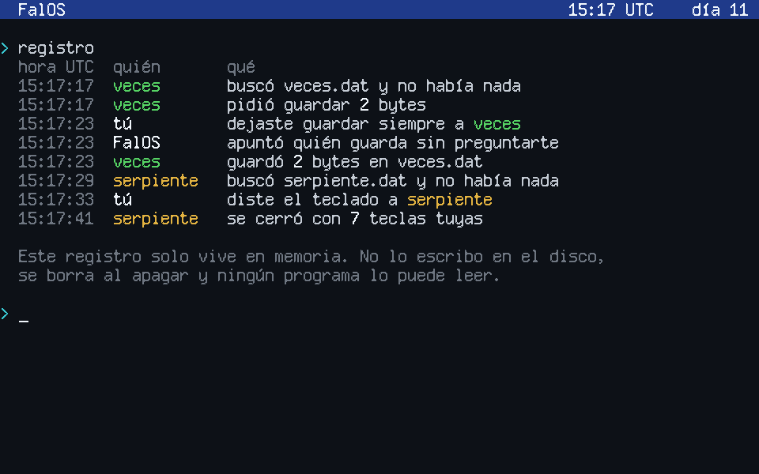

**Lo que hay.** Una orden nueva, `registro`, que dice qué programa ha leído o
guardado qué, y a qué hora. También apunta lo que decidiste tú: a quién dejaste
guardar y a quién no, a quién le diste el teclado, y con cuántas teclas tuyas se
cerró cada uno. Si un programa repite lo mismo, no llena la lista: se junta en
una línea con las veces.

```
lanza veces
deja siempre 1
registro
niega veces
```

Y dos piezas más:

- **Un reloj en la barra.** El núcleo lee el reloj de la placa una vez por
  segundo, lo pinta arriba y el registro apunta la hora con él. Va en UTC,
  porque ese reloj no sabe en qué país estás.
- **`deja siempre`.** `deja` da permiso hasta que el programa se cierra. `deja
  siempre` lo recuerda aunque reinicies, y no te vuelve a preguntar. `permisos`
  dice quién lo tiene, y `niega` con su nombre se lo quita, aunque no esté
  abierto.

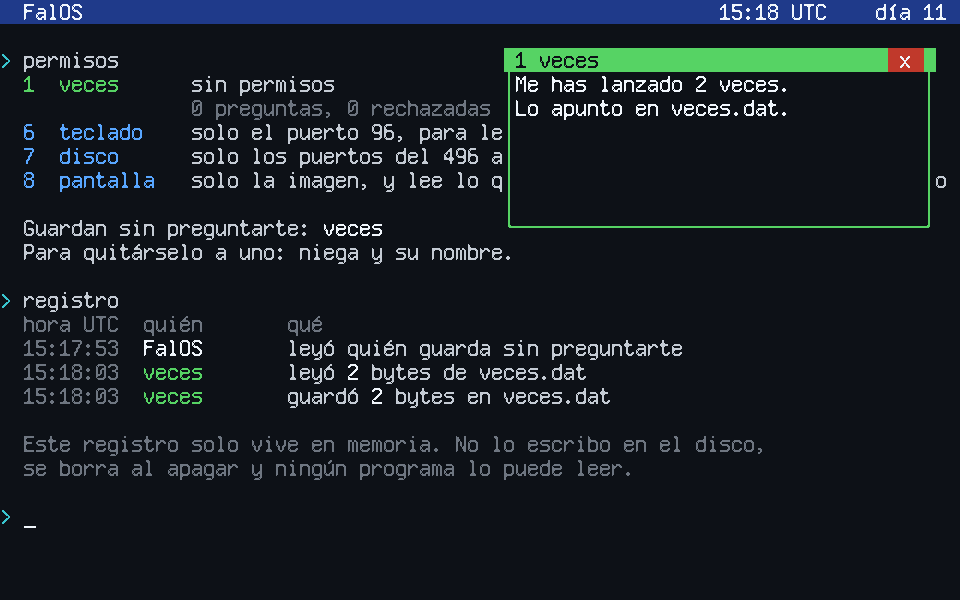

**Lo que se aprende.** Un registro de lo que haces también es un dato tuyo, y
de los que más dicen. Por eso este vive solo en memoria: no se escribe en el
disco, se borra al apagar, y ningún programa tiene una llamada para leerlo. Lo
lees tú, desde la consola. La prueba automática lo busca en el disco después de
usarlo, y no puede estar.

**La seguridad.** La lista de quién guarda siempre sí va al disco, en
`permisos.sis`, porque si no, no sobreviviría a un reinicio. La escribe el
núcleo, y ningún programa la puede tocar: el archivo de un programa se llama
siempre como él más `.dat`, y ese nombre lo pone el núcleo, no el programa. Al
arrancar, FalOS la lee y mira que solo haya nombres y saltos de línea. Si
encuentra cualquier otra cosa, la tira entera y vuelve a preguntar. La prueba
automática le mete un byte raro y mira que pregunta.

**Lo que costó.** Para ver si una línea del registro repetía la anterior usé una
variable llamada `igual`, que es una palabra de Fal: el compilador la paró, como
`pregunta` ayer. Y una trampa en la prueba, que vi antes de subirla: en el bash
de GitHub, un `! grep` que falla no para el paso. La comprobación de "no vuelve
a preguntar" se habría quedado en verde aunque volviera a preguntar.

## Día 10: notas cifradas con tu contraseña, y FalOS te dice quién usa el disco

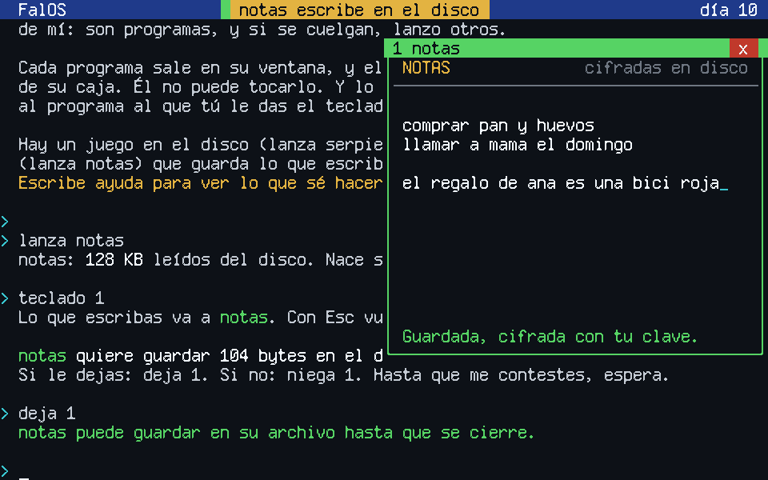

**Lo que hay.** Un bloc de notas, `notas`. Al abrirlo por primera vez te pide
que elijas una contraseña y la repitas. Lo que escribes se guarda en el disco
cifrado con ChaCha20, el mismo cifrado que usan TLS y WireGuard, con una clave
que sale de tu contraseña. Con la tecla Fin se guarda. La siguiente vez que lo
abres, sin la contraseña no hay notas.

```
lanza notas
teclado 1
lee notas.dat
```

`lee notas.dat` enseña lo que hay de verdad en el disco: ruido. La prueba
automática lo descifra con un ChaCha20 escrito aparte, en Python, y comprueba
dos cosas: que con la contraseña buena sale el texto, y que el texto no está en
ningún byte del disco.

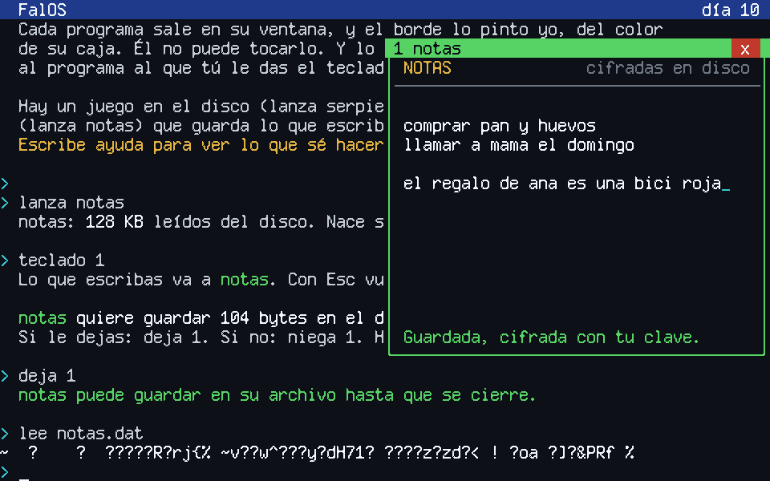

Y hay tres piezas más:

- **La barra dice quién usa el disco.** Cuando un programa lee o escribe, el
  núcleo lo pinta arriba durante tres segundos, con un cuadro del color de su
  caja: "notas escribe en el disco". Es lo mismo que el punto verde del móvil
  cuando algo usa la cámara. Lo pinta el núcleo después de las ventanas, así que
  ningún programa lo puede tapar ni fingir.
- **Lo que deja un programa se borra.** Cuando se cierra, cada página de memoria
  que usó se llena de ceros antes de volver a la lista de libres. Antes se
  borraba al prestarla a otro, y entre medias se quedaba ahí, con la clave de
  `notas` dentro.
- **El índice del disco ya ocupa dos sectores.** Estaba en 476 de 512 bytes, y
  no cabían a la vez el récord de la serpiente, las veces y las notas. Ahora son
  1.024. Un disco del formato viejo se rechaza en vez de pisarse: la primera
  línea dice `FALDISC2`.

**Lo que se aprende.** Una contraseña no es una clave. ChaCha20 necesita 32
bytes al azar, y una contraseña son unas pocas letras que se pueden adivinar. Lo
que se hace es pasarla por una función lenta a propósito: aquí son 20.000
vueltas de ChaCha20, unos cuatro segundos en QEMU. A ti te cuesta esperar una
vez. A quien prueba contraseñas una detrás de otra le cuesta lo mismo por cada
intento.

Y otra que parece un detalle: cada vez que guardas, el cifrado usa un número
distinto, que se apunta delante. Si dos versiones de la nota se cifraran igual,
juntándolas se podría quitar el cifrado sin saber la contraseña. Para saber si
la contraseña es la buena, delante del texto va cifrado "FalOS ok": si al
descifrar no sale eso, no es.

**La seguridad.** Al disco, y al programa que escribe en él, solo les llega el
ruido, y antes de guardar FalOS te pide permiso, como ayer. Lo que sí ve las
letras es lo que las pinta: el núcleo las pone en la ventana, y el programa de
la pantalla las dibuja. Eso no lo arregla cifrar el disco. Después de calcular la clave, `notas` llena de ceros la
contraseña que escribiste.

**Lo que costó.** Fal no tenía operaciones de bits, y ChaCha20 está hecho de
tres: sumar dando la vuelta a los 32 bits, el o exclusivo y girar. Ahora Fal
tiene `suma_doble`, `o_exclusivo` y `gira_doble`, y fuera de los 32 bits
revientan en vez de recortar en silencio. Se prueban con los números del RFC
8439, el que define ChaCha20.

La primera ventana decía "Tu contrase a". Una ñ en un texto de Fal son dos
bytes, y la ventana pinta una casilla por byte: el programa tiene que pasarla a
la letra de la pantalla antes. Y el parámetro de la pregunta se iba a llamar
`pregunta`, que es una palabra de Fal: lo paró el compilador, otra vez.

## Día 9, por la tarde: nada se guarda sin preguntarte

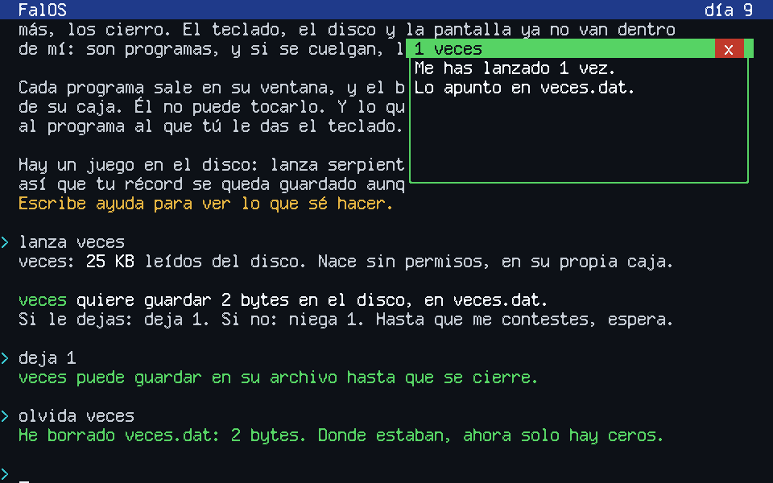

**Lo que hay.** Me aburría y me apeteció ir adelantando. Esta mañana un programa
podía guardar en su archivo sin que tú lo supieras. Ahora no: la primera vez que
lo intenta, FalOS te lo dice, con cuántos bytes y en qué archivo, y el programa
se queda esperando hasta que contestes.

```
deja 1
niega 1
olvida veces
```

`deja` le da permiso hasta que se cierre, y `niega` se lo quita, también a
mitad. Si le dices que no, la serpiente lo cuenta en la pantalla: "nuevo mejor,
no me dejas guardarlo". Y `olvida X` borra lo que guardó X.

**Lo que se aprende.** Borrar un archivo, en casi todos los sistemas, es quitarlo
de la lista. Lo que había escrito se queda en el disco hasta que otro archivo
caiga encima, y por eso existen los programas que recuperan fotos borradas. Con
`olvida`, el programa del disco primero llena de ceros el sitio donde estaba, y
después lo quita del índice. La prueba automática mira ese sector después, byte
a byte, y tiene que estar a cero.

**La seguridad.** El permiso lo das tú, desde la consola, y un programa no puede
dárselo a sí mismo: no puede escribir órdenes, eso ya lo intentó `impostor` el
día 5. Leer lo suyo no pide permiso, porque solo puede haberlo escrito si se lo
diste antes.

**Lo que costó.** La pregunta sale en la consola mientras quizá estás escribiendo
otra orden. Se hace igual que cuando se cierra un programa: se limpia el renglón,
se escribe el aviso, y lo que llevabas escrito vuelve debajo. Y de paso salió un
fallo viejo: en `tareas`, "esperando trabajo" llegaba justo hasta la columna
siguiente y se pegaba a los segundos.

## Día 9: FalOS escribe en el disco, y la serpiente se acuerda de tu récord

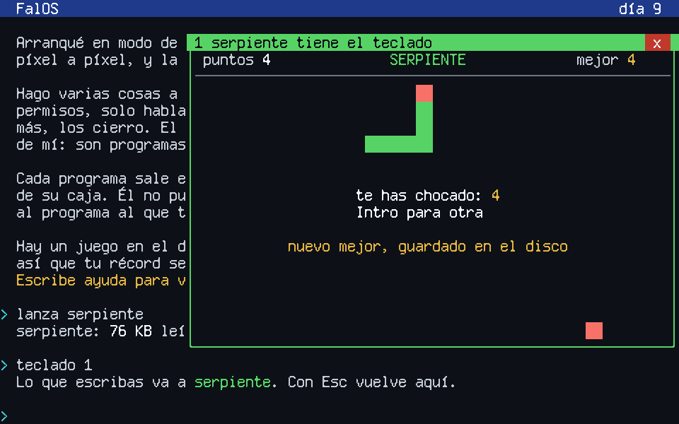

**Lo que hay.** Hasta ayer, el disco solo se leía. Hoy un programa puede guardar
algo, y que siga ahí después de apagar. La serpiente lo usa para el récord:
cuando lo superas, lo escribe en el disco, y la próxima vez que arranca FalOS,
aunque sea desde cero, el marcador ya dice cuál era.

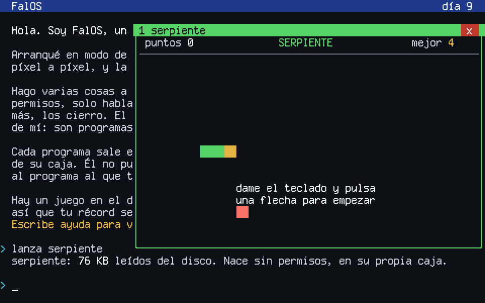

Hay dos llamadas nuevas: una para guardar hasta 512 bytes de la página de
trabajo del programa, y otra para traerlos de vuelta. Y un programa nuevo,
`veces`, que cuenta cuántas veces lo has lanzado. Es el ejemplo más corto que
hay de las dos.

```
lanza veces
disco
lee veces.dat
```

**Lo que se aprende.** En Windows, en macOS y en Linux, un programa que abres
puede escribir en casi cualquier archivo tuyo: tus fotos, tus documentos, los
de otros programas. Por eso un ransomware puede cifrarte la carpeta entera sin
pedir permiso a nadie. Android e iOS lo hicieron al revés: cada aplicación tiene
su propio cajón, y lo de fuera hay que pedirlo.

FalOS va por ahí, y más estrecho todavía. Un programa no elige dónde escribe.
Pide guardar, y el núcleo pone el nombre: el del programa, con `.dat` detrás.
`serpiente` escribe en `serpiente.dat` y no puede escribir en otro sitio, porque
no hay forma de decírselo.

**La seguridad.** El que escribe de verdad es el programa del disco, el mismo
que ya leía, sin permisos y con sus ocho puertos. Y solo escribe archivos que
acaban en `.dat`: ni el núcleo le puede pedir que pise un programa.

Antes de escribir, lee el índice entero, y si no lo entiende, no toca nada. Si
el sitio donde estaba el archivo cae encima de otro, lo escribe al final, en
espacio libre. Si el índice está lleno, contesta con un error. Y escribe en
orden: primero los datos y después el índice, para que un apagón entre medias
no deje el índice señalando a algo escrito a medias.

La prueba automática le conecta tres discos preparados para que se equivoque:
uno con el índice roto, otro lleno, y otro en el que `veces.dat` dice estar
justo encima de `veces.prg`, su propio programa. En los dos primeros comprueba
que el disco sigue igual byte a byte. En el tercero, que el programa sigue
entero y el número se ha guardado en otro sitio.

**Lo que costó.** Un programa pide guardar desde dentro de una llamada al
sistema, con las interrupciones cerradas. Y quien escribe es otro programa, que
para hacerlo necesita que le toque el procesador. Si el núcleo esperase ahí
dentro, esperaría para siempre. Así que no espera: deja al programa dormido,
`con el disco` en la lista de `tareas`, y el trabajo lo hace la consola en
cuanto está libre. Cuando acaba, despierta al programa con la respuesta.

Y los nombres, otra vez. La llamada para traer lo guardado se iba a llamar
`RECUPERA`, y el núcleo ya tenía una función `recupera`: la de la flecha de
arriba, que trae la orden anterior. Y `NUEVO`, para el índice que se está
montando, es una palabra de Fal. Las dos las paró el compilador.

## Día 8: un juego escrito en Fal, y el teclado es de quien tú digas

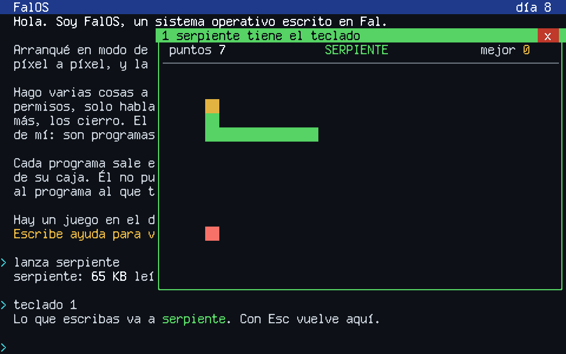

**Lo que hay.** El primer juego de FalOS: una serpiente que crece cada vez que
come. Es un programa de Fal como los demás, de [320 líneas](programas/serpiente.fal),
que sale del disco, corre en el anillo 3 sin permisos y vive en su ventana.

```
lanza serpiente
teclado 1
```

Para jugar, hay que darle el teclado: con un clic en su ventana o con
`teclado N`. Mientras lo tiene, su título dice `tiene el teclado`, y lo que
escribes le llega a él y a nadie más. Esc lo devuelve a la consola.

Hasta ayer, los programas no podían leer teclas. Hoy pueden, y con eso vino lo
demás que un juego necesita: pedir una ventana más grande, poner una letra de
color en una casilla concreta y una página de memoria para apuntar dónde está
cada trozo de la serpiente.

**Lo que se aprende.** En [X11](https://es.wikipedia.org/wiki/X_Window_System), el
sistema de ventanas que ha usado Linux durante décadas, cualquier programa con
una ventana puede leer lo que escribes en las demás. No hace falta ningún
permiso especial: basta con preguntar. Es una de las razones por las que existe
Qubes, y por las que Linux se está pasando a Wayland.

En FalOS, la tecla que pulsas la recibe el programa del teclado, se la da al
núcleo, y el núcleo decide a quién va. Solo a uno: al que tú le has dado el
teclado, o a la consola. Los demás no la ven, ni siquiera saben que has pulsado
algo.

**La seguridad.** Volvamos a `disfraz`, el que se hace pasar por FalOS y te pide
la contraseña. Hoy sí intenta leer lo que escribes. Si lo lanzas y escribes tu
contraseña en la consola, no le llega nada:

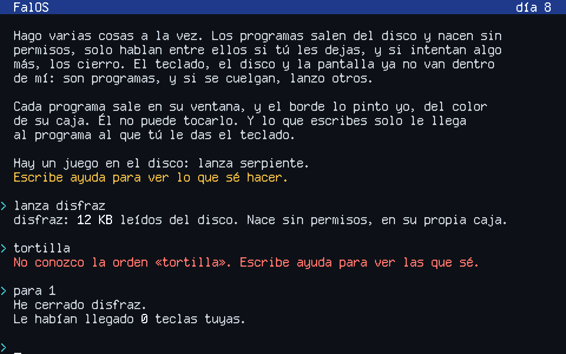

Lo que hace falta para que le llegue es que tú le des el teclado. Y entonces su
título dice `disfraz tiene el teclado`, con el color de su caja. Eso lo pinta el
núcleo, no él.

Un programa no puede pedir el teclado, ni quitárselo a otro. Y Esc no le llega
nunca a ningún programa: la atiende el núcleo antes que nadie. Es la misma idea
que Ctrl+Alt+Supr en Windows, que por eso se pedía antes de escribir la
contraseña: ningún programa puede capturar esa combinación, así que si la pulsas,
quien te contesta es el sistema.

Dentro de su ventana, un programa pinta lo que quiera, y el núcleo mira cada
casilla que pide: que caiga dentro de su rectángulo, que el color exista, que la
letra se pueda pintar. Lo que no puede es salirse, ni tocar el borde.

**Lo que costó.** Cada letra de FalOS mide 12 por 24 píxeles, el doble de alta
que de ancha. La primera serpiente estaba hecha de rectángulos altos y parecía
un código de barras. Ahora cada casilla del juego son dos letras juntas, y sale
cuadrada.

Los programas no tienen listas: Fal sin sistema debajo no sabe pedir memoria
mientras corre. Así que cada programa tiene ahora una página de trabajo, y ahí
apunta la serpiente sus trozos. El juego sabe de memoria dónde está esa página,
y si se saliera de ella, el procesador lo pararía.

Y las mayúsculas, otra vez. `duerme` era una función y `DUERME` el número de la
llamada para dormir, y `comida` y `COMIDA` también chocaban. Las dos las cazó el
compilador antes de arrancar, gracias al aviso que se le añadió el día 6.

## Día 7: cada programa en su ventana, del color de su caja, y ratón

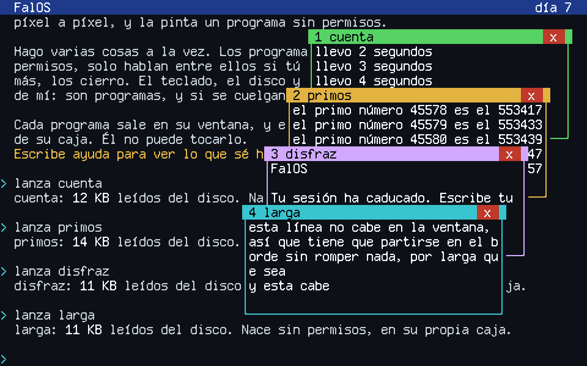

**Lo que hay.** Cada programa sale ya en su propia ventana, con el borde y el
título del color de su caja: verde el 1, amarillo el 2, lila el 3 y cian el 4. Las
ventanas se mueven arrastrando el título con el ratón, se traen delante con un clic
y se cierran con la x roja, que cierra también el programa. Cuando un programa
termina o FalOS lo cierra, su ventana se queda en gris, para que se pueda leer lo
último que dijo.

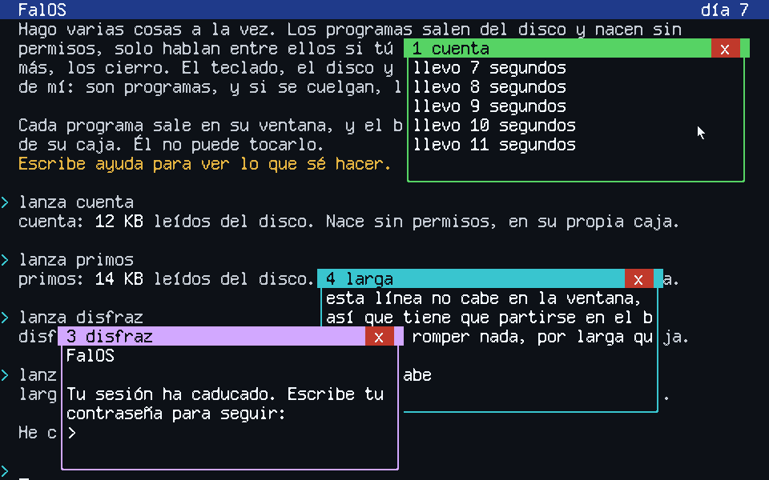

**Lo que se aprende.** La idea es de [Qubes OS](https://www.qubes-os.org). Allí
cada ventana lleva el color de la máquina virtual de la que sale, y ese borde no lo
pinta el programa: lo pinta el sistema. Si una ventana roja te pide la contraseña
del banco, sabes que no es tu banco, aunque se le parezca en todo.

En FalOS pasa lo mismo. Un programa solo puede mandarle letras al núcleo, y el
núcleo las pone dentro de su ventana. El borde, el título y el número los pinta el
núcleo, y el programa no tiene forma de salir de su rectángulo. `disfraz` lo
intenta: dice que es FalOS y que tu sesión ha caducado. Pero su ventana dice
`disfraz`.

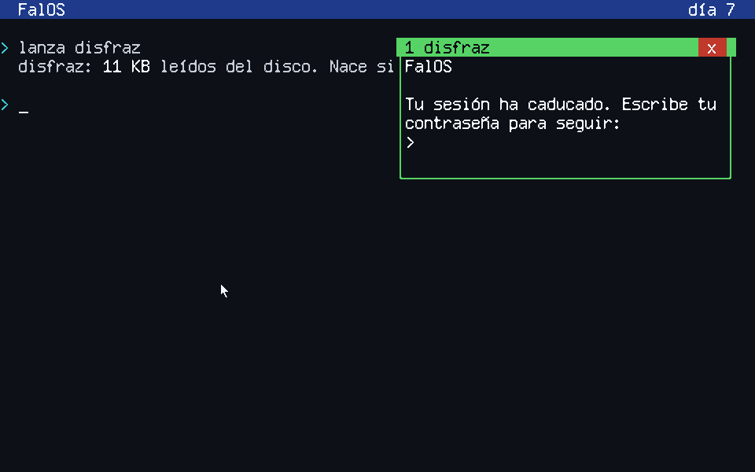

**La seguridad.** El ratón y el teclado llegan por el mismo chip, el 8042, y los
dos por el puerto 96. Ese chip tiene otro puerto, el 100, y con él se puede
reiniciar el ordenador. Por eso el programa del teclado no lo tiene: el ratón lo
enciende el núcleo al arrancar, y cuando llega un byte, el núcleo sabe por la
interrupción si viene del teclado o del ratón, y se lo dice al programa. Así el
programa del teclado sigue con un solo puerto, y entiende los dos.

Lo que ese programa entrega es cuánto se ha movido el ratón y qué botones lleva
pulsados, nada más. Dónde está la flecha, qué ventana hay debajo y qué significa un
clic lo decide el núcleo. Si el programa se cuelga, FalOS lanza otro y el ratón
sigue funcionando.

Y hay un límite que conviene decir. Quien enseña los bordes es el programa de la
pantalla, que tampoco es de fiar: el núcleo decide los colores, pero lo pinta él.
Los bordes te protegen de los programas, todavía no de ese.

En modo de texto, sin gráficos, también hay ventanas: los bordes son los caracteres
de caja de siempre y la flecha es una casilla con los colores al revés.

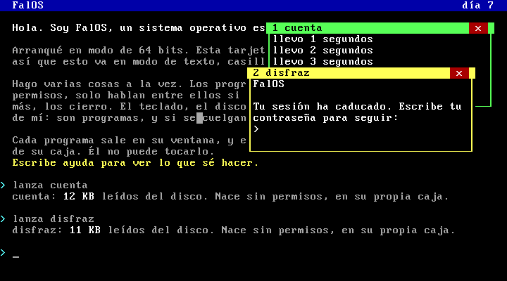

**Lo que costó.** Lo que dio guerra fueron los nombres. El compilador paró dos
veces: `ventana_acabada` era una función y
`VENTANA_ACABADA` una constante, y en Fal las mayúsculas no importan, así que eran
el mismo nombre. Esta vez lo dijo el compilador antes de arrancar, y no una
pantalla en negro.

La letra tampoco tenía las líneas para dibujar cajas, y hubo que añadirle seis
caracteres. Y en modo de texto, un fondo de color claro parpadea, porque así lo
decidieron los PC de los ochenta: FalOS apaga ese parpadeo al arrancar.

## Día 6: los programas salen del disco, y FalOS dibuja su propia letra

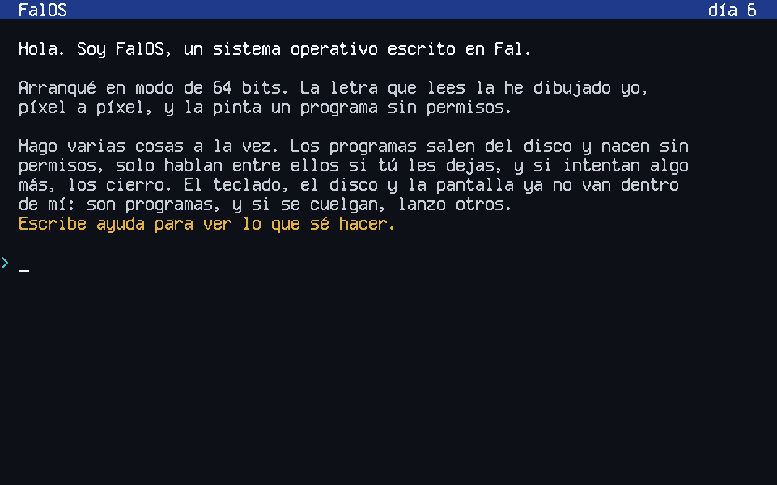

**Lo que hay.** Se acabó la pantalla de 1981. FalOS ya pinta píxeles: 960 por 600,
con 32 bits por píxel, y una letra que no viene de ningún sitio. Cada carácter
está dibujado en [un archivo de texto](controladores/letra.txt), con puntos
y almohadillas, en una rejilla de 6 por 12. Son 119. Al arrancar, FalOS los agranda
al doble y redondea las esquinas.

Quien pinta tampoco va dentro del núcleo. Es el tercer programa sin permisos,
como el teclado y el disco. Con `cuelga pantalla`, la imagen se congela un segundo
y vuelve. Nada de lo escrito se pierde, porque lo que hay que pintar lo guarda el
núcleo en una página que ese programa solo puede leer.

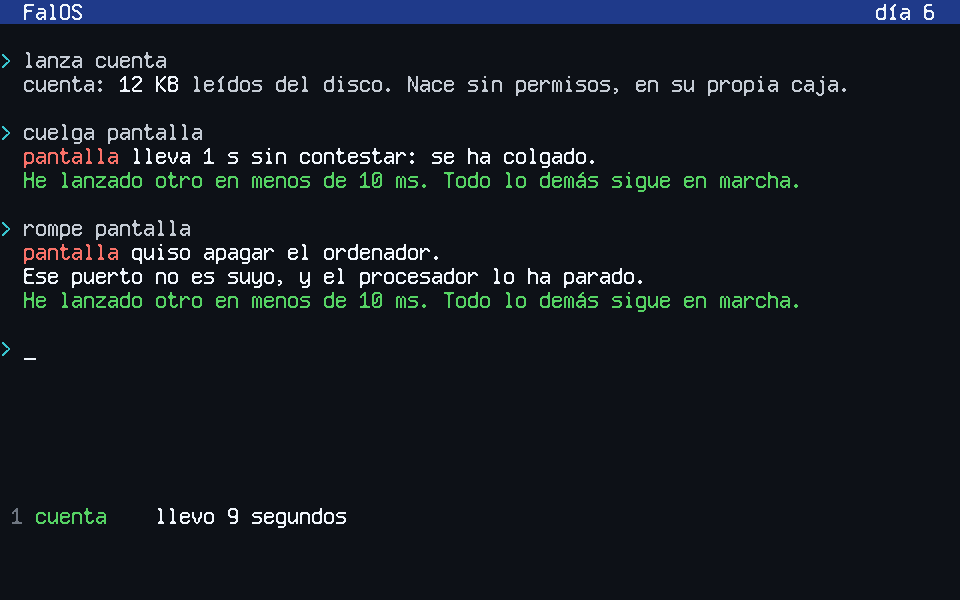

Y los programas ya no van metidos en FalOS. Están en el disco, como archivos.
`lanza cuenta` los busca, los trae y les monta su caja. Lo único que FalOS lleva
dentro son los tres controladores que necesita para ver, oír y leer.

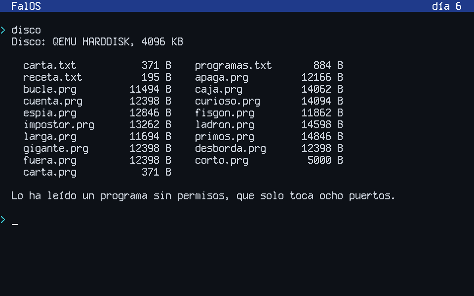

**Lo que se aprende.** Hasta hoy, FalOS se fiaba de lo que ejecutaba, porque lo
llevaba compilado dentro. Un archivo de un disco es otra cosa: lo ha podido escribir
cualquiera. Y lo primero que se lee de un programa es su cabecera, cuatro números
en los que el propio programa dice cuánto ocupa, cuánta memoria quiere y por dónde
empieza. Es decir, le estás preguntando al desconocido quién es.

Un cargador que se lo cree es uno de los fallos más viejos que hay. Por eso `haz_disco`
mete en el disco cinco archivos hechos para engañar a FalOS:

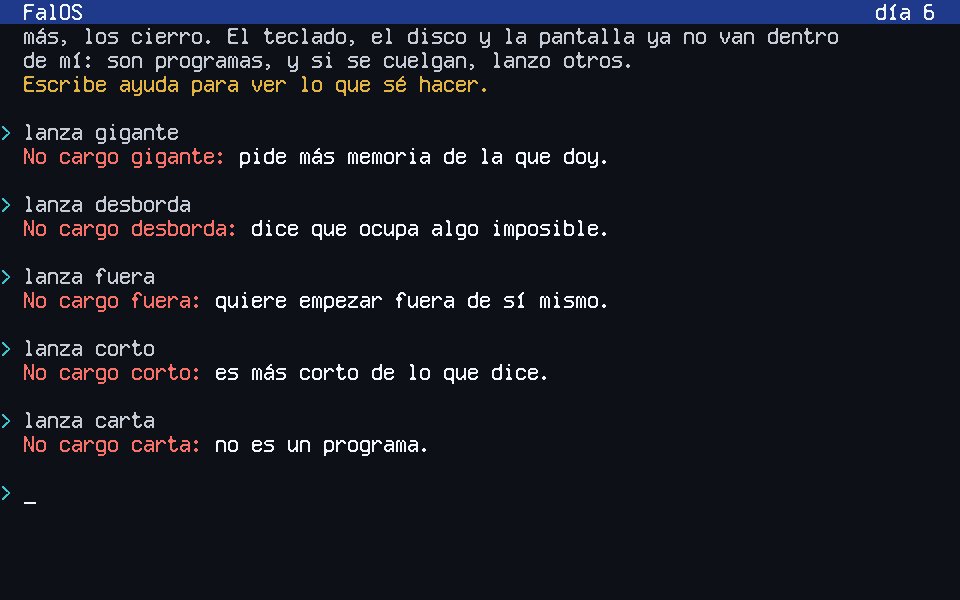

`gigante` dice que necesita un terabyte. `fuera` dice que empieza dentro del núcleo.
`corto` está a medias. `carta` ni siquiera es un programa. Y `desborda` es el bueno:
dice que ocupa 9.223.372.036.854.775.807 bytes, el número más grande que cabe. Si
FalOS sumara algo a ese número para calcular cuántas páginas hacen falta, la cuenta
se saldría, y Fal pararía el sistema entero. Un archivo tumbaría el núcleo sin
ejecutar ni una instrucción. Por eso primero se compara con el tope y solo después
se hace ninguna cuenta.

**La seguridad.** Hay un detalle que no se ve. La cabecera llega por una página que
FalOS comparte con el programa del disco, y ese programa no es de fiar: podría
cambiar los números justo después de que FalOS los mire. Por eso FalOS los copia una
vez y ya solo usa su copia. Es un fallo con nombre propio, se lee en un momento y se
usa en otro, y lo que lo evita es una línea aburrida.

Al programa de la pantalla se le da lo justo: los puertos para encender los gráficos
y la imagen. No toca el bus PCI, que le daría poder sobre todos los aparatos: esa
dirección la busca el núcleo al arrancar y se la deja puesta. Y la página con el
texto que hay que pintar la tiene de solo lectura.

Después de cargar y cerrar programas y de rechazar los cinco archivos, FalOS sigue
usando la misma memoria prestada que al arrancar: 760 KB.

**Lo que costó.** La pantalla salió negra, y el programa que la pinta se reiniciaba
cientos de veces sin decir por qué. Era la misma trampa del día 2: en Fal las
mayúsculas no importan, así que `SUBIDAS` y `subidas` eran la misma variable. Una
variable nueva tapaba la constante, y el programa reventaba al primer pintado. FalOS
lo relanzaba, y reventaba otra vez.

A la tercera vez, el problema ya no es mío, es del lenguaje: antes de esta fueron
`MARCO` y `HISTORIAL`. Así que Fal ahora avisa cuando una variable pisa una constante
escrita con otras mayúsculas. Con el código del día 2 caza `HISTORIAL`, y si vuelvo a
meter `subidas`, lo caza también. Y en el FalOS de hoy encontró otro: `pagina` pisaba
`PAGINA` en `sistema.fal`. Esta vez no rompía nada, por suerte. La prueba automática
ahora falla si sale ese aviso.

Luego el aviso rojo. Si el núcleo se para con los gráficos puestos, tiene que volver al
modo de texto para contarlo, o verías una pantalla congelada. Apagar los gráficos
no basta: al encenderlos, la tarjeta había cambiado una docena de registros y
no los devuelve. Además, la letra del modo de texto vive en la misma memoria que
la imagen, y pintar encima la borraba. Por eso FalOS deja libres las primeras 70
filas de esa memoria.

Y lo mejor del día lo encontró la prueba automática, no yo. En mi ordenador todo iba
bien. En GitHub, con tres `bucle` gastando procesador, `lanza larga` fallaba y el
disco se reiniciaba dos veces. Esos programas no hacían nada prohibido, solo gastar
su turno. Pero el disco se quedaba con un cuarto del procesador, tardaba más de un
segundo en contestar, y el vigilante lo daba por colgado. Un programa sin ningún
permiso podía dejar a FalOS sin disco. El vigilante miraba el reloj de la pared. Ahora
solo cuenta el tiempo en que el controlador pudo contestar y no lo hizo: si no le han
dado turno, no está colgado.

Fal también ha crecido hoy: sabe hablar de 16 y de 32 bits con los aparatos, copiar
memoria de golpe sin saltarse las comprobaciones, meter un archivo en un programa
y compilar programas desde otro programa de Fal, que es lo que hace `haz_disco`.

## Día 5: el teclado sale del núcleo, y si se cuelga, vuelve

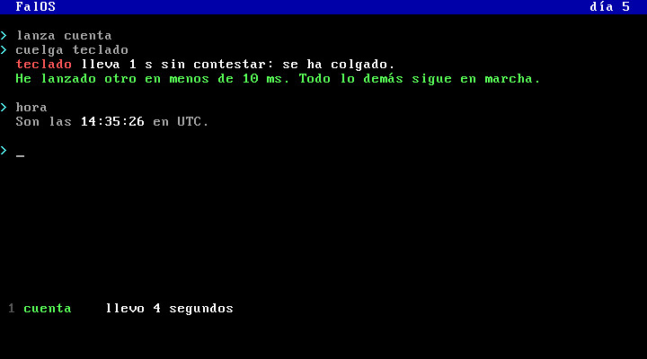

**Lo que hay.** El teclado ya no va dentro del núcleo. Es un programa normal, en
el anillo 3, sin permisos, y traduce las teclas él solo: la ñ, las tildes, AltGr.
El núcleo solo le avisa de que ha llegado algo, y recibe la letra ya hecha.

Con `cuelga teclado` se queda dando vueltas a propósito. Dejas de poder escribir,
pero `cuenta` sigue contando abajo. Al segundo, FalOS se da cuenta, lo cierra y
lanza otro en menos de 10 ms. Lo que habías escrito mientras tanto aparece solo.

Con `rompe teclado`, intenta apagar el ordenador. No puede: el procesador solo le
deja tocar el puerto 96, y apagar es el 100, justo al lado. Se cierra, se lanza
otro, y sigues escribiendo.

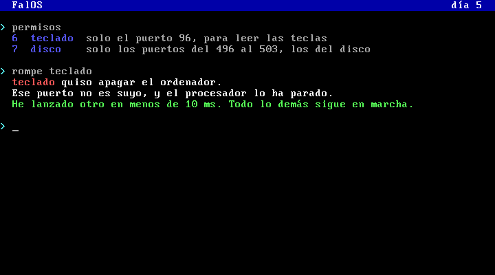

Y FalOS ya lee un disco. `disco` enseña lo que hay, y `lee carta.txt` saca un
archivo. Eso también lo hace un programa sin permisos, que solo toca los ocho
puertos del disco.

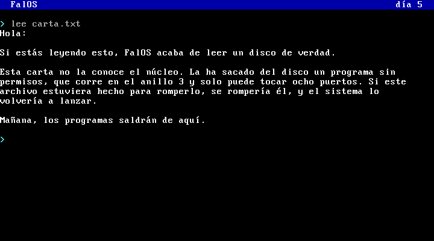

Dos programas nuevos lo intentan por las malas. `fisgon` quiere leer el teclado,
como haría un programa que te roba las contraseñas, y dura lo que tarda en tocar
el puerto. `impostor` quiere escribir `reinicia` haciéndose pasar por ti: lleva
decenas de intentos y no ha entrado ni una letra.

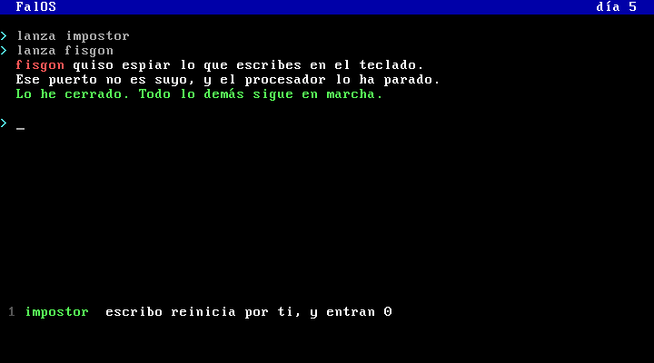

**Lo que se aprende.** Un controlador es un programa que habla con un aparato, y
en casi todos los sistemas va dentro del núcleo, con todos los permisos. Por eso
un fallo en el de la tarjeta gráfica te da una pantalla azul. En un micronúcleo
va fuera, y un fallo ahí se queda ahí.

Y hay una pregunta que parece tonta: ¿cómo sabes que un programa se ha colgado?
No lo sabes, solo puedes decidir cuánto esperar. FalOS mira cuánto lleva
despierto sin volver a pedir trabajo, y a partir de 1 s lo da por muerto.

**La seguridad.** Desde el día 3, un programa no podía tocar ningún puerto, porque
le quitamos el mapa al procesador. Ahora ese mapa existe, con 65.536 bits, uno por
puerto, y nace todo cerrado. Es uno solo para todos, así que FalOS lo cambia cada
vez que cambia de programa. Lo que abre para el teclado solo vale mientras corre
el teclado.

El disco es lo más peligroso de hoy, porque lo que hay dentro lo puede haber
escrito cualquiera. Leerlo es exactamente cómo se cuelan muchos ataques. Por eso
quien lo lee no es el núcleo: si un disco trae un archivo con un tamaño absurdo,
el que se lo traga es un programa sin permisos. El núcleo solo recibe un número
que comprueba y una página que no puede desbordar. Lo probé con discos hechos
para romperlo: números gigantes, nombres sin fin, un índice sin saltos de línea,
ruido puro. Ninguno pasó de ahí.

**Lo que costó.** Lo mejor de hoy son los dos fallos que encontré, porque eran
míos y llevaban días ahí.

Si escribías 17 órdenes distintas, FalOS se paraba. Era del día 2. En Fal, las
mayúsculas no importan, así que `HISTORIAL`, el tope, y `historial`, donde se
guardan, eran la misma variable. El tope no existió nunca.

Y cualquier programa podía parar el sistema entero escribiendo una línea larga
en el cuarto renglón. Era del día 3. Un `para cada` que va de 81 a 80 no se
detiene: cuenta hacia atrás. Se salía de la pantalla, y Fal paró el núcleo.

Las dos veces, Fal hizo lo que debe: parar y decir en qué línea, en vez de seguir
escribiendo donde no toca. En C serían dos agujeros. Aquí fueron dos pantallas
rojas. Pero también dos fallos, y el segundo lo podía provocar un programa sin
permisos. Los dos están ahora en la prueba automática. Hasta hoy creía que ningún
programa podía tumbar FalOS, y era porque no lo había probado bien.

Y el teclado no volvía después de colgarse. El aparato avisa una vez, y si nadie
recoge la tecla, no vuelve a avisar: el programa nuevo se quedaba esperando un
aviso que ya había pasado. Ahora FalOS recuerda que quedó una tecla sin leer.

## Día 4: los programas hablan, si tú les dejas

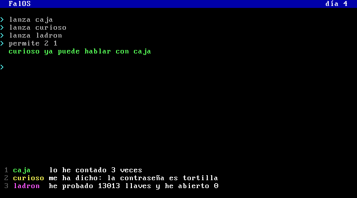

**Lo que hay.** Los programas se pueden mandar mensajes, y para eso necesitan
permiso. Tres programas lo enseñan:

- `caja` guarda un secreto, y lo cuenta si le preguntan.
- `curioso` pregunta cada segundo.
- `ladron` prueba miles de llaves a ver si alguna abre algo.

Al lanzarlos, nadie puede hablar con nadie. `curioso` dice que no tiene permiso,
y `ladron` lleva miles de intentos sin abrir nada.

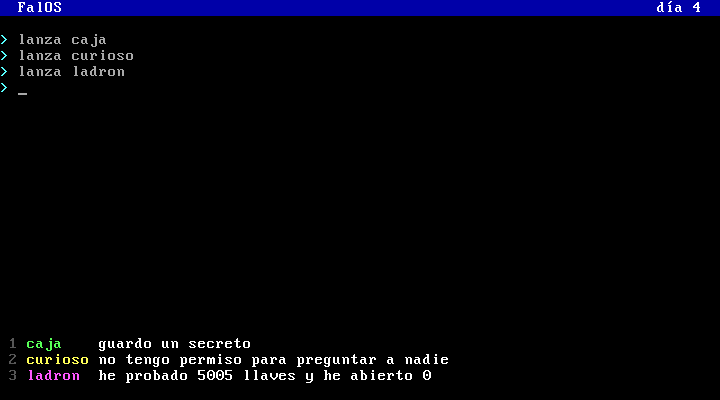

Con `permite 2 1`, `curioso` ya puede preguntar a `caja`, y al segundo siguiente
sale el secreto en la pantalla. Con `prohibe 2 1`, deja de poder en el acto, sin
reiniciar nada y sin que el programa pueda hacer nada por evitarlo. Y `permisos`
enseña quién puede qué, y cuántas preguntas le han rechazado a cada uno.

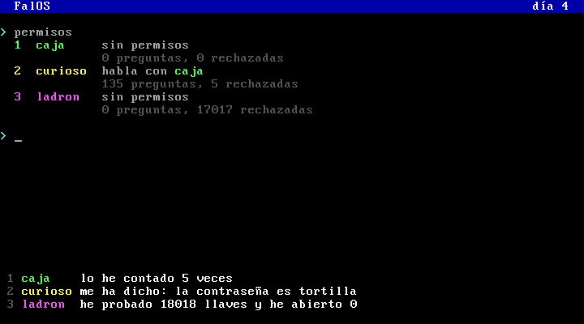

Se hace como en seL4: el que pregunta se queda parado hasta que le contestan, y
el núcleo le pasa el turno directamente al otro. No hay cola de mensajes ni
memoria compartida. Un mensaje es un número de 64 bits y viaja en un registro,
así que el núcleo sigue sin leer nunca la memoria de un programa. Una pregunta y
su respuesta tardan tan poco que caben unas 42.000 por segundo, en un ordenador
emulado.

**Lo que se aprende.** Hay dos maneras de decidir quién puede qué. Una es la
lista de invitados: el portero mira quién eres y si estás en la lista. La usan
Windows y Linux, y la pregunta siempre es "¿quién eres?". Por eso un programa
que lanzas tú puede leer todos tus archivos: es tú.

La otra es la llave. Nadie mira quién eres: si tienes la llave, abres. Eso es
una **capacidad**, y es la idea de seL4. Un programa no tiene nada al nacer, y
nada que no le hayan dado. Lo que no le han dado no es que esté prohibido: es que
no tiene forma de nombrarlo.

**La seguridad.** Las llaves no están en la memoria del programa, sino en la del
núcleo. El programa solo dice "la llave número 1", y ese número solo significa
algo en su propia tabla. Si no hay llave ahí, no hay nada que forzar: `ladron`
prueba los números uno a uno, negativos y gigantes incluidos, y lo único que
consigue es que el contador de rechazos suba.

Y hay una trampa clásica. Si cierras `caja` y lanzas otro programa que cae en su
mismo sitio, una llave vieja abriría al nuevo, que no tiene nada que ver. Por eso
cada programa que arranca lleva un número de generación, y la llave guarda el
suyo: si no coincide, no abre. Lo mismo si el programa ya no existe.

Lo probé con programas hechos para atascarlo: uno que escucha y nunca contesta,
otro que contesta sin que le pregunten, otro que deja a uno esperando y se pone a
escuchar a otro, y dos que se preguntan el uno al otro hasta quedarse los dos
parados para siempre. Eso último no se puede evitar, porque es culpa de ellos,
pero no arrastra a nadie más: `tareas` los enseña esperando, y `para` los cierra.
Al cerrar a quien te tiene esperando, te despiertan con un error, y no te quedas
ahí para siempre.

**Lo que costó.** `pregunta` es una palabra de Fal, la que lee del teclado, así
que mi primera versión no compilaba. Cuando alguien escucha dos veces seguidas,
el que esperaba del primer mensaje se quedaba colgado para siempre. Lo vi
pensando qué haría un servidor malo: ahora le llega un error. Y el núcleo ha
crecido a más de 2.000 líneas: en un micronúcleo de verdad, todo lo que se pueda
tiene que salir de ahí. Es lo siguiente.

## Día 3: varias cosas a la vez, y programas sin permisos

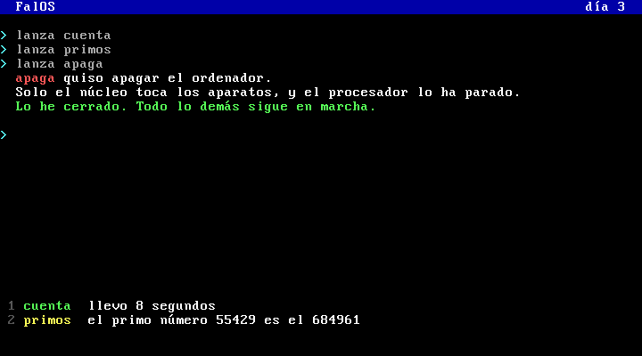

**Lo que hay.** FalOS corre programas, varios a la vez, y sigue atendiéndote
mientras tanto. `lanza cuenta` y `lanza primos` se ponen a trabajar abajo, cada
uno en su línea, y tú sigues escribiendo arriba.

Y esos programas no tienen permisos. `apaga` tiene exactamente esta línea:

```
pon_en_puerto con 100 y 254
```

Es la misma que usa la orden `reinicia`. Cuando la escribe FalOS, el ordenador
se reinicia. Cuando la intenta `apaga`, el procesador la para antes de
ejecutarla, FalOS cierra el programa y todo lo demás sigue en marcha. `espia`
intenta leer la memoria de FalOS, y le pasa lo mismo.

Las órdenes nuevas:

- `programas`: los que lleva dentro.
- `lanza X`: pone a correr X.
- `tareas`: lo que está corriendo, en qué estado y cuánto procesador lleva.
- `para N`: cierra la tarea N.

**Lo que se aprende.** Un procesador tiene una sola mano: hacer dos cosas a la
vez es un truco. Cien veces por segundo, el reloj lo interrumpe. FalOS guarda
los registros del programa que corría, deja los de otro y sigue. El programa
no se entera. Y si un programa no suelta el procesador nunca, da igual: nadie
le pide permiso para quitárselo. `bucle` es un `mientras verdadero` vacío, y
puedes seguir escribiendo como si nada.

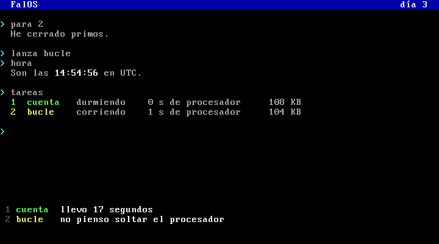

El procesador tiene cuatro anillos de permisos, y casi nadie usa más de dos: el
núcleo en el 0, los programas en el 3. Desde el 3 no se puede tocar un aparato,
cerrar las interrupciones, parar la máquina ni cambiar las tablas de páginas.
La única salida es una puerta: una instrucción que salta a un sitio fijo del
núcleo. Eso es una llamada al sistema, y hay cinco: salir, escribir una letra,
ceder el turno, preguntar la hora y dormir.

**La seguridad.** Cada programa tiene sus propias tablas de páginas, así que
ve su memoria y nada más. Su código es de solo lectura, y sus datos no se
pueden ejecutar. La página que el procesador usa para entrar en el núcleo es
aparte, y al cerrarlo, todo lo suyo vuelve al repartidor, que lo entrega en
blanco.

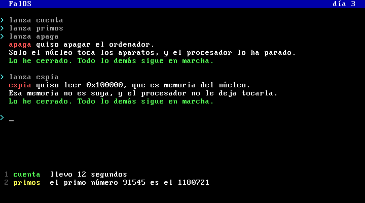

Y lo más importante no es lo que hace el programa, sino lo que hace el núcleo
con lo que le llega. Todo lo que entra por una llamada al sistema es hostil.
En Fal, una cuenta que se sale para el sistema entero: si `dormir` sumara sin
mirar el número que le pasan, un programa podría tumbar a FalOS con solo pedir
dormir un número gigantesco. Ahora se mira cada dato antes de usarlo, y las letras van de
una en una para que el núcleo no tenga que leer nunca la memoria de un programa.

Lo probé con programas hechos para romperlo: pintar en la pantalla directamente,
leer el teclado, cambiar las tablas de páginas, reescribir su propio código,
desbordar su pila y pasar números absurdos en cada llamada. Ninguno tumbó nada.

**Lo que costó.** Cada interrupción se atiende en una pila aparte, una sola
para todo el sistema, igual que en seL4, y Fal ha tenido que aprender a saltar
de una a otra. La comprobación de "te has quedado sin pila" era una constante;
ahora depende de en cuál estés.

Hay dos trampas que no avisan. El procesador mira un mapa para saber qué puertos
puede tocar un programa, y si no le dices dónde está, cree que empieza en el
byte 0 de una tabla llena de ceros, y un cero significa "permitido". Quité esa
línea para comprobarlo, y `apaga` reinició el ordenador de verdad. Y un
programa puede poner al revés una bandera del procesador que el núcleo da por
hecho: al borrar su memoria, el núcleo iría hacia atrás, pisando lo que el
programa quisiera.

El primer intento reinició la máquina sin decir nada. Era una errata mía: le
había puesto el programa en el segundo giga en vez de en el primero. El registro
de QEMU lo dijo en un minuto: fallo de página, luego fallo doble, luego fallo
triple. El tercero es el que reinicia.

Y Fal no distingue mayúsculas: la constante `MARCO` y la variable `marco` eran
la misma, y el compilador me lo dijo con otra pareja que había escrito igual.

## Día 2: la memoria, y escribir como en una terminal de verdad

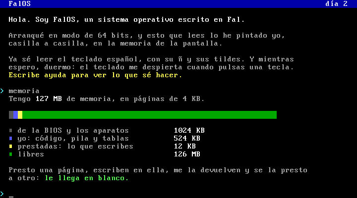

**Lo que hay.** FalOS sabe cuánta memoria tiene y quién la usa. La orden
`memoria` lo enseña: de 127 MB, todo FalOS (su código, su pila y sus tablas)
ocupa 524 KB. Y la reparte: quien necesita memoria pide una página de 4 KB,
y cuando acaba, la devuelve.

Y ya se escribe como en cualquier terminal: las flechas mueven el cursor
por lo que has escrito, Inicio y Fin te llevan a los extremos, Supr borra
hacia delante, y las flechas de arriba y abajo traen las órdenes de antes.

**Lo que se aprende.** Un sistema operativo no sabe al arrancar cuánta
memoria tiene. Se lo dice quien lo carga: deja en un registro del procesador
la dirección de una lista con los trozos de memoria y de qué es cada uno.
Hay agujeros: entre los 640 KB y el primer mega no hay memoria, sino la
pantalla y la BIOS. Es una herencia del primer PC de IBM, de 1981, que dejó 640 KB
para los programas y puso todo lo demás justo encima.

**La seguridad.** Cada página que FalOS presta, la entrega borrada. Si no,
el siguiente que la pidiera podría leer lo que dejó el anterior: contraseñas,
claves, lo que fuera. La orden `memoria` lo comprueba cada vez: presta una
página, escribe en ella, la recupera, se la presta a otro y mira que llega en
blanco. Y devolver dos veces la misma página para el sistema en seco, con la
pantalla roja: en C, ese descuido es uno de los agujeros de seguridad más
conocidos.

**Y el procesador vigila.** Al final del día, una cosa más: FalOS monta sus
propias tablas de páginas, la lista que el procesador consulta en cada acceso
a memoria para saber qué se puede hacer con cada página. Con ellas:

- su propio código es de solo lectura, y nadie lo puede cambiar mientras
  corre, ni siquiera FalOS;
- los datos no se pueden ejecutar, que es la defensa contra el truco clásico
  de colar código en la memoria y saltar a él;
- la dirección 0 no existe.

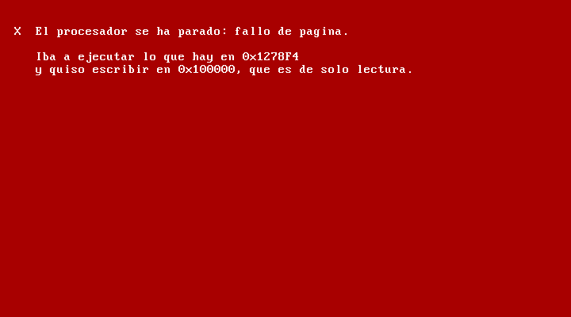

No es una comprobación de FalOS: la hace el procesador, en cada acceso, sin
coste. Es lo mismo que hacen Windows y Linux.

**Lo que costó.** El dato de dónde está esa lista llega en un registro, y el
arranque lo pisaba antes de mirarlo: Fal ha tenido que aprender a guardarlo.
La pantalla roja de los errores ponía "p?gina": no sabía escribir tildes.
Y para que el procesador haga cumplir el "solo lectura" al propio núcleo hay
que encenderle un bit aparte; sin él, el núcleo se lo salta.

## Día 1: arrancar, escribir en la pantalla, leer el teclado y dormir

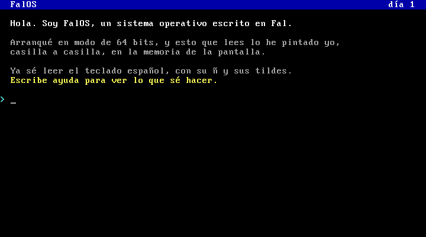

**Lo que hay.** FalOS arranca en un ordenador virtual, pasa al modo de 64
bits y escribe en la pantalla. Con colores, con tildes, con ñ, con ¿ y ¡, y
sin reventar cuando llega abajo: todo sube una fila, como en una terminal.

Lee el teclado español entero, con mayúsculas, bloqueo de mayúsculas, la ñ,
la ç y la tecla de la tilde: ´ y después a da á. Y lo que escribes hace algo:

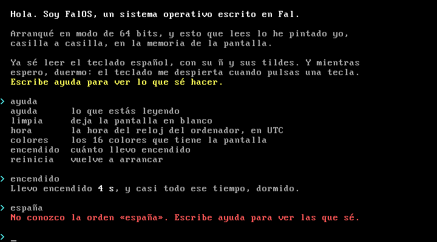

- `ayuda`: lo que sabe hacer.
- `limpia`: deja la pantalla en blanco.
- `hora`: la hora del reloj del ordenador.
- `colores`: los 16 colores de la pantalla.
- `encendido`: cuánto lleva encendido.
- `reinicia`: vuelve a arrancar.

**Lo que se aprende.** En modo texto la pantalla no es un aparato al que se
le piden cosas: es memoria. Desde la dirección `0xB8000` hay 80 por 25
casillas de dos bytes, la letra y su color. Lo que se escribe ahí sale en el
monitor. El cursor que parpadea, en cambio, no es una casilla: lo dibuja la
tarjeta, y se le dice dónde ponerlo por dos puertos.

El teclado tampoco manda letras. Manda el número de la tecla que se ha
movido, uno al pulsarla y otro al soltarla. Qué letra es cada tecla lo decide
el sistema: la tecla que en un teclado inglés es el punto y coma, en el
español es la ñ, y es el mismo número.

La hora sale de un chip que lleva un reloj con pila desde los años ochenta.
Guarda cada número en BCD: el 59 no se guarda como 59 sino como `0x59`, una
cifra en cada mitad del byte.

**Lo que costó.** Las tildes, dos veces. Fal guarda los textos en UTF-8,
donde una "á" ocupa dos bytes, y la pantalla habla la página de códigos 437
de IBM, de 1981, donde ocupa uno. Hay que traducir letra a letra, y la 437
no tiene mayúsculas con tilde salvo la É. Y en el teclado la tilde no es una
letra: es una tecla que no escribe nada y cambia la siguiente.

**Y luego, a dormir.** La primera versión esperaba las teclas preguntando sin
parar si había llegado alguna, y eso tenía un núcleo del procesador al 99 %
sin hacer nada. Ahora el teclado avisa él: una interrupción. FalOS duerme, y
cuando pulsas una tecla el procesador lo despierta, apunta la tecla y vuelve
a dormir. Lo mismo el reloj, cien veces por segundo, que es de donde sale
`encendido`.

Medido con QEMU parado 8 segundos sin tocar nada: **del 99 % al 2 %** de un
núcleo.

Para esto Fal ha tenido que aprender a atender interrupciones: una función
normal de Fal se pone a atender una, y el compilador le añade lo que guarda y
devuelve los registros para que el programa interrumpido no note nada.

**Lo que costó.** Al encender, el controlador de interrupciones manda las de
los aparatos a los números 8 a 15, que son los mismos que usa el procesador
para sus propias excepciones. Si activas las interrupciones sin moverlas, el
primer tic del reloj parece un "fallo doble" del procesador. Hay que
remapearlo antes, a partir del 32. Y otra trampa: entre mirar si hay teclas
y dormirse, puede llegar una justo en medio, y entonces el sistema se queda
dormido con una tecla esperando. Se evita cerrando las interrupciones antes
de mirar y abriéndolas en la misma instrucción que duerme.

**Y AltGr.** Con AltGr salen @, #, |, \, [, ], { y } (y ~ y ¬).

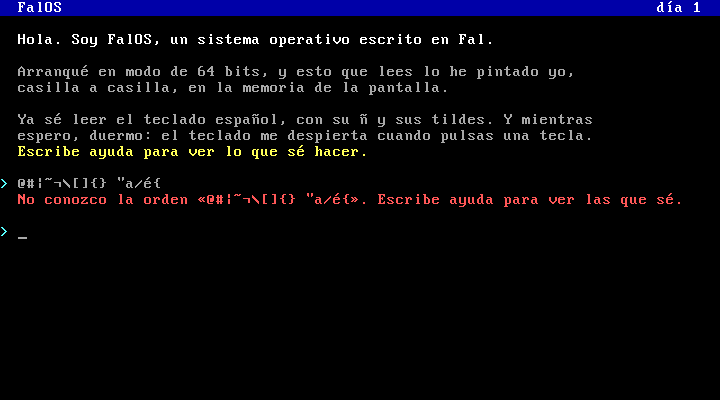

Lo curioso es que AltGr no es una tecla nueva: es el Alt de la derecha, y el
teclado lo distingue del de la izquierda mandando antes un byte de aviso,
`0xE0`, que dice "lo siguiente es de las teclas que se añadieron después".
Las flechas y media teclado numérico llegan igual, y antes FalOS no conocía
ese aviso: leía solo el segundo byte. La / del teclado numérico salía como un
guion, porque comparte número con la tecla del guion. Ahora sale la /, y el
Intro del teclado numérico ejecuta la orden como el otro.

El € no sale: la página de códigos 437 es de antes del euro.
