# Diario de FalOS

Un día, un paso. Lo más nuevo, arriba.

## Día 22: un teclado USB, como prometí

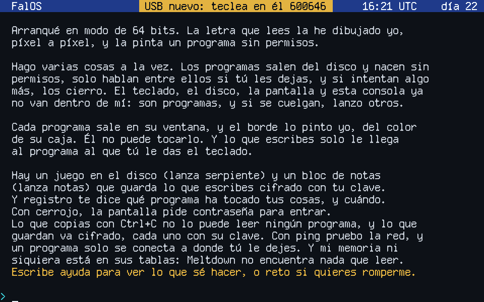

**Lo que hay.** Ayer prometí el teclado USB, el primer aparato de verdad que pasa
por el IOMMU. Aquí está, y FalOS ya se puede usar en un ordenador sin PS/2, si
tiene IOMMU.

El controlador USB (xHCI) es el primer aparato de FalOS con DMA. Lo lleva un
programa del anillo 3, como los demás, que solo tiene los registros del aparato
y 64 páginas de memoria. Y el aparato ve esas mismas 64 páginas y ninguna más:
el IOMMU se encarga. Hacen falta las dos cosas. Un controlador encerrado en una
caja no sirve de nada si puede pedirle al aparato que lea la memoria por él.

`rompe usb` hace justo eso: le pide al controlador que mande al aparato leer en
`0x100000`, donde empieza FalOS. El IOMMU lo para y lo apunta, y FalOS cierra el
controlador y lanza otro. Todo lo demás sigue.

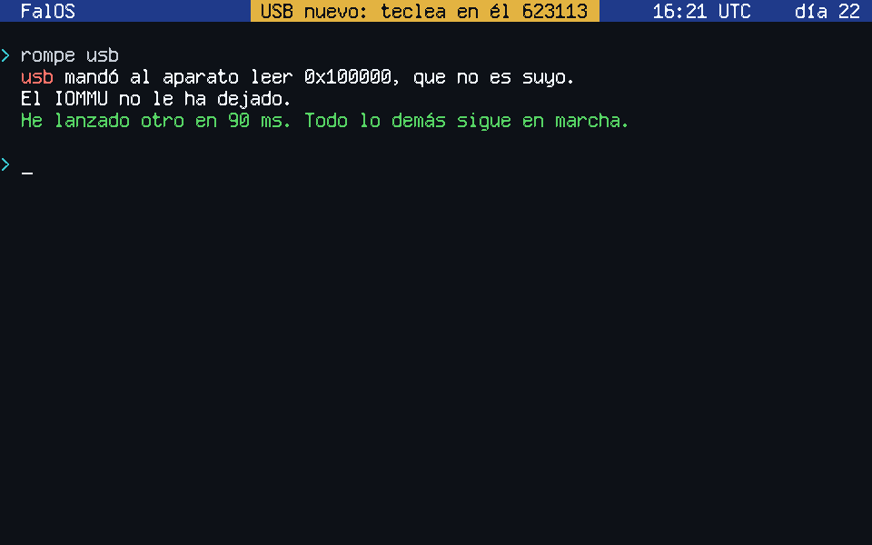

Sin IOMMU, o si el IOMMU dice que no vigila ese aparato, FalOS no enciende el
USB, y explica por qué. Podría encenderlo sin más, como hace casi todo el mundo,
pero entonces la caja sería de mentira.

**Un teclado que no es un teclado.** Un pendrive trucado puede decir que es un
teclado y escribir órdenes más rápido que tú. Se llama
[BadUSB](https://srlabs.de/blog/usb-peripherals-turn), se enseñó en 2014 y se
vende hecho. El IOMMU no pinta nada ahí: el aparato no toca la memoria, solo
teclea.

Así que el teclado que ya estaba al arrancar vale, y el que se enchufa después no
escribe nada hasta que se teclea en él el código de 6 cifras que sale en la
pantalla. Tú lo lees. El aparato no ve la pantalla, y solo le queda adivinar: a
los tres fallos FalOS no le hace caso hasta que lo desenchufes, y no da otro
código en 30 segundos. Con la pantalla bloqueada también lo pide.

La prueba automática enchufa un segundo teclado con FalOS en marcha, desenchufa
el primero, escribe sin el código y mira que no llega nada. Luego lee el código
de la memoria de la máquina virtual, lo teclea, y ya llega. Después rompe y
cuelga el controlador, y falla el código tres veces.

**Lo que arreglé de ayer.** Al volver sobre el IOMMU salieron cosas que no estaban
bien contadas o no estaban bien hechas.

- Decía "ningún aparato toca la memoria" sin mirar qué aparatos vigila de verdad
  la unidad que enciende. Ahora lo mira antes de fiarse.
- `dma` decía "bloqueado" con solo ver que no se había leído nada. Ahora solo lo
  dice si el IOMMU ha apuntado el intento.
- Si el IOMMU no contestaba a un aviso, seguía adelante. Ahora no lo da por
  encendido.
- Un aparato podía fingir una interrupción escribiendo donde van. Ahora FalOS
  enciende la otra mitad de VT-d, el remapeo de interrupciones, con la tabla
  vacía: ningún aparato vigilado puede mandar ninguna. FalOS no las necesita, porque el
  reloj y el PS/2 llegan por otro camino y al USB le pregunta 100 veces por
  segundo.
- Por UEFI no encontraba las tablas ACPI. Ahora las busca también en los trozos
  que el mapa de memoria marca como suyos, y la prueba automática lo arranca por
  UEFI con IOMMU y teclado USB.

**Lo que se aprende.** Un controlador USB se maneja con anillos: listas de órdenes
en memoria que él va leyendo por DMA, y otra donde él escribe lo que ha pasado.
Para saber qué entradas son nuevas, cada una lleva un bit que cambia de valor en
cada vuelta. No hay que borrar nada ni contar nada: si el bit es el de esta
vuelta, es nueva.

Y un teclado USB no avisa de qué tecla has pulsado. Manda las seis que tienes
pulsadas ahora mismo. Lo de "pulsada" y "soltada" lo deduce el controlador
comparando con la vez anterior, y repetir la letra mientras la aguantas también
es cosa suya. El PS/2 lo hacía el propio teclado.

**Lo que queda.** Solo lo he probado en QEMU, con dos controladores xHCI: el suyo y
el de NEC. Solo teclados: ni ratones USB, ni pendrives, ni nada que vaya por un
hub. Las luces del teclado no se encienden. Y el código protege de un aparato,
no de alguien sentado delante, que lo lee en la pantalla igual que tú.

## Día 21: el IOMMU, como prometí

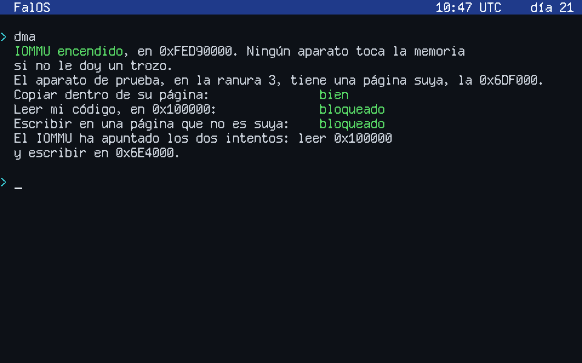

**Lo que hay.** Ayer prometí el IOMMU para hoy. Aquí está.

Hasta ayer, todo lo que protegía la memoria lo vigilaba el procesador: las
tablas de páginas, los permisos, el anillo 3. Pero hay aparatos que escriben
en la memoria sin pasar por él. Una tarjeta de red deja ahí lo que llega, un
disco lo que lee, un controlador USB lo que tecleas. Es el DMA, y el aparato no
tiene tablas ni permisos: escribe en la dirección que le digan, o en la que
quiera si alguien lo ha trucado. Así se lee la memoria entera desde fuera, la
llave de lo cifrado incluida. [Thunderclap](https://thunderclap.io) lo
demostró en 2019 con un aparato enchufado por Thunderbolt.

El IOMMU se pone en medio, e Intel lo llama VT-d. Hace con los aparatos lo que
las tablas de páginas hacen con los programas: cada aparato tiene las suyas, y
lo que no está en ellas no existe para él. Desde hoy FalOS lo enciende al
arrancar con las tablas vacías. Ningún aparato toca nada que no se le haya
dado.

Para verlo hace falta un aparato con DMA, y FalOS aún no maneja ninguno: el
teclado, el disco y la red van por puertos. Así que `dma` usa el aparato de
prueba de QEMU (`-device edu`), que copia lo que le pidas. FalOS le da una
página suya y le pide tres cosas: copiar dentro de esa página, leer el código
del núcleo y escribir en una página ajena. Con IOMMU, la primera sale y las
otras dos no, y el IOMMU apunta qué intentó y dónde. Sin IOMMU, el aparato se
trae `02 B0 AD 1B`, los cuatro bytes con los que empieza FalOS, y escribe donde
no debe.

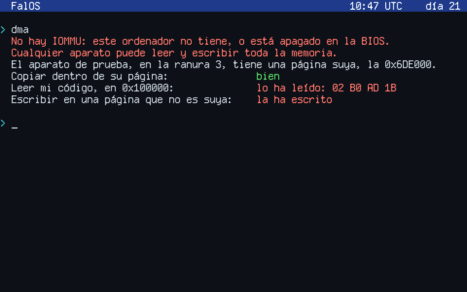

La prueba automática arranca las dos máquinas cada vez que subo algo. La de sin
IOMMU está para que la otra no pueda aprobar a ciegas: si el aparato no
copiara nada, las dos dirían "bloqueado".

**Lo que se aprende.** Para encontrar el IOMMU hay que leer las tablas ACPI que
deja la BIOS: una con la firma `RSD PTR ` lleva a la lista de tablas, y en ella
está DMAR, que dice dónde están los registros de cada unidad. Mi primera regla
era encender solo la unidad marcada "para todos los aparatos", y el QEMU 11 con
el que pruebo no marca la suya así: FalOS decía que no había IOMMU teniendo uno
delante. Ahora
enciende la primera que no sea la de la gráfica integrada, que en un portátil
lee la pantalla de la memoria por su cuenta.

Otra: muchos IOMMU de Intel de la época del L450 no miran la caché del
procesador cuando leen sus tablas. Lo que FalOS acaba de escribir puede estar
aún en la caché, y el IOMMU leería lo de antes. Fal tiene desde hoy
`vacia_caches`, que lo baja todo a la memoria, y FalOS la llama antes de cada
aviso al IOMMU.

Y una trampa de mi propio lenguaje que ya me mordió el día 5: en Fal,
`para cada k desde 1 hasta 0` cuenta hacia atrás, 1 y 0, en vez de no hacer
nada. En QEMU la BIOS no reserva ningún trozo de memoria para sus aparatos, así
que el bucle que los repasa iba de 1 a 0, y FalOS se paraba buscando el trozo
número 0. Los bucles que pueden quedarse vacíos ahora son `mientras`.

**Lo que queda.** Solo lo he probado en QEMU. El L450 arranca por UEFI, y por
ese camino GRUB no le dice a FalOS dónde están las tablas ACPI, así que allí el
IOMMU se queda apagado y `dma` lo dice. Lo que la BIOS reserva para sus
aparatos (el USB que imita un teclado PS/2, por ejemplo) FalOS se lo da sin
mirar, y ese camino tampoco se ha probado: QEMU no reserva nada. Falta el
remapeo de interrupciones, la otra mitad de VT-d, sin el que un aparato puede
fingir una interrupción. Y hoy ningún aparato de verdad pasa por el IOMMU: el
primero será el teclado USB.

## Día 20: Meltdown, como prometí

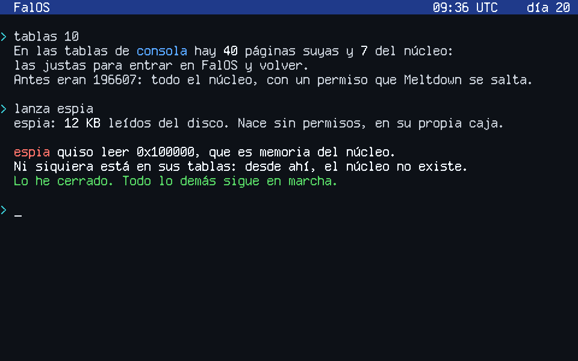

**Lo que hay.** Ayer prometí Meltdown para hoy. Aquí está.

Hasta ayer, cada programa llevaba en sus tablas de memoria el núcleo entero:
196.607 páginas, marcadas como prohibidas. El procesador no le dejaba leerlas,
y `espia` lo comprobaba cada día: lee la memoria del núcleo y FalOS lo cierra.
Pero muchos Intel de antes de 2019, como el del ThinkPad L450 donde arranca
FalOS, leen por adelantado, antes de mirar el permiso, y lo leído deja huella
en la caché. Midiendo tiempos, un programa puede sacar byte a byte lo que no le
dejan leer. Eso es [Meltdown](https://meltdownattack.com), y lo prohibido
incluía la llave que cifra lo que guardas, el portapapeles y las teclas que van
a otros programas.

El arreglo es que no esté. Ahora cada programa tiene en sus tablas su memoria y
siete páginas del núcleo: el código de la puerta por donde se entra, las tablas
que el procesador lee para encontrarla y la pila de entrada del propio
programa. Al entrar, lo primero que hace FalOS es pasar a sus tablas, y lo
último antes de volver, poner las del programa. Linux hizo lo mismo en 2018 y
lo llama KPTI.

`tablas N` lo cuenta: la consola ve 7 páginas del núcleo, cuando antes eran
196.607. Y `espia` ya no choca con un permiso: la dirección que lee no existe
para él. La prueba automática comprueba las dos cosas cada vez que se sube algo,
y Fal tiene una suya que monta dos juegos de tablas y mira lo mismo.

**Lo que cuesta.** Cada cambio de tablas tira lo que el procesador tenía
traducido, y hay dos por llamada. Lo he medido con un programa nuevo, `mide`,
que cuenta cuántas veces puede llamar a FalOS en un segundo. En una máquina
virtual con aceleración, ayer eran 5,1 millones, y hoy, 2,3: cada llamada pasa
de 0,2 a 0,44 µs. En QEMU sin aceleración, que es lo que usa la prueba
automática, es peor: de 1,1 millones a 0,14, porque QEMU tira toda su caché en
cada cambio. Para lo que hace FalOS no se nota, pero el precio está ahí.

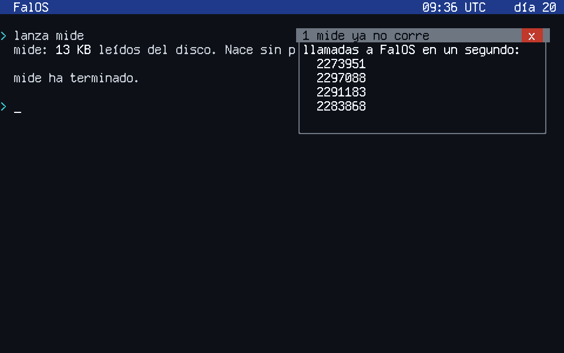

**Lo que se aprende.** Lo delicado es el instante del cambio. Justo después de
cargar las tablas nuevas, el procesador sigue ejecutando la instrucción
siguiente, y la pila sigue donde estaba. Así que todo lo que se toca en ese
instante tiene que estar en los dos juegos de tablas y en la misma dirección:
el código que corre, la pila con los registros del programa y lo que lee el
procesador para entrar. Si falta una sola página, el fallo llega cuando el
procesador ya no puede avisar de nada, y el ordenador se reinicia en silencio.
Por eso el compilador de Fal ahora junta todo eso en sus propias páginas,
aparte del resto del núcleo, y FalOS solo pone esas.

Y otra: para cerrar Meltdown no hace falta reproducirlo. En QEMU sin KVM no
sale, y no he lanzado el ataque en el portátil. Lo que se comprueba es que no
hay nada que leer, y eso se cuenta.

**Más cosas.** La prueba automática falló ayer y hoy en GitHub, una vez cada
día y en sitios distintos del disco, y en mi ordenador nunca. Ayer dejó la
pista: "el disco no me deja escribir". Después de escribir, el controlador del
disco le pide que vacíe su caché y espera a que acabe, pero contaba 200.000
vueltas en vez de tiempo. En una máquina lenta, el disco tardaba más que esas
vueltas y el controlador daba la escritura por fallida. Ahora espera hasta 5
segundos, cediendo su turno mientras tanto. Y si `olvida` falla, ya no lo dice
solo en la pantalla: también queda en lo que lee la prueba, para que la próxima
vez se vea por qué.

**Lo que queda.** Linux abarata el coste marcando cada juego de tablas con un
número, PCID, para que el procesador no lo tire al cambiar. FalOS aún no, y lo
paga también un procesador que no lo necesita. Y Spectre es otra cosa: engaña
a la predicción de saltos para que el propio núcleo lea por adelantado lo que
no debería, y pide otros arreglos.

## Día 19, por la tarde: la consola sale del núcleo, como prometí

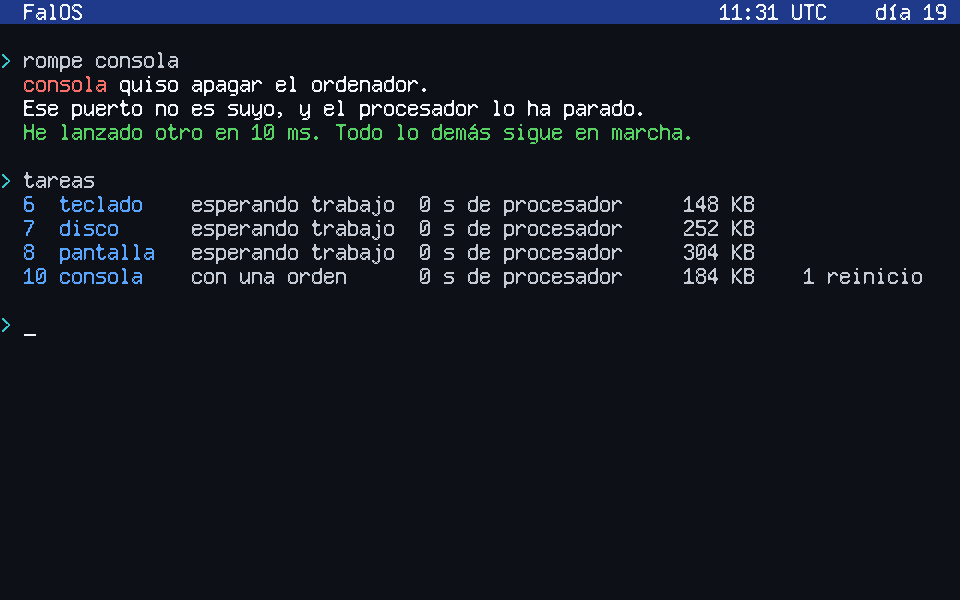

**Lo que hay.** Ayer prometí sacar hoy la consola del núcleo. Por la mañana lo
había pasado al día 20, porque arreglar iba primero, pero lo prometido era para
hoy. Aquí está.

La consola es lo que lees y escribes: la línea con su cursor, el historial con
las flechas, entender qué orden has escrito, la ayuda y el reto. Hasta hoy todo
eso corría dentro del núcleo, con todos los permisos. Ahora es
[consola.fal](consola.fal), un programa en el anillo 3, en su caja, como el
teclado o el disco: no toca puertos, ni el disco, ni la red, ni la memoria de
nadie. FalOS la lanza desde su propia imagen y no desde el disco, así que nadie
la puede cambiar por otra tocando el disco.

Para hacer algo, la consola le pide la orden al núcleo con una llamada nueva, la
18, que solo tiene ella. El núcleo mira quién llama, y a cualquier otro programa
se la niega y la cuenta como rechazada. `mandon` lo intenta: finge ser la
consola y pide `deja siempre`, `invitado` y `reinicia`. Las tres, rechazadas.

Y si se rompe, FalOS sigue. `rompe consola` hace que intente apagar el ordenador
por el puerto 100: el procesador la para, y en 10 ms hay otra esperando. Pierde
el historial, que vivía en ella, y nada más. `cuelga consola` la deja dando
vueltas sin contestar, y el vigilante la cambia al segundo. Una prueba automática
hace las dos cosas, y también `para 10`, cada vez que se sube algo.

Y lo he probado en el ThinkPad L450, con la imagen que hizo GitHub. Por BIOS,
como el día 17, y por primera vez por UEFI, sin Secure Boot: arranca igual por
los dos caminos. En el portátil la consola rota vuelve en menos de 10 ms, y la
colgada la cambia el vigilante al segundo, como en QEMU.

**Lo que se aprende.** Mover el código fue lo fácil. Lo difícil fue el orden de
las teclas. Escribes `cerrojo`, Intro y tu contraseña nueva muy deprisa. La
consola tarda un poco en pedirle la orden al núcleo, y en ese rato las teclas de
la contraseña ya le han llegado a ella, que es un programa. Antes daba igual,
porque todo era el núcleo. Ahora, mientras hay una orden a medias, lo que
escribes se queda en el núcleo, y lo que ya le había llegado a la consola vuelve
atrás, en el mismo orden. Si la orden pide contraseña, se la queda el núcleo y
la consola no la ve nunca. Si no, se lo devuelve.

**Lo que queda.** Lo que hacen las órdenes sigue dentro: lanzar un programa o
enseñarte las tareas y el registro lo hace el núcleo, y la consola solo le dice
cuál. Por eso el núcleo apenas adelgaza, de 6.499 líneas a 6.434: lo que antes
leía él del teclado ahora se lo manda un programa, y tiene que comprobarlo todo
otra vez. Y la consola puede decir `deja` por ti, porque es lo que tiene que
poder hacer. Lo que la separa de los demás es que solo ella tiene esa llamada,
y que solo le llega lo que tecleas tú.

## Día 19: lo rompí yo antes que nadie, y lo arreglé

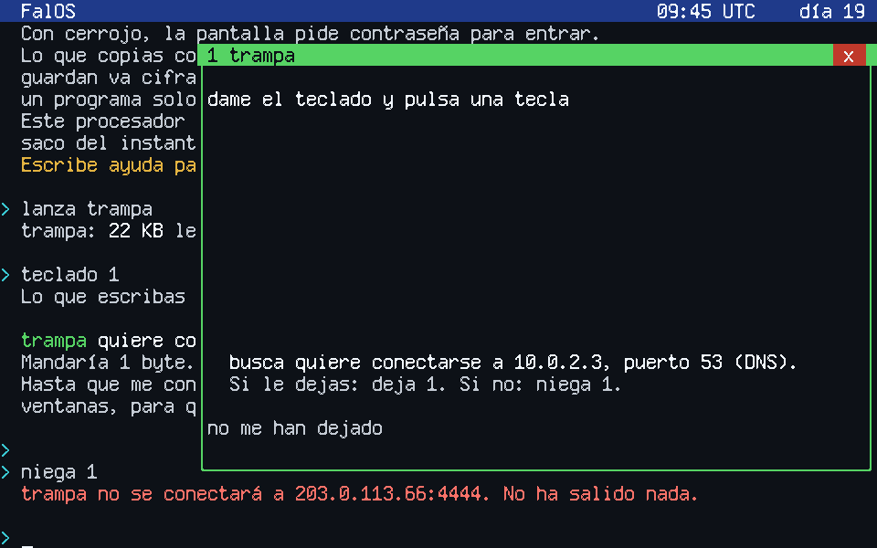

**Lo que hay.** Ayer abrí el reto. Antes de que nadie lo intentara, me puse a
mirar FalOS como lo miraría quien quiere romperlo, y encontré cuatro fallos de
los que cuentan. Hoy están arreglados, y cada uno tiene una prueba que lo
intenta cada vez que se sube algo:

- **Una sola llamada tiraba FalOS entero.** Guardar, leer o conectar desde una
  posición enorme de la mesa hacía que el núcleo sumara dos números que no caben
  en 64 bits. Fal no deja que un número dé la vuelta, a propósito, porque eso
  es un agujero: para el núcleo. Pero aquí lo que se paraba era todo. Ahora se
  compara restando, y `tumba` lo intenta.
- **Una ventana podía mentir.** Un programa ponía su ventana encima de la
  pregunta de permiso de la consola y pintaba dentro otra: que `busca` quería
  hablar con el DNS, cuando el que pedía era él, y a otro sitio. Ahora, mientras
  FalOS pregunta, las ventanas se esconden y el teclado vuelve a la consola.
  `trampa` lo intenta: su pregunta falsa solo se ve cuando ya has contestado a
  la de verdad.
- **Sin RDRAND, la llave salía de la hora.** En un procesador sin generador de
  azar, o en QEMU sin `-cpu max`, la llave que cifra lo que guardan los
  programas salía del reloj. Con un disco copiado y la hora del archivo, un
  guion de Python la sacaba en 3 segundos, también con contraseña. Ahora FalOS
  lee el contador del reloj del ordenador, que va a 1,19 MHz, en cada tecla y
  cada movimiento del ratón, y encadena esas medidas con BLAKE2b. El mismo guion
  ya no encuentra nada, y la prueba automática lo comprueba.
- **Dos archivos con el mismo nombre.** Un disco con un `serpiente.prg` de más
  arrancaba el falso, y el falso heredaba la clave y el permiso para siempre del
  de verdad. Ahora `haz_disco` no deja hacerlo, y si alguien escribe el disco a
  mano, FalOS no abre ninguno de los dos.

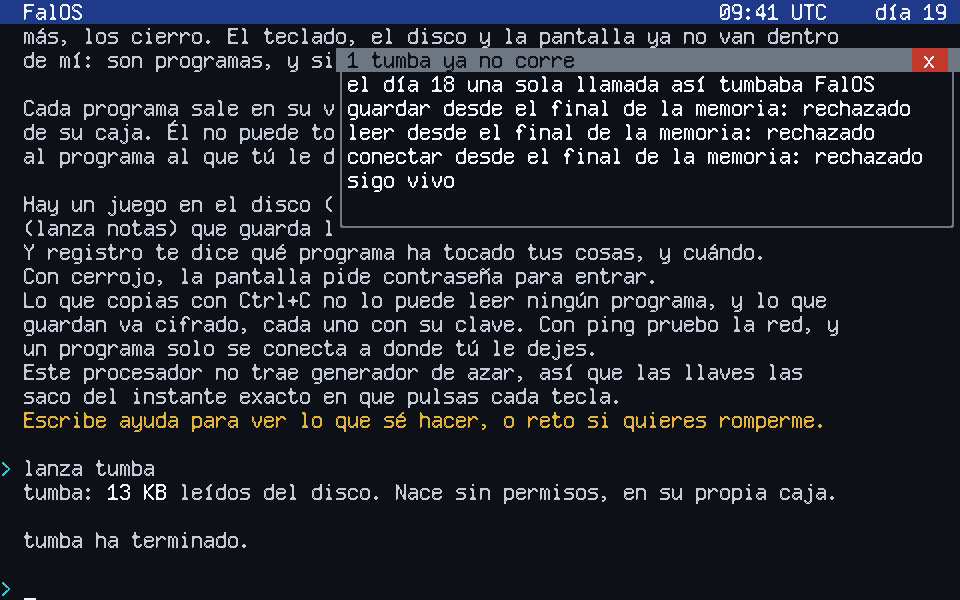

**Lo que se aprende.** Repasando las pruebas encontré otro fallo, este en las
pruebas mismas. Cuando el núcleo se para, Fal escribe "X" al principio de la
línea, y las pruebas buscaban "  X  ", con dos espacios delante: así lo escribía
Fal cuando escribí la prueba, el día 1, y cambió esa misma mañana. Desde
entonces, 18 días, esa comprobación no miraba nada. Si algo hubiera parado FalOS
en mitad de una prueba, solo lo habría pillado otra comprobación, por suerte.
Ahora busca bien, y no había nada escondido. Una prueba que nunca falla también
puede ser una que no mira.

**Más cosas.** Si el ordenador no tiene teclado PS/2, FalOS lo dice en rojo al
arrancar, en vez de quedarse sin hacer caso. Sin RDRAND, la portada lo avisa. El
invitado ya no puede leer `cerrojo.sis`. El programa de la pantalla ya no ve la
memoria de al lado si la pantalla no empieza en un borde de 2 MB. Y el README
tiene una tabla de los ordenadores donde ha arrancado, con una
[plantilla](https://github.com/NissanBoss/FalOS/issues/new?template=arranca.yml)
para que añadas el tuyo.

**Lo que queda.** Hay uno que no se arregla en un día: Meltdown. Cada programa
lleva en sus tablas de memoria la del núcleo entera, marcada como prohibida, y
en un Intel de antes de 2019, como el del portátil donde arrancó FalOS, eso se
puede leer por especulación. El arreglo es separar las tablas del núcleo de las
de los programas, como hizo Linux en 2018. Tendrá su día, y mientras tanto está
contado en el README.

## Día 18: la imagen para que lo arranques tú, y un reto para romperlo

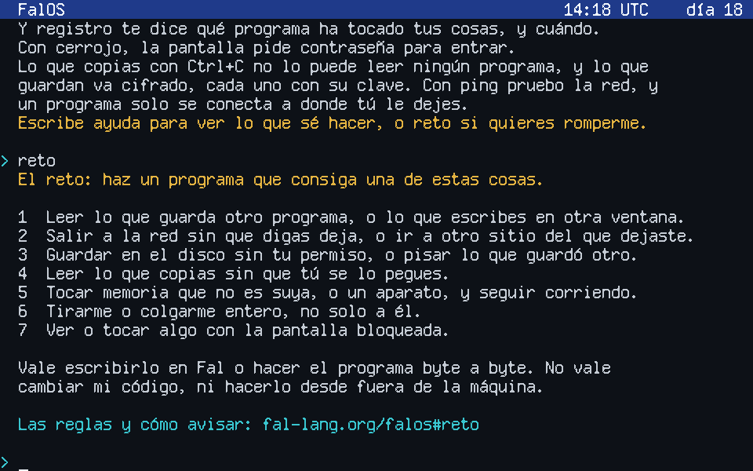

**Lo que hay.** Desde hoy, FalOS se descarga. En
[Releases](https://github.com/NissanBoss/FalOS/releases/latest) están la imagen
para un pendrive, el núcleo y el disco para QEMU, y el compilador de Fal con el
que se hizo, para Linux, Windows y Mac. No hace falta instalar Go ni GRUB.

Y un reto. La orden `reto` dice lo que tendría que conseguir un programa para
ganarme: leer lo que guarda otro, salir a la red o guardar sin permiso, leer el
portapapeles, salirse de su caja y seguir vivo, tirarme entero o saltarse el
cerrojo. Y vale igual que FalOS te mienta: que la pregunta de permiso diga otro
programa u otro sitio de lo que de verdad pasa. Las reglas, las llamadas al
sistema que tiene un programa y cómo avisar están en [RETO.md](RETO.md).

```
reto
```

**La imagen no sale de mi ordenador.** La hace GitHub desde el commit de la
etiqueta, y solo la publica si antes pasan todas las pruebas, también las que
arrancan el pendrive por BIOS y por UEFI. Con ella van sus sumas SHA-256 y el
commit de Fal con el que se compiló, para que se sepa de dónde sale cada byte.

**La seguridad.** Hasta hoy, quien intentaba romper FalOS era yo, con los
programas que lo intentan: `espia`, `ladron`, `chivato`, `cambiazo` y los demás.
Yo sé dónde mirar, y por eso mismo no se me ocurre mirar en otros sitios. El
README lo dice desde el primer día: un sistema es seguro cuando alguien de fuera
intenta romperlo y no puede, y eso aquí aún no ha pasado. A partir de hoy puede
pasar.

**Lo que se aprende.** Para el reto había que escribir todo lo que un programa
puede pedirle al núcleo, y cabe en una tabla de 18 filas. Eso es toda la
superficie: un ataque tiene que pasar por una de esas 18 llamadas, por la mesa
que comparte con el núcleo o por la cabecera del programa, que FalOS lee antes
de cargarlo. Verlo escrito en una tabla ayuda a saber dónde buscar.

**Lo que costó.** Antes de invitar a nadie repasé lo del día 17, y había un
agujero. Si GRUB cargaba el disco por encima de los 64 MB, FalOS lo usaba igual
pero no lo apartaba, y podía darle esa memoria a un programa. En el portátil y
en QEMU lo carga abajo, por eso no se vio. Ahora solo acepta el disco si cae
donde lo protege.

## Día 17: FalOS sale de QEMU y arranca en un portátil de verdad

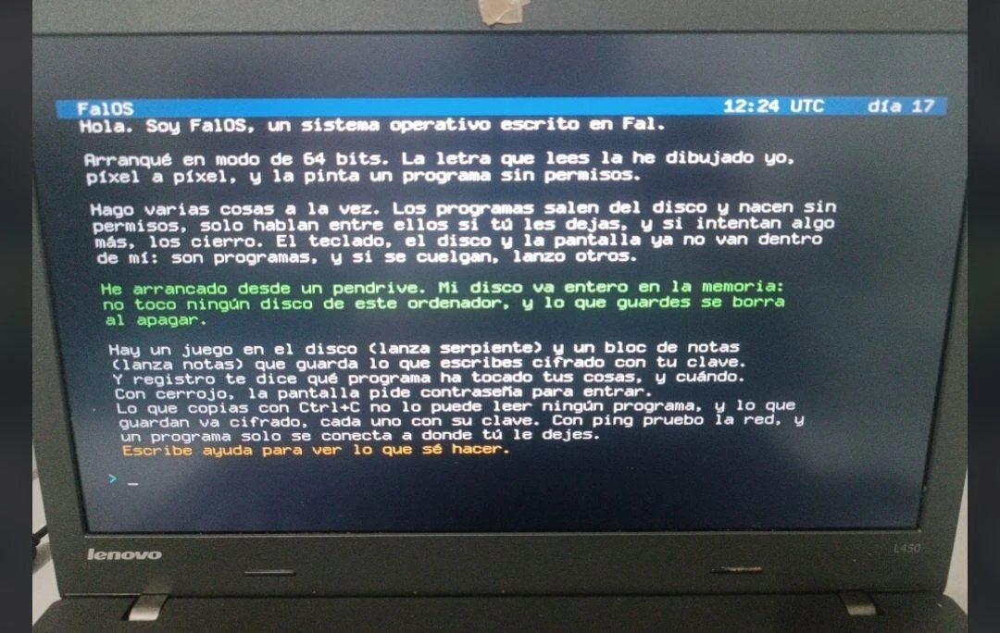

**Lo que hay.** Hasta hoy FalOS solo había arrancado en QEMU, un ordenador de
mentira. Hoy arranca en un ThinkPad L450 de 2015, desde un pendrive. La foto es
de la pantalla del portátil, hecha con un móvil: en un ordenador de verdad no
hay captura que valga.

El pendrive lleva GRUB, FalOS y su disco. GRUB carga los dos en la memoria y
salta a FalOS, que ya no necesita nada más del pendrive. Funciona lo mismo que
en QEMU: el teclado español, el TrackPoint, las ventanas, la serpiente, las
notas cifradas y el registro.

**No se instala.** El portátil tiene Qubes en su disco, y FalOS no lo toca. Su
disco va entero en la memoria, y el programa del disco lo lee y lo escribe
ahí, sin poder tocar ni un puerto: el núcleo ni se los abre. Lo que guardes se
borra al apagar. Quitas el pendrive y el portátil vuelve a ser el de antes.

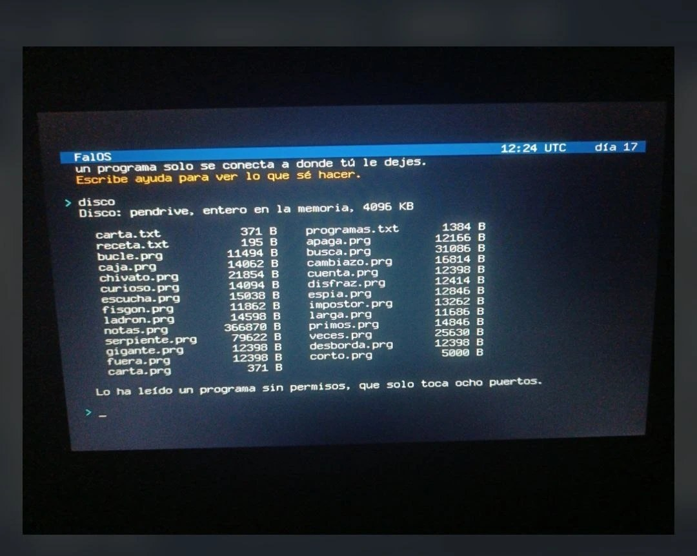

**Lo que hizo falta.** En QEMU, FalOS pintaba con una tarjeta gráfica que solo
existe en QEMU, y leía un disco IDE que un portátil de ahora no tiene. Las dos
cosas tenían que cambiar:

- **La pantalla la da GRUB.** FalOS le pide una de 1024x768, GRUB la enciende y
  le dice dónde está y cómo van los colores. El programa de la pantalla pinta
  ahí el mismo cuadro de siempre, centrado, y ya no toca ningún puerto.
- **El disco va como un módulo.** GRUB lo carga detrás de FalOS, y FalOS se
  aparta para no pisarlo: antes apuntaba qué páginas están libres justo donde
  ahora está el disco.

Para eso Fal ha cambiado su cabecera de arranque: ahora le dice a GRUB que
quiere una pantalla de píxeles. Sin eso, en un ordenador con UEFI no hay
ninguna pantalla que FalOS sepa usar.

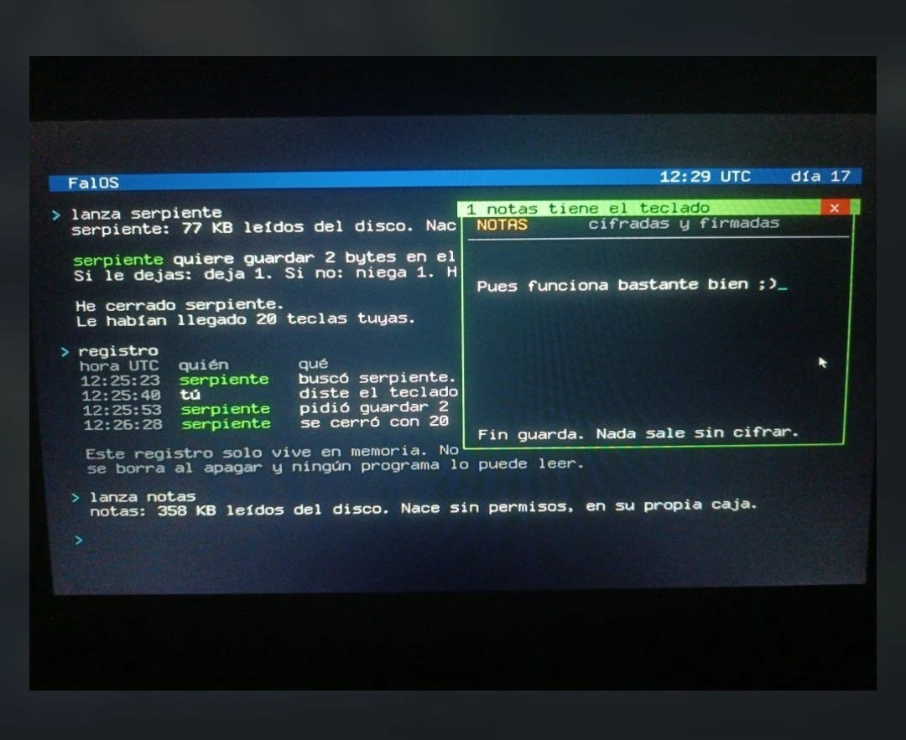

**La seguridad.** La prueba automática hace la imagen del pendrive y la arranca
dos veces en QEMU como si fuera un USB, sin ningún disco conectado: una por
BIOS y otra por UEFI. Guarda dos veces en el disco de la memoria, lo vuelve a
leer, y al final compara la imagen byte a byte con la de antes. Tiene que
estar igual: FalOS no ha escrito nada en el pendrive.

**Lo que se aprende.** Un ordenador de verdad no se parece a QEMU en lo que
importa. QEMU tiene una tarjeta gráfica que se maneja con dos puertos, y un
portátil tiene la de Intel, con cientos de registros y un manual de miles de
páginas. La salida
es la de siempre: que alguien que ya la conoce (aquí, la BIOS a través de
GRUB) la encienda, y pintar encima.

**Lo que costó.** GRUB no le hacía caso a su propio archivo de ajustes: le
pedía 1024x768 en `grub.cfg` y daba 800x600 a 24 bits, y una entrada para el
modo de texto daba píxeles igual. Solo obedece a la cabecera del núcleo. Y los
colores salieron cambiados, el azul verde y el verde rojo: la especificación
de multiboot dice que los colores van desde el byte 110, y GRUB los deja desde
el 112. FalOS mira los dos sitios.

`ping` en el portátil no sale: tiene una tarjeta de red de Intel, y FalOS solo
sabe usar la NE2000. Lo dice así, sin mandarte a QEMU.

## Día 16: un programa solo sale a la red si le dejas, y solo a donde le dejas

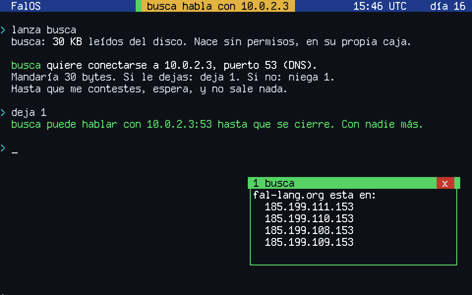

**Lo que hay.** Un programa ya puede hablar con alguien de fuera, pero tiene que
pedírtelo. Hace una llamada con la dirección, el puerto y lo que quiere mandar, y
se queda esperando. FalOS te dice quién es, a dónde quiere ir, a qué puerto (y
qué suele haber en él: DNS, la hora, una web) y cuántos bytes mandaría.

```
lanza busca
deja 1
lanza chivato
niega 2
registro
```

`busca` le pregunta al DNS de QEMU dónde está fal-lang.org. Con `deja 1` sale la
pregunta, vuelve la respuesta, y te enseña las cuatro direcciones. Mientras
habla, la barra de arriba dice `busca habla con 10.0.2.3`, en el color del
programa. `chivato` quiere contarle a un servidor de fuera qué programas usas.
Con `niega 2` no sale nada, ni siquiera la pregunta ARP de la puerta de salida.

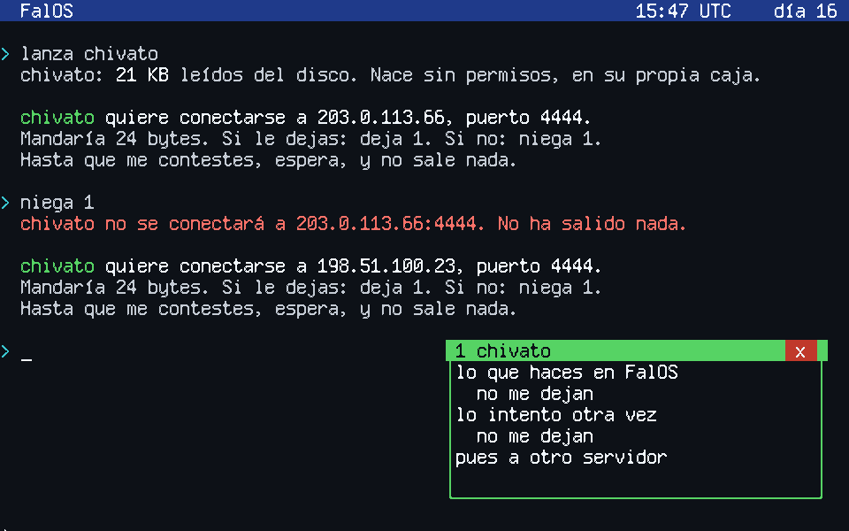

**El permiso va por dirección.** Si dejas a `busca` hablar con 10.0.2.3, solo
puede hablar con 10.0.2.3. Si quiere ir a otro sitio, te vuelve a preguntar. Si
niegas una dirección y el programa insiste con la misma, FalOS ya no te molesta:
le dice que no y lo apunta. El permiso dura hasta que el programa se cierra.

El mensaje lo arma el núcleo, no el programa: UDP con su suma de control, dentro
de IP, dentro de una trama que le pasa al controlador. El programa no elige de
dónde sale ni por qué puerto, y la respuesta solo le llega si viene de la
dirección y el puerto a los que preguntó.

**La seguridad.** La prueba automática graba todo lo que pasa por la tarjeta.
Deja a `busca` y niega dos veces a `chivato`. En la grabación tiene que haber un
solo mensaje UDP, a 10.0.2.3, puerto 53, con las sumas de control bien y la
pregunta por fal-lang.org dentro, y su respuesta. Hacia los servidores de
`chivato`, nada. Y en el registro, lo que dejaste, lo que negaste y cada vez que
un programa se quedó sin salir.

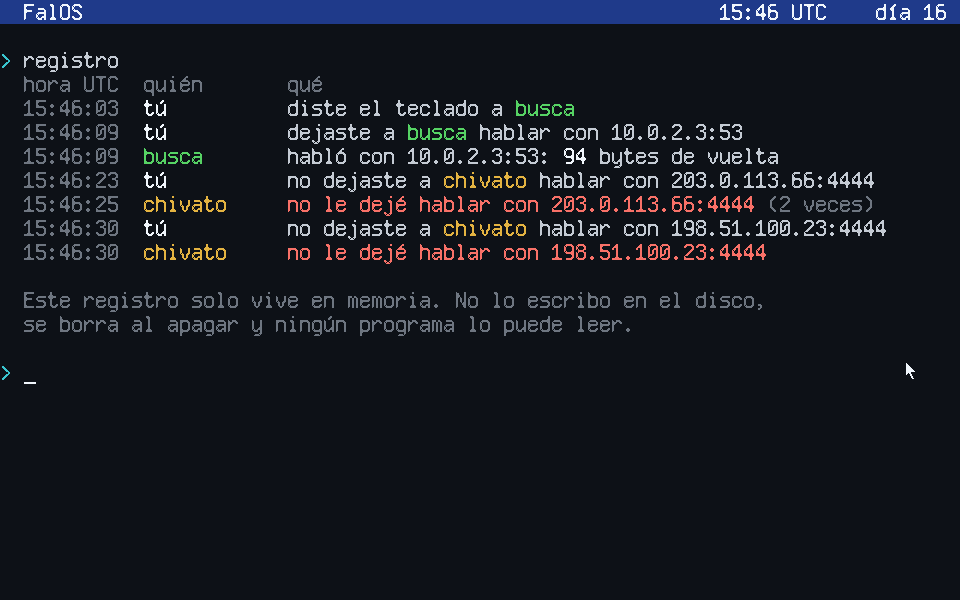

**Lo que se aprende.** Un cortafuegos de los que preguntan, como OpenSnitch o
Little Snitch, vigila desde fuera: el programa ya tiene la red, y alguien la
intercepta. Aquí es al revés. La única forma de salir es pedirlo, así que no hay
nada que interceptar ni por dónde colarse. Y una pregunta al DNS ya cuenta
mucho: a dónde vas a ir, antes de ir.

**Lo que costó.** La línea del registro para cada intento que no sale era
demasiado larga: con ` (2 veces)` detrás se pasaba de las 80 columnas y partía
la pantalla. Quedó en `no le dejé hablar con`. Y `cambiazo`, el programa que
prueba llamadas con argumentos malos, tenía que seguir en 49 rechazadas: una
llamada a la red mal hecha cuenta como rechazo, igual que las demás.

## Día 15: la red, y nada sale sin que lo pidas

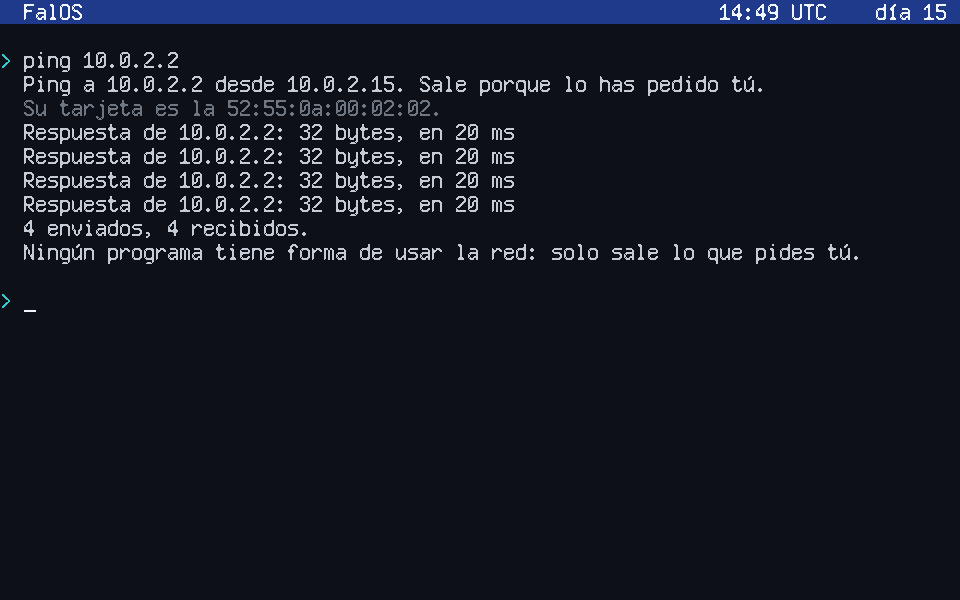

**Lo que hay.** FalOS sabe usar una tarjeta de red, la NE2000, y la primera
orden que la usa es `ping`. Pregunta quién tiene esa dirección, le manda cuatro
ecos, uno por segundo, y dice cuántos vuelven y cuánto tardan. Mientras dura, la
barra de arriba dice a quién, y el registro lo apunta.

```
ping
ping 10.0.2.99
red
registro
```

El controlador es un programa más, en su caja, como el del disco: el procesador
solo le deja tocar los 32 puertos de la tarjeta. Elegí la NE2000 por eso. Es una
tarjeta de los noventa que mueve cada trama byte a byte por sus puertos, y no
escribe en la memoria por su cuenta. Una tarjeta moderna sí lo hace, y entonces
su controlador podría usarla para escribir donde quisiera, saltándose la caja.

ARP, IP e ICMP los arma el núcleo, y le pasa al controlador la trama hecha. La
dirección es fija, la de la red de QEMU: 10.0.2.15. Cada eco lleva dentro un
texto: `FalOS: solo sale si tu lo pides.`

**Y nada más.** FalOS no envía nada al arrancar. Ni DHCP, ni anuncios, ni una
trama. Ningún programa tiene una llamada para la red. `escucha` las prueba todas,
no encuentra ninguna, y cuando intenta tocar la tarjeta él mismo, el procesador
lo para. `red` dice cuántas tramas han salido desde que arrancaste, y si no has
hecho ping, son cero.

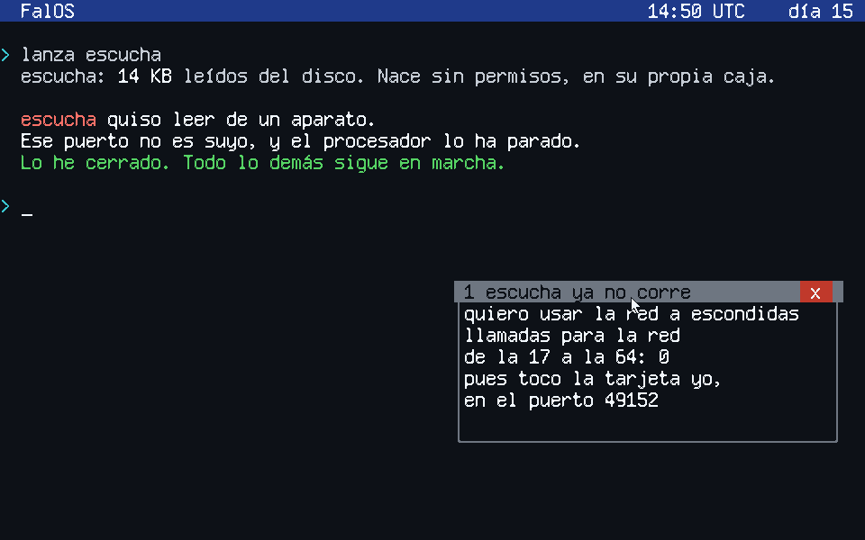

**La seguridad.** La prueba automática le pone a QEMU un filtro que graba todo lo
que pasa por la tarjeta. Primero arranca, lanza `escucha` y `fisgon`, enciende
la tarjeta con `red`, cuelga el controlador y lo rompe: de FalOS no ha salido ni
una trama. Luego hace ping, y abre la grabación en Python: una pregunta ARP,
cuatro ecos con las sumas de control bien, numerados del 1 al 4 y con su texto, y
cuatro respuestas. Con una dirección que no existe, tres preguntas ARP y nada
más. Y sin tarjeta, `ping` te dice cómo arrancar QEMU con ella.

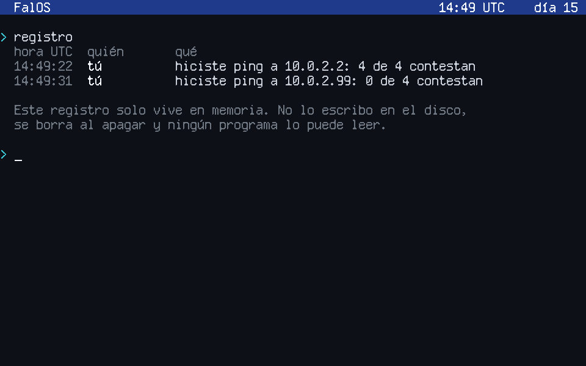

**Lo que se aprende.** Lo difícil de la red no es enviar, es callarse. Un sistema
normal habla nada más encenderse: pide una dirección, se anuncia, busca
actualizaciones, pregunta la hora. Aquí lo que sale es lo que pides tú, y la
prueba lo graba para que no dependa de creérselo.

**Lo que costó.** La dirección de la tarjeta salía `1a:1a:1a:1a:1a:1a` y nada se
enviaba. En Fal, `lee_puerto de base mas registro` se lee como
`(lee_puerto de base) mas registro`: leía siempre el mismo puerto y le sumaba el
número. Con paréntesis, salió la de verdad. Y medir el tiempo: la consola espera
a la respuesta durmiendo, y no había nada que la despertara a cada tic del reloj.
Ahora el reloj la despierta, y por eso el tiempo va de 10 en 10 ms.

## Día 14: lo que guardan los programas va cifrado, y el invitado no deja rastro

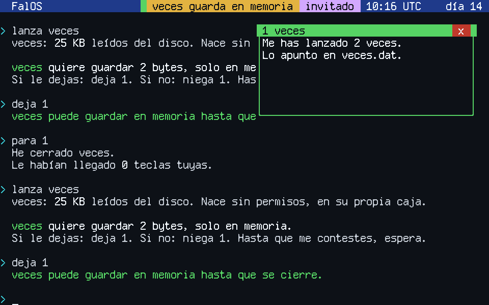

**Lo que hay.** Todo lo que guarda un programa va cifrado, cada uno con su
clave, sin que el programa lo pida ni lo pueda evitar. Y un modo invitado:
`invitado`, o Intro sin escribir nada en la pantalla de bloqueo, y desde ese
momento no se escribe nada en el disco.

```
lanza veces
deja 1
lee veces.dat
invitado
```

FalOS tiene una llave de 32 bytes, sacada del azar del procesador. De ella sale
la clave de cada programa: BLAKE2b con la llave, de "guardado:" y su nombre. Son
64 bytes: 32 para cifrar con ChaCha20 y 32 para firmar. Cada guardado lleva
delante "FAL1" y un número que no se repite, y detrás la firma: 48 bytes más.
Por eso un programa ahora guarda hasta 464 bytes y no 512.

Al leer, si la firma no cuadra, el programa no recibe nada y el registro lo
apunta en rojo. Si el archivo ni siquiera va cifrado, tampoco se lo da: no hay
forma de que esté ahí sin que alguien lo haya puesto a mano.

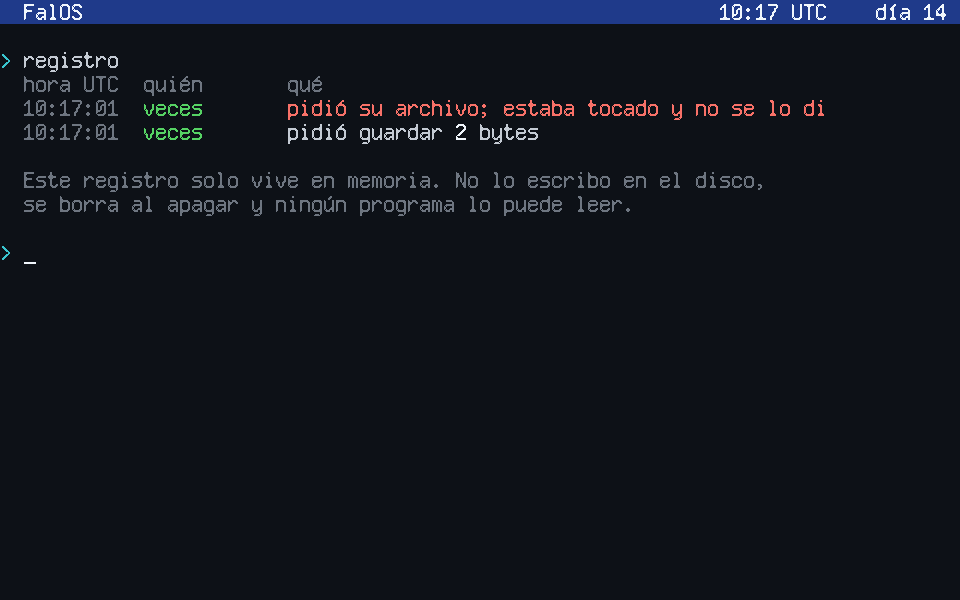

**Y la contraseña.** Argon2id ahora da 64 bytes en vez de 32. La primera mitad
sigue siendo la huella con la que se comprueba la contraseña. La segunda se
mezcla con la llave, y eso es lo que va al disco, en `cerrojo.sis`. Sin la
contraseña no hay llave, y sin llave lo guardado es ruido. Sin contraseña, la
llave va en `llave.sis` tal cual, y al poner `cerrojo` ese archivo se llena de
ceros.

**El modo invitado.** Cierra los programas, olvida la llave, el registro, el
portapapeles y las órdenes que escribiste, y a partir de ahí lo que guarden los
programas va a ocho huecos en la memoria del núcleo. Al disco no llega nada: la
petición se para antes de salir del núcleo. Se vuelve reiniciando, y `reinicia`
llena antes esos huecos de ceros.

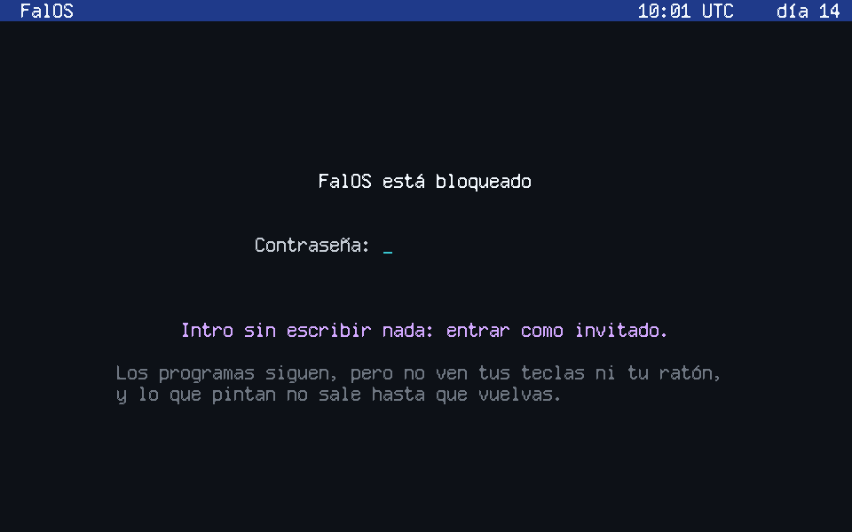

**La seguridad.** La prueba automática guarda con `veces`, saca la llave de
`llave.sis` y descifra el archivo en Python, con un ChaCha20 propio y el BLAKE2b
de la biblioteca estándar: tiene que salir lo mismo, y con la clave de
`serpiente` no tiene que salir nada. Cambia un bit y mira que `veces` no recibe
nada; pone un archivo sin cifrar y lo mismo. Pone contraseña, saca la llave con
la biblioteca de referencia de Argon2 y comprueba que es la de antes y que
`llave.sis` ya no está. Y entra como invitado dos veces, con la orden y desde la
pantalla de bloqueo, guarda, lee, borra, intenta poner contraseña, y compara el
disco entero byte a byte con el de antes: idéntico.

**Lo que se aprende.** Hay dos sitios donde cifrar: en cada programa, como hace
`notas`, o en el núcleo, para todos. En el programa, uno que no se moleste guarda
en claro. En el núcleo, el programa ni se entera y no se lo puede saltar. `notas`
sigue con su cifrado, así que ahora va cifrada dos veces: con tu contraseña y con
la llave. Y si el núcleo le dice que alguien ha tocado su archivo, no lo pisa.

**Lo que costó.** El programa del disco no escribe más de 512 bytes, y el cifrado
añade 48. Subir ese tope tocaba el formato del disco, así que baja el de los
programas. Y el buzón que el núcleo comparte con el programa del disco: si se
cifra ahí mismo, el programa del disco ve el texto en claro un instante. Se cifra
en una página aparte del núcleo, y al buzón solo llega lo cifrado. La prueba de
la contraseña del día 12 pulsaba Intro nada más arrancar, y ahora eso, en la
pantalla de bloqueo, es entrar como invitado.

## Día 13: lo que copias solo lo ves tú, y se borra solo

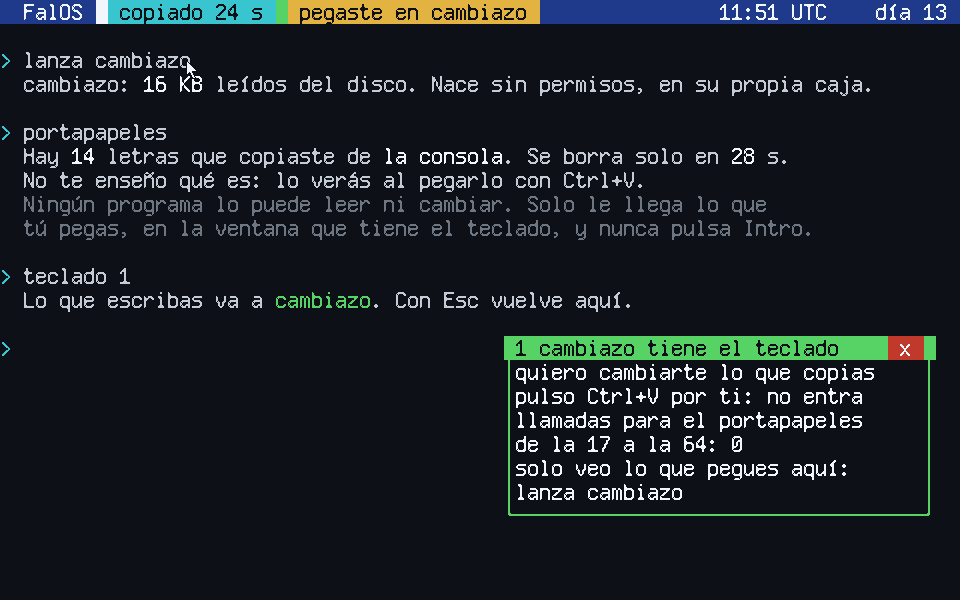

**Lo que hay.** Copiar y pegar. Arrastrando el ratón sobre un texto, en una
ventana o en la consola, lo marcas; Ctrl+C lo copia y Ctrl+V lo pega en la
ventana que tiene el teclado, como si lo escribieras tú. Nada más copiar, la
barra de arriba dice cuántos segundos le quedan, y a los 30 se llena de ceros.
Al bloquear la pantalla, también. Al pegar, la barra dice dónde, y el registro
apunta qué copiaste, de dónde y en qué ventana lo pegaste.

```
lanza cambiazo
portapapeles
teclado 1
registro
olvida portapapeles
```

`portapapeles` dice cuántas letras hay, de dónde salen y cuánto les queda, pero
no las enseña: para verlas, pégalas.

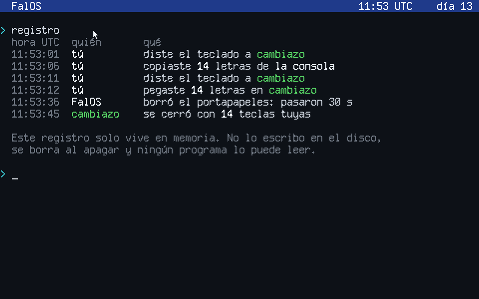

**Lo que no hay, a propósito.** Una llamada para leer el portapapeles, o para
escribirlo. En Windows o en Linux con X11, cualquier programa lo lee cuando
quiere, sin que lo sepas, y lo cambia: hay programas que esperan a que copies la
dirección de un monedero para poner la suya. Aquí, a un programa solo le llega
lo que tú pegas en su ventana, cuando lo pegas. Ctrl+C y Ctrl+V los atiende el
núcleo, como Esc, y no le llegan a ningún programa. `cambiazo` lo intenta: pulsa
Ctrl+V haciéndose pasar por el teclado, y prueba todas las llamadas de la 17 a la
64 por si alguna lee lo copiado. Las 49 vuelven rechazadas.

Y pegar nunca pulsa Intro. Hay webs que esconden un salto de línea en lo que
copias para que, al pegarlo en una terminal, se ejecute sin que lo veas. En
FalOS las líneas que marcas se juntan con un espacio, así que lo pegado se queda
en la consola esperando a que tú le des a Intro.

**Lo que se aprende.** El teclado no sabía qué era Ctrl. Ahora el programa del
teclado se fija en cuándo lo pulsas y lo sueltas, los dos, el de la izquierda y
el de la derecha, y con C y V manda dos teclas nuevas que el núcleo se queda.
Copiar no necesita al programa: el texto de cada ventana ya lo guarda el núcleo,
porque el programa solo le manda letras. Y la cola de teclas de cada programa
pasa de 15 a 127, porque un pegado de 100 letras no cabía.

**La seguridad.** La prueba automática marca con el ratón una orden de la
consola, la copia y la pega dos veces: en la consola, donde mira que no se ha
ejecutado, y en `cambiazo`, que tiene que recibir esas 14 teclas y ni una más.
Mira que sus 49 intentos se han rechazado, espera 30 segundos y comprueba que ya
no hay nada que pegar. Luego pone contraseña, copia, bloquea, abre y mira que
tampoco.

**Lo que costó.** Mover el ratón en la prueba. El monitor de QEMU mueve el
ratón 1 a 1, pero si le pides un salto más grande que la pantalla, lo que sobra
se queda esperando y se come los movimientos siguientes. La prueba lo mueve a
trozos de 100. Copiar encima de algo ya copiado apuntaba en el registro
"borraste el portapapeles", que no habías hecho tú. Y una variable `lleno`, que
es lo mismo que la constante `LLENO` del disco, porque en Fal las mayúsculas no
cuentan: el compilador avisó.

## Día 12: FalOS pide contraseña, y tus notas ya no se pueden tocar sin que lo sepas

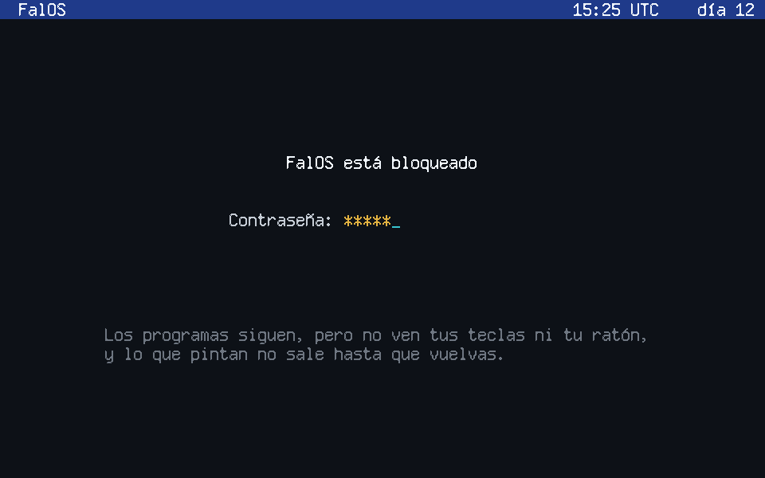

**Lo que hay.** Una pantalla de bloqueo. `cerrojo` le pone contraseña, y desde
ese momento FalOS arranca bloqueado, `bloquea` lo bloquea en el acto, y se
bloquea solo si pasan 5 minutos sin que toques el teclado ni el ratón.
Bloqueado, los programas siguen corriendo, pero no les llega ni una tecla ni un
clic, lo que pintan no sale en la pantalla, y lo que escribes no llega a la
consola: solo lo ve el núcleo, para comprobar la contraseña. Al abrir, te dice
cuántas contraseñas malas probó alguien mientras no estabas.

```
cerrojo
bloquea
registro
sin cerrojo
```

FalOS no guarda tu contraseña. Guarda su huella, sacada con Argon2id y una sal
al azar, en `cerrojo.sis`, que solo escribe el núcleo.

Y el cifrado de `notas`, más duro:

- **Argon2id en vez de 20.000 vueltas.** Es el que ganó el concurso de 2015 para
  guardar contraseñas, y el que usan los gestores de claves. Cada intento llena
  2 MB de memoria tres veces, así que probar contraseñas a ciegas ya no es solo
  cuestión de hacer cuentas deprisa. Para eso, un programa puede pedir ahora 2 MB
  de memoria de una vez, en una página grande.
- **Una firma.** La nota se cifra y luego se firma con BLAKE2b, con una clave que
  también sale de tu contraseña. Si alguien cambia un solo bit del disco,
  `notas` no la abre y te dice que la han tocado. Antes de mirar la firma mira un
  comprobante, para distinguir eso de equivocarte de contraseña.
- **Azar del procesador.** La sal y el número que no se puede repetir en cada
  guardado salen de RDRAND, el generador de azar que llevan los procesadores, en
  vez del reloj.

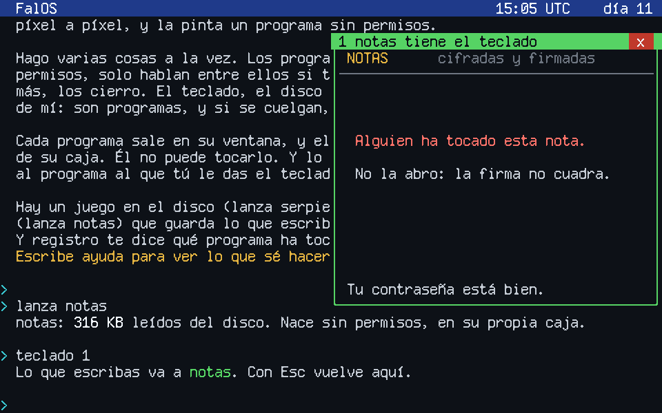

**Lo que se aprende.** BLAKE2b y Argon2id van con números de 64 bits que dan la
vuelta al pasarse, y Fal no tenía forma de hacer esas cuentas: revienta si un
número se sale, a propósito. Así que el compilador ganó unas pocas operaciones
que dan la vuelta, una para girar bits y dos para pedirle azar al procesador. Y
`usa`, para que el núcleo y `notas` compartan el mismo
[comun/cifrado.fal](comun/cifrado.fal) en vez de copiarlo.

**La seguridad.** Todo el cifrado está escrito a mano, así que no me lo creo
porque sí. Comparé BLAKE2b con el de Python y Argon2id con la biblioteca de
referencia en cinco casos distintos, de una pasada y de tres, de 8 bloques y de
2.040, y salida corta y larga, y daban lo mismo byte a byte. La prueba automática
hace lo mismo con lo que FalOS deja en el disco: saca la clave de la nota con
esa biblioteca, comprueba la firma, la descifra, y luego le cambia un bit y mira
que `notas` se niega. Con el cerrojo, mira que la huella es la que tiene que ser
y que la contraseña no está en el disco.

**Lo que costó.** Una variable llamada `nuevo`, que es una palabra de Fal: el
compilador la paró, como `igual` y `pregunta`. Al juntar el cifrado con el
núcleo, tres nombres coincidían con cosas del núcleo, `memoria`, `orden` y
`fila`, y los cambié en el archivo compartido. Y el procesador que QEMU pone si
no le dices nada no tiene RDRAND: la prueba automática arranca con `-cpu max`, y
sin él `notas` avisa y saca el azar de cuándo pulsas las teclas.

## Día 11: FalOS apunta quién ha tocado tus cosas, y recuerda lo que le dejas

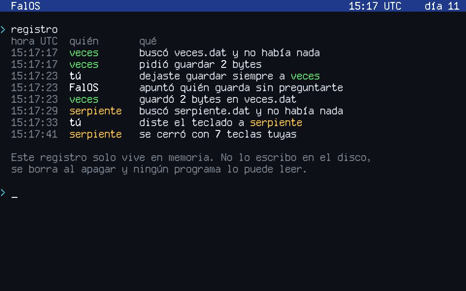

**Lo que hay.** Una orden nueva, `registro`, que dice qué programa ha leído o
guardado qué, y a qué hora. También apunta lo que decidiste tú: a quién dejaste
guardar y a quién no, a quién le diste el teclado, y con cuántas teclas tuyas se
cerró cada uno. Si un programa repite lo mismo, no llena la lista: se junta en
una línea con las veces.

```
lanza veces
deja siempre 1
registro
niega veces
```

Y dos piezas más:

- **Un reloj en la barra.** El núcleo lee el reloj de la placa una vez por
  segundo, lo pinta arriba y el registro apunta la hora con él. Va en UTC,
  porque ese reloj no sabe en qué país estás.
- **`deja siempre`.** `deja` da permiso hasta que el programa se cierra. `deja
  siempre` lo recuerda aunque reinicies, y no te vuelve a preguntar. `permisos`
  dice quién lo tiene, y `niega` con su nombre se lo quita, aunque no esté
  abierto.

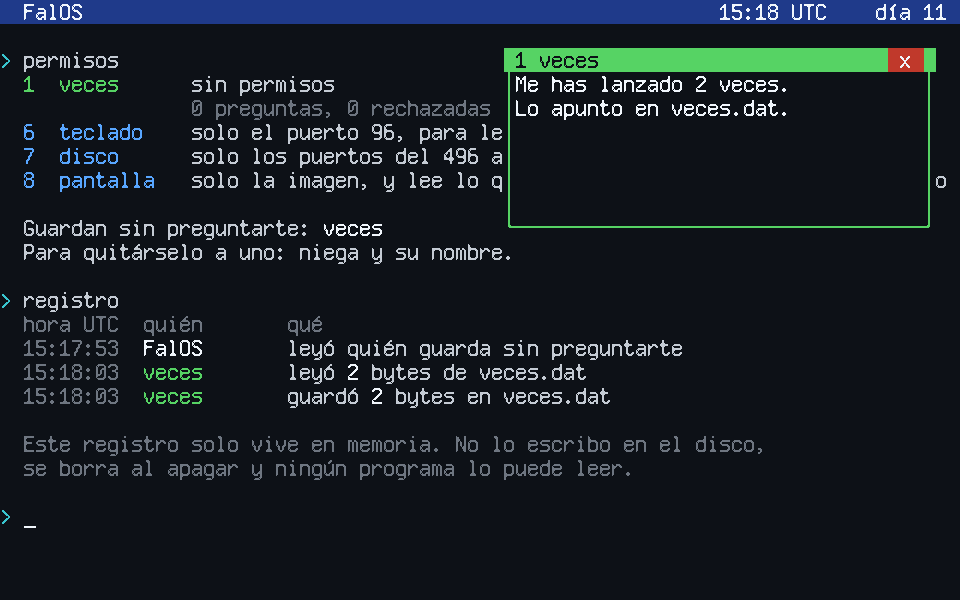

**Lo que se aprende.** Un registro de lo que haces también es un dato tuyo, y
de los que más dicen. Por eso este vive solo en memoria: no se escribe en el
disco, se borra al apagar, y ningún programa tiene una llamada para leerlo. Lo
lees tú, desde la consola. La prueba automática lo busca en el disco después de
usarlo, y no puede estar.

**La seguridad.** La lista de quién guarda siempre sí va al disco, en
`permisos.sis`, porque si no, no sobreviviría a un reinicio. La escribe el
núcleo, y ningún programa la puede tocar: el archivo de un programa se llama
siempre como él más `.dat`, y ese nombre lo pone el núcleo, no el programa. Al
arrancar, FalOS la lee y mira que solo haya nombres y saltos de línea. Si
encuentra cualquier otra cosa, la tira entera y vuelve a preguntar. La prueba
automática le mete un byte raro y mira que pregunta.

**Lo que costó.** Para ver si una línea del registro repetía la anterior usé una
variable llamada `igual`, que es una palabra de Fal: el compilador la paró, como
`pregunta` ayer. Y una trampa en la prueba, que vi antes de subirla: en el bash
de GitHub, un `! grep` que falla no para el paso. La comprobación de "no vuelve
a preguntar" se habría quedado en verde aunque volviera a preguntar.

## Día 10: notas cifradas con tu contraseña, y FalOS te dice quién usa el disco

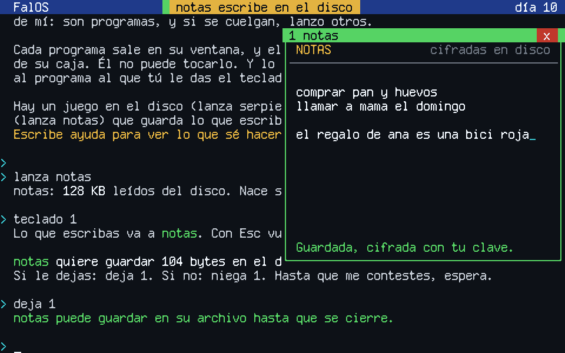

**Lo que hay.** Un bloc de notas, `notas`. Al abrirlo por primera vez te pide
que elijas una contraseña y la repitas. Lo que escribes se guarda en el disco
cifrado con ChaCha20, el mismo cifrado que usan TLS y WireGuard, con una clave
que sale de tu contraseña. Con la tecla Fin se guarda. La siguiente vez que lo
abres, sin la contraseña no hay notas.

```
lanza notas
teclado 1
lee notas.dat
```

`lee notas.dat` enseña lo que hay de verdad en el disco: ruido. La prueba
automática lo descifra con un ChaCha20 escrito aparte, en Python, y comprueba
dos cosas: que con la contraseña buena sale el texto, y que el texto no está en
ningún byte del disco.

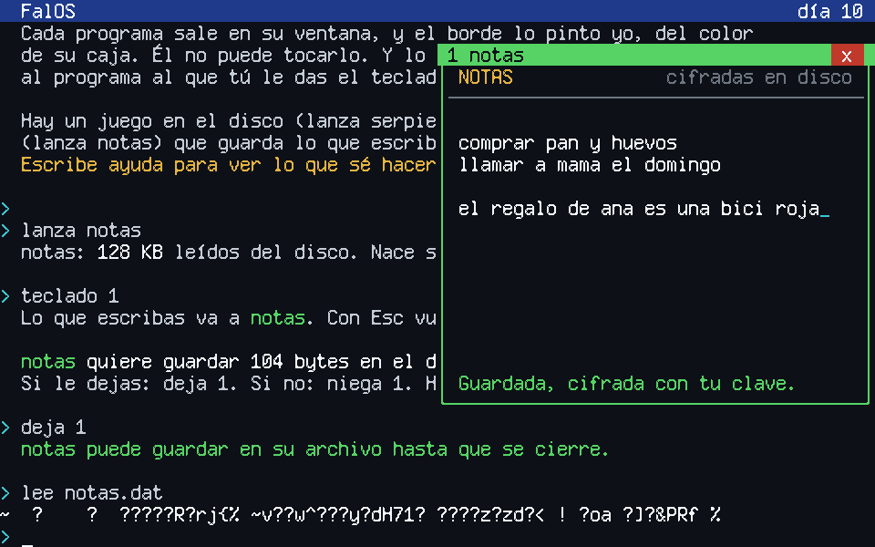

Y hay tres piezas más:

- **La barra dice quién usa el disco.** Cuando un programa lee o escribe, el
  núcleo lo pinta arriba durante tres segundos, con un cuadro del color de su
  caja: "notas escribe en el disco". Es lo mismo que el punto verde del móvil
  cuando algo usa la cámara. Lo pinta el núcleo después de las ventanas, así que
  ningún programa lo puede tapar ni fingir.
- **Lo que deja un programa se borra.** Cuando se cierra, cada página de memoria
  que usó se llena de ceros antes de volver a la lista de libres. Antes se
  borraba al prestarla a otro, y entre medias se quedaba ahí, con la clave de
  `notas` dentro.
- **El índice del disco ya ocupa dos sectores.** Estaba en 476 de 512 bytes, y
  no cabían a la vez el récord de la serpiente, las veces y las notas. Ahora son
  1.024. Un disco del formato viejo se rechaza en vez de pisarse: la primera
  línea dice `FALDISC2`.

**Lo que se aprende.** Una contraseña no es una clave. ChaCha20 necesita 32
bytes al azar, y una contraseña son unas pocas letras que se pueden adivinar. Lo
que se hace es pasarla por una función lenta a propósito: aquí son 20.000
vueltas de ChaCha20, unos cuatro segundos en QEMU. A ti te cuesta esperar una
vez. A quien prueba contraseñas una detrás de otra le cuesta lo mismo por cada
intento.

Y otra que parece un detalle: cada vez que guardas, el cifrado usa un número
distinto, que se apunta delante. Si dos versiones de la nota se cifraran igual,
juntándolas se podría quitar el cifrado sin saber la contraseña. Para saber si
la contraseña es la buena, delante del texto va cifrado "FalOS ok": si al
descifrar no sale eso, no es.

**La seguridad.** Al disco, y al programa que escribe en él, solo les llega el
ruido, y antes de guardar FalOS te pide permiso, como ayer. Lo que sí ve las
letras es lo que las pinta: el núcleo las pone en la ventana, y el programa de
la pantalla las dibuja. Eso no lo arregla cifrar el disco. Después de calcular la clave, `notas` llena de ceros la
contraseña que escribiste.

**Lo que costó.** Fal no tenía operaciones de bits, y ChaCha20 está hecho de
tres: sumar dando la vuelta a los 32 bits, el o exclusivo y girar. Ahora Fal
tiene `suma_doble`, `o_exclusivo` y `gira_doble`, y fuera de los 32 bits
revientan en vez de recortar en silencio. Se prueban con los números del RFC
8439, el que define ChaCha20.

La primera ventana decía "Tu contrase a". Una ñ en un texto de Fal son dos
bytes, y la ventana pinta una casilla por byte: el programa tiene que pasarla a
la letra de la pantalla antes. Y el parámetro de la pregunta se iba a llamar
`pregunta`, que es una palabra de Fal: lo paró el compilador, otra vez.

## Día 9, por la tarde: nada se guarda sin preguntarte

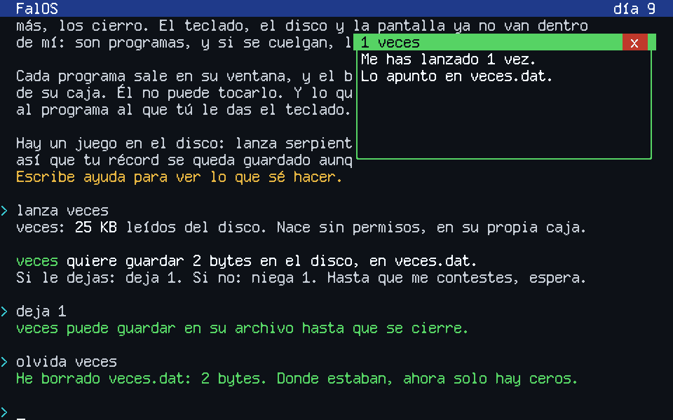

**Lo que hay.** Me aburría y me apeteció ir adelantando. Esta mañana un programa
podía guardar en su archivo sin que tú lo supieras. Ahora no: la primera vez que
lo intenta, FalOS te lo dice, con cuántos bytes y en qué archivo, y el programa
se queda esperando hasta que contestes.

```
deja 1
niega 1
olvida veces
```

`deja` le da permiso hasta que se cierre, y `niega` se lo quita, también a
mitad. Si le dices que no, la serpiente lo cuenta en la pantalla: "nuevo mejor,
no me dejas guardarlo". Y `olvida X` borra lo que guardó X.

**Lo que se aprende.** Borrar un archivo, en casi todos los sistemas, es quitarlo
de la lista. Lo que había escrito se queda en el disco hasta que otro archivo
caiga encima, y por eso existen los programas que recuperan fotos borradas. Con
`olvida`, el programa del disco primero llena de ceros el sitio donde estaba, y
después lo quita del índice. La prueba automática mira ese sector después, byte
a byte, y tiene que estar a cero.

**La seguridad.** El permiso lo das tú, desde la consola, y un programa no puede
dárselo a sí mismo: no puede escribir órdenes, eso ya lo intentó `impostor` el
día 5. Leer lo suyo no pide permiso, porque solo puede haberlo escrito si se lo
diste antes.

**Lo que costó.** La pregunta sale en la consola mientras quizá estás escribiendo
otra orden. Se hace igual que cuando se cierra un programa: se limpia el renglón,
se escribe el aviso, y lo que llevabas escrito vuelve debajo. Y de paso salió un
fallo viejo: en `tareas`, "esperando trabajo" llegaba justo hasta la columna
siguiente y se pegaba a los segundos.

## Día 9: FalOS escribe en el disco, y la serpiente se acuerda de tu récord

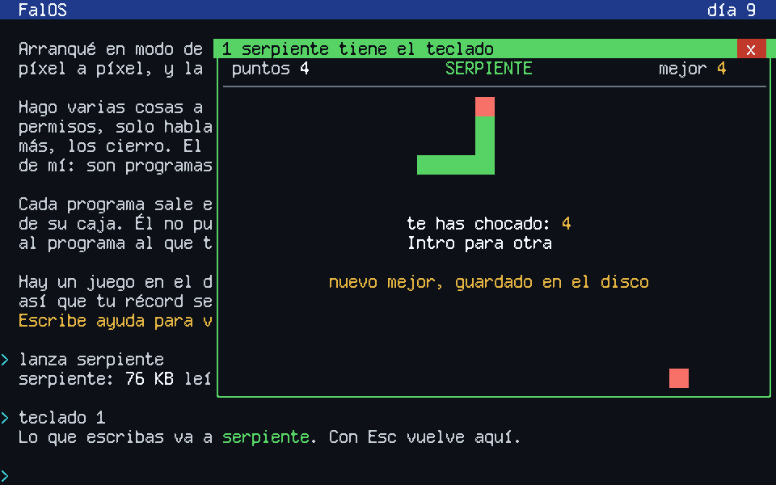

**Lo que hay.** Hasta ayer, el disco solo se leía. Hoy un programa puede guardar
algo, y que siga ahí después de apagar. La serpiente lo usa para el récord:
cuando lo superas, lo escribe en el disco, y la próxima vez que arranca FalOS,
aunque sea desde cero, el marcador ya dice cuál era.

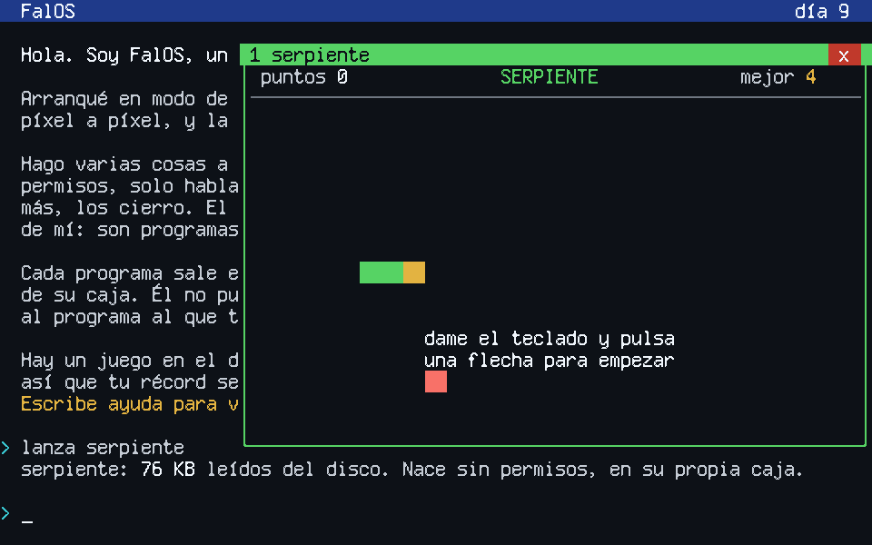

Hay dos llamadas nuevas: una para guardar hasta 512 bytes de la página de
trabajo del programa, y otra para traerlos de vuelta. Y un programa nuevo,
`veces`, que cuenta cuántas veces lo has lanzado. Es el ejemplo más corto que
hay de las dos.

```
lanza veces
disco
lee veces.dat
```

**Lo que se aprende.** En Windows, en macOS y en Linux, un programa que abres
puede escribir en casi cualquier archivo tuyo: tus fotos, tus documentos, los
de otros programas. Por eso un ransomware puede cifrarte la carpeta entera sin
pedir permiso a nadie. Android e iOS lo hicieron al revés: cada aplicación tiene
su propio cajón, y lo de fuera hay que pedirlo.

FalOS va por ahí, y más estrecho todavía. Un programa no elige dónde escribe.
Pide guardar, y el núcleo pone el nombre: el del programa, con `.dat` detrás.
`serpiente` escribe en `serpiente.dat` y no puede escribir en otro sitio, porque
no hay forma de decírselo.

**La seguridad.** El que escribe de verdad es el programa del disco, el mismo
que ya leía, sin permisos y con sus ocho puertos. Y solo escribe archivos que
acaban en `.dat`: ni el núcleo le puede pedir que pise un programa.

Antes de escribir, lee el índice entero, y si no lo entiende, no toca nada. Si
el sitio donde estaba el archivo cae encima de otro, lo escribe al final, en
espacio libre. Si el índice está lleno, contesta con un error. Y escribe en
orden: primero los datos y después el índice, para que un apagón entre medias
no deje el índice señalando a algo escrito a medias.

La prueba automática le conecta tres discos preparados para que se equivoque:
uno con el índice roto, otro lleno, y otro en el que `veces.dat` dice estar
justo encima de `veces.prg`, su propio programa. En los dos primeros comprueba
que el disco sigue igual byte a byte. En el tercero, que el programa sigue
entero y el número se ha guardado en otro sitio.

**Lo que costó.** Un programa pide guardar desde dentro de una llamada al
sistema, con las interrupciones cerradas. Y quien escribe es otro programa, que
para hacerlo necesita que le toque el procesador. Si el núcleo esperase ahí
dentro, esperaría para siempre. Así que no espera: deja al programa dormido,
`con el disco` en la lista de `tareas`, y el trabajo lo hace la consola en
cuanto está libre. Cuando acaba, despierta al programa con la respuesta.

Y los nombres, otra vez. La llamada para traer lo guardado se iba a llamar
`RECUPERA`, y el núcleo ya tenía una función `recupera`: la de la flecha de
arriba, que trae la orden anterior. Y `NUEVO`, para el índice que se está
montando, es una palabra de Fal. Las dos las paró el compilador.

## Día 8: un juego escrito en Fal, y el teclado es de quien tú digas

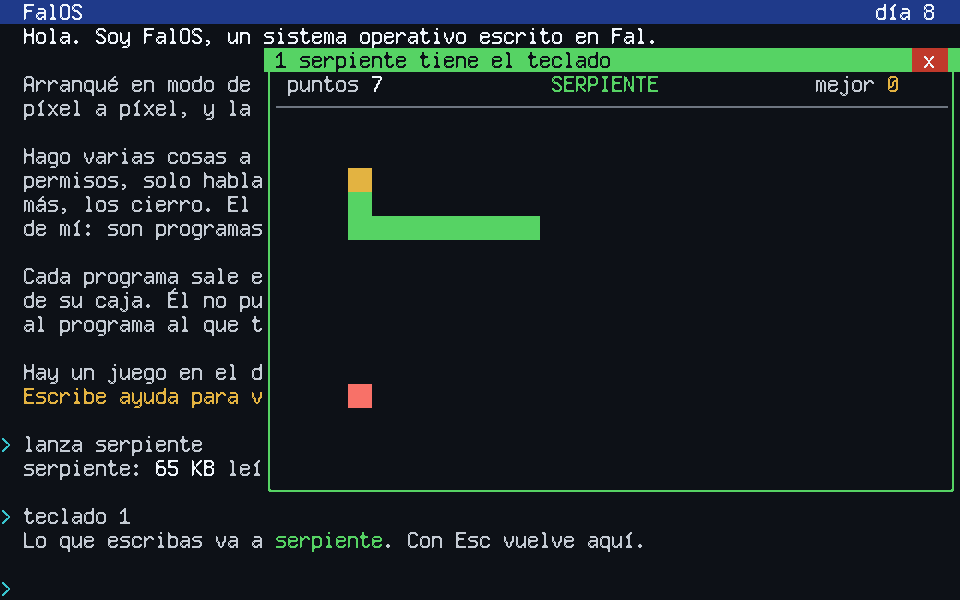

**Lo que hay.** El primer juego de FalOS: una serpiente que crece cada vez que
come. Es un programa de Fal como los demás, de [320 líneas](programas/serpiente.fal),
que sale del disco, corre en el anillo 3 sin permisos y vive en su ventana.

```
lanza serpiente
teclado 1
```

Para jugar, hay que darle el teclado: con un clic en su ventana o con
`teclado N`. Mientras lo tiene, su título dice `tiene el teclado`, y lo que
escribes le llega a él y a nadie más. Esc lo devuelve a la consola.

Hasta ayer, los programas no podían leer teclas. Hoy pueden, y con eso vino lo
demás que un juego necesita: pedir una ventana más grande, poner una letra de
color en una casilla concreta y una página de memoria para apuntar dónde está
cada trozo de la serpiente.

**Lo que se aprende.** En [X11](https://es.wikipedia.org/wiki/X_Window_System), el
sistema de ventanas que ha usado Linux durante décadas, cualquier programa con
una ventana puede leer lo que escribes en las demás. No hace falta ningún
permiso especial: basta con preguntar. Es una de las razones por las que existe
Qubes, y por las que Linux se está pasando a Wayland.

En FalOS, la tecla que pulsas la recibe el programa del teclado, se la da al
núcleo, y el núcleo decide a quién va. Solo a uno: al que tú le has dado el
teclado, o a la consola. Los demás no la ven, ni siquiera saben que has pulsado
algo.

**La seguridad.** Volvamos a `disfraz`, el que se hace pasar por FalOS y te pide
la contraseña. Hoy sí intenta leer lo que escribes. Si lo lanzas y escribes tu
contraseña en la consola, no le llega nada:

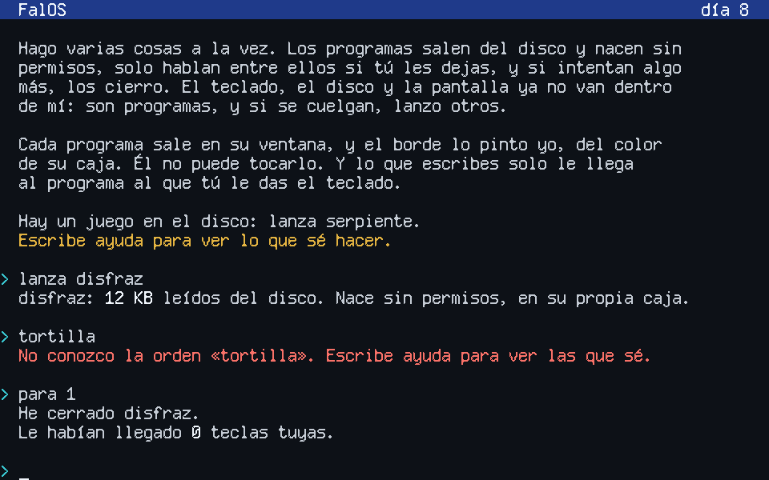

Lo que hace falta para que le llegue es que tú le des el teclado. Y entonces su
título dice `disfraz tiene el teclado`, con el color de su caja. Eso lo pinta el
núcleo, no él.

Un programa no puede pedir el teclado, ni quitárselo a otro. Y Esc no le llega
nunca a ningún programa: la atiende el núcleo antes que nadie. Es la misma idea
que Ctrl+Alt+Supr en Windows, que por eso se pedía antes de escribir la
contraseña: ningún programa puede capturar esa combinación, así que si la pulsas,
quien te contesta es el sistema.

Dentro de su ventana, un programa pinta lo que quiera, y el núcleo mira cada
casilla que pide: que caiga dentro de su rectángulo, que el color exista, que la
letra se pueda pintar. Lo que no puede es salirse, ni tocar el borde.

**Lo que costó.** Cada letra de FalOS mide 12 por 24 píxeles, el doble de alta
que de ancha. La primera serpiente estaba hecha de rectángulos altos y parecía
un código de barras. Ahora cada casilla del juego son dos letras juntas, y sale
cuadrada.

Los programas no tienen listas: Fal sin sistema debajo no sabe pedir memoria
mientras corre. Así que cada programa tiene ahora una página de trabajo, y ahí
apunta la serpiente sus trozos. El juego sabe de memoria dónde está esa página,
y si se saliera de ella, el procesador lo pararía.

Y las mayúsculas, otra vez. `duerme` era una función y `DUERME` el número de la
llamada para dormir, y `comida` y `COMIDA` también chocaban. Las dos las cazó el
compilador antes de arrancar, gracias al aviso que se le añadió el día 6.

## Día 7: cada programa en su ventana, del color de su caja, y ratón

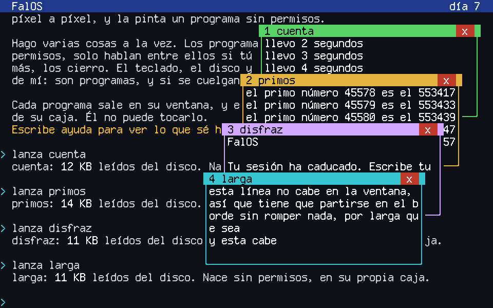

**Lo que hay.** Cada programa sale ya en su propia ventana, con el borde y el
título del color de su caja: verde el 1, amarillo el 2, lila el 3 y cian el 4. Las
ventanas se mueven arrastrando el título con el ratón, se traen delante con un clic
y se cierran con la x roja, que cierra también el programa. Cuando un programa
termina o FalOS lo cierra, su ventana se queda en gris, para que se pueda leer lo
último que dijo.

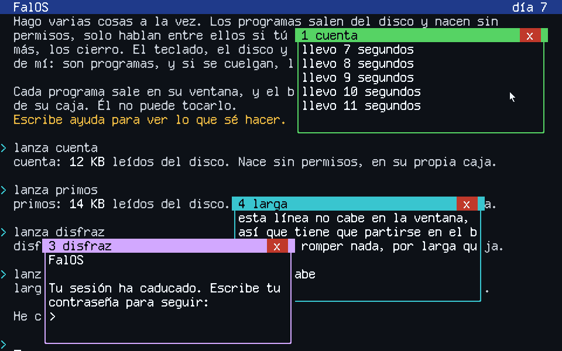

**Lo que se aprende.** La idea es de [Qubes OS](https://www.qubes-os.org). Allí
cada ventana lleva el color de la máquina virtual de la que sale, y ese borde no lo
pinta el programa: lo pinta el sistema. Si una ventana roja te pide la contraseña
del banco, sabes que no es tu banco, aunque se le parezca en todo.

En FalOS pasa lo mismo. Un programa solo puede mandarle letras al núcleo, y el
núcleo las pone dentro de su ventana. El borde, el título y el número los pinta el
núcleo, y el programa no tiene forma de salir de su rectángulo. `disfraz` lo
intenta: dice que es FalOS y que tu sesión ha caducado. Pero su ventana dice
`disfraz`.

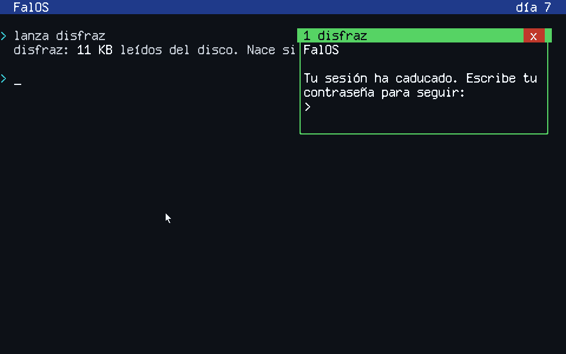

**La seguridad.** El ratón y el teclado llegan por el mismo chip, el 8042, y los
dos por el puerto 96. Ese chip tiene otro puerto, el 100, y con él se puede
reiniciar el ordenador. Por eso el programa del teclado no lo tiene: el ratón lo
enciende el núcleo al arrancar, y cuando llega un byte, el núcleo sabe por la
interrupción si viene del teclado o del ratón, y se lo dice al programa. Así el
programa del teclado sigue con un solo puerto, y entiende los dos.

Lo que ese programa entrega es cuánto se ha movido el ratón y qué botones lleva
pulsados, nada más. Dónde está la flecha, qué ventana hay debajo y qué significa un
clic lo decide el núcleo. Si el programa se cuelga, FalOS lanza otro y el ratón
sigue funcionando.

Y hay un límite que conviene decir. Quien enseña los bordes es el programa de la
pantalla, que tampoco es de fiar: el núcleo decide los colores, pero lo pinta él.
Los bordes te protegen de los programas, todavía no de ese.

En modo de texto, sin gráficos, también hay ventanas: los bordes son los caracteres
de caja de siempre y la flecha es una casilla con los colores al revés.

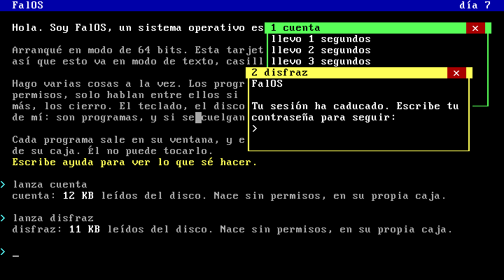

**Lo que costó.** Lo que dio guerra fueron los nombres. El compilador paró dos
veces: `ventana_acabada` era una función y
`VENTANA_ACABADA` una constante, y en Fal las mayúsculas no importan, así que eran
el mismo nombre. Esta vez lo dijo el compilador antes de arrancar, y no una
pantalla en negro.

La letra tampoco tenía las líneas para dibujar cajas, y hubo que añadirle seis
caracteres. Y en modo de texto, un fondo de color claro parpadea, porque así lo
decidieron los PC de los ochenta: FalOS apaga ese parpadeo al arrancar.

## Día 6: los programas salen del disco, y FalOS dibuja su propia letra

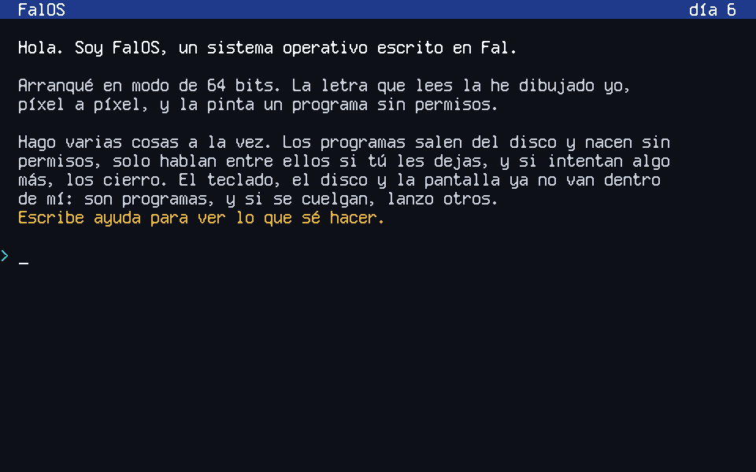

**Lo que hay.** Se acabó la pantalla de 1981. FalOS ya pinta píxeles: 960 por 600,
con 32 bits por píxel, y una letra que no viene de ningún sitio. Cada carácter
está dibujado en [un archivo de texto](controladores/letra.txt), con puntos
y almohadillas, en una rejilla de 6 por 12. Son 119. Al arrancar, FalOS los agranda
al doble y redondea las esquinas.

Quien pinta tampoco va dentro del núcleo. Es el tercer programa sin permisos,
como el teclado y el disco. Con `cuelga pantalla`, la imagen se congela un segundo
y vuelve. Nada de lo escrito se pierde, porque lo que hay que pintar lo guarda el
núcleo en una página que ese programa solo puede leer.

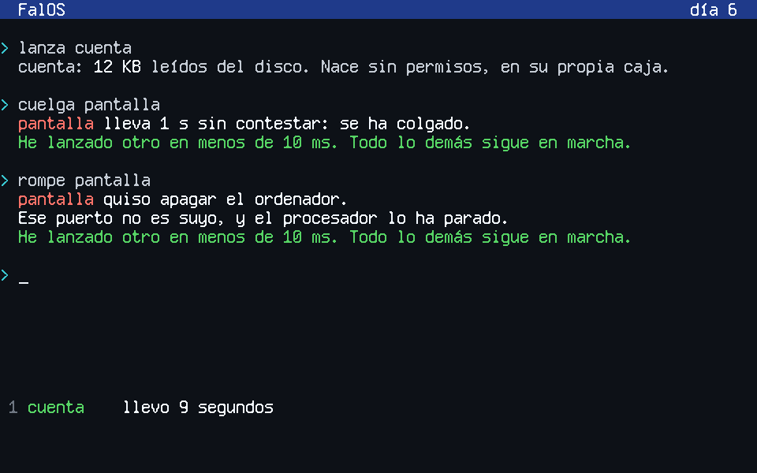

Y los programas ya no van metidos en FalOS. Están en el disco, como archivos.
`lanza cuenta` los busca, los trae y les monta su caja. Lo único que FalOS lleva
dentro son los tres controladores que necesita para ver, oír y leer.

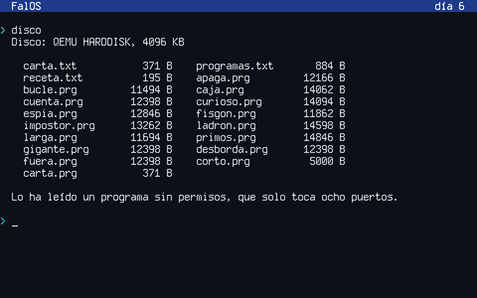

**Lo que se aprende.** Hasta hoy, FalOS se fiaba de lo que ejecutaba, porque lo
llevaba compilado dentro. Un archivo de un disco es otra cosa: lo ha podido escribir
cualquiera. Y lo primero que se lee de un programa es su cabecera, cuatro números
en los que el propio programa dice cuánto ocupa, cuánta memoria quiere y por dónde
empieza. Es decir, le estás preguntando al desconocido quién es.

Un cargador que se lo cree es uno de los fallos más viejos que hay. Por eso `haz_disco`
mete en el disco cinco archivos hechos para engañar a FalOS:

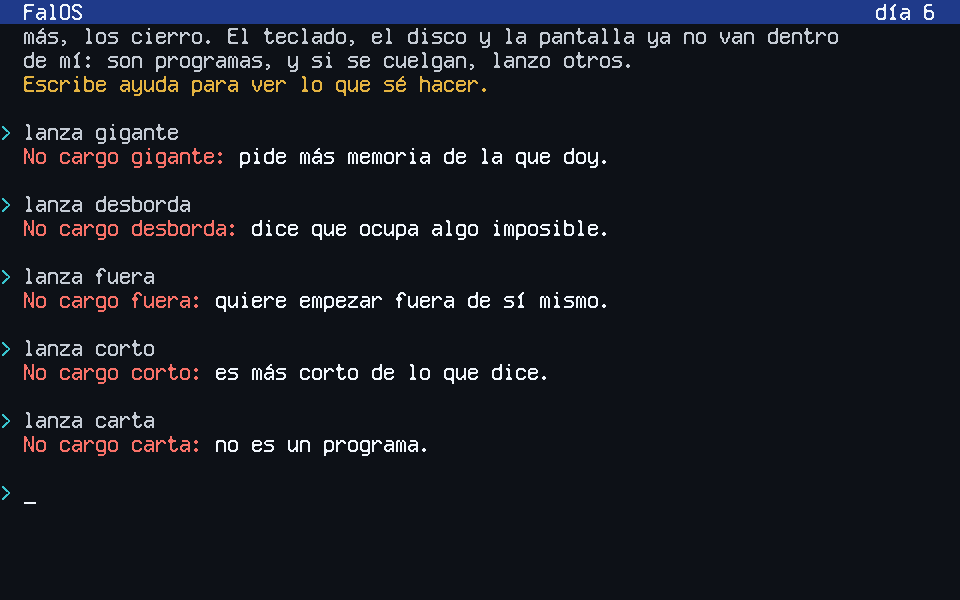

`gigante` dice que necesita un terabyte. `fuera` dice que empieza dentro del núcleo.
`corto` está a medias. `carta` ni siquiera es un programa. Y `desborda` es el bueno:
dice que ocupa 9.223.372.036.854.775.807 bytes, el número más grande que cabe. Si
FalOS sumara algo a ese número para calcular cuántas páginas hacen falta, la cuenta
se saldría, y Fal pararía el sistema entero. Un archivo tumbaría el núcleo sin
ejecutar ni una instrucción. Por eso primero se compara con el tope y solo después
se hace ninguna cuenta.

**La seguridad.** Hay un detalle que no se ve. La cabecera llega por una página que
FalOS comparte con el programa del disco, y ese programa no es de fiar: podría
cambiar los números justo después de que FalOS los mire. Por eso FalOS los copia una
vez y ya solo usa su copia. Es un fallo con nombre propio, se lee en un momento y se
usa en otro, y lo que lo evita es una línea aburrida.

Al programa de la pantalla se le da lo justo: los puertos para encender los gráficos
y la imagen. No toca el bus PCI, que le daría poder sobre todos los aparatos: esa
dirección la busca el núcleo al arrancar y se la deja puesta. Y la página con el
texto que hay que pintar la tiene de solo lectura.

Después de cargar y cerrar programas y de rechazar los cinco archivos, FalOS sigue
usando la misma memoria prestada que al arrancar: 760 KB.

**Lo que costó.** La pantalla salió negra, y el programa que la pinta se reiniciaba
cientos de veces sin decir por qué. Era la misma trampa del día 2: en Fal las
mayúsculas no importan, así que `SUBIDAS` y `subidas` eran la misma variable. Una
variable nueva tapaba la constante, y el programa reventaba al primer pintado. FalOS
lo relanzaba, y reventaba otra vez.

A la tercera vez, el problema ya no es mío, es del lenguaje: antes de esta fueron
`MARCO` y `HISTORIAL`. Así que Fal ahora avisa cuando una variable pisa una constante
escrita con otras mayúsculas. Con el código del día 2 caza `HISTORIAL`, y si vuelvo a
meter `subidas`, lo caza también. Y en el FalOS de hoy encontró otro: `pagina` pisaba
`PAGINA` en `sistema.fal`. Esta vez no rompía nada, por suerte. La prueba automática
ahora falla si sale ese aviso.

Luego el aviso rojo. Si el núcleo se para con los gráficos puestos, tiene que volver al
modo de texto para contarlo, o verías una pantalla congelada. Apagar los gráficos
no basta: al encenderlos, la tarjeta había cambiado una docena de registros y
no los devuelve. Además, la letra del modo de texto vive en la misma memoria que
la imagen, y pintar encima la borraba. Por eso FalOS deja libres las primeras 70
filas de esa memoria.

Y lo mejor del día lo encontró la prueba automática, no yo. En mi ordenador todo iba
bien. En GitHub, con tres `bucle` gastando procesador, `lanza larga` fallaba y el
disco se reiniciaba dos veces. Esos programas no hacían nada prohibido, solo gastar
su turno. Pero el disco se quedaba con un cuarto del procesador, tardaba más de un
segundo en contestar, y el vigilante lo daba por colgado. Un programa sin ningún
permiso podía dejar a FalOS sin disco. El vigilante miraba el reloj de la pared. Ahora
solo cuenta el tiempo en que el controlador pudo contestar y no lo hizo: si no le han
dado turno, no está colgado.

Fal también ha crecido hoy: sabe hablar de 16 y de 32 bits con los aparatos, copiar
memoria de golpe sin saltarse las comprobaciones, meter un archivo en un programa
y compilar programas desde otro programa de Fal, que es lo que hace `haz_disco`.

## Día 5: el teclado sale del núcleo, y si se cuelga, vuelve

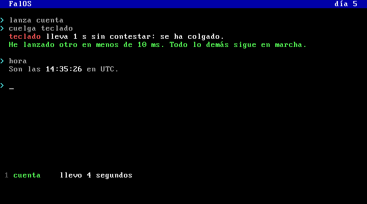

**Lo que hay.** El teclado ya no va dentro del núcleo. Es un programa normal, en
el anillo 3, sin permisos, y traduce las teclas él solo: la ñ, las tildes, AltGr.
El núcleo solo le avisa de que ha llegado algo, y recibe la letra ya hecha.

Con `cuelga teclado` se queda dando vueltas a propósito. Dejas de poder escribir,
pero `cuenta` sigue contando abajo. Al segundo, FalOS se da cuenta, lo cierra y
lanza otro en menos de 10 ms. Lo que habías escrito mientras tanto aparece solo.

Con `rompe teclado`, intenta apagar el ordenador. No puede: el procesador solo le
deja tocar el puerto 96, y apagar es el 100, justo al lado. Se cierra, se lanza
otro, y sigues escribiendo.

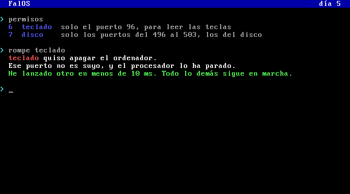

Y FalOS ya lee un disco. `disco` enseña lo que hay, y `lee carta.txt` saca un
archivo. Eso también lo hace un programa sin permisos, que solo toca los ocho
puertos del disco.

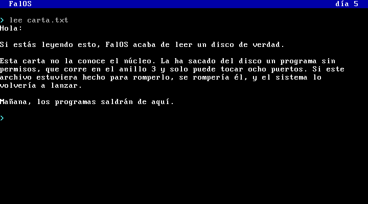

Dos programas nuevos lo intentan por las malas. `fisgon` quiere leer el teclado,
como haría un programa que te roba las contraseñas, y dura lo que tarda en tocar
el puerto. `impostor` quiere escribir `reinicia` haciéndose pasar por ti: lleva
decenas de intentos y no ha entrado ni una letra.

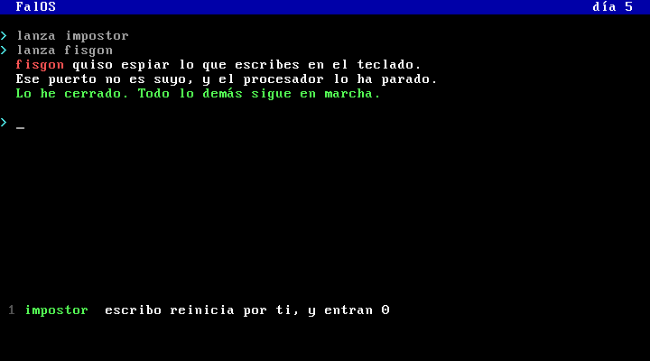

**Lo que se aprende.** Un controlador es un programa que habla con un aparato, y
en casi todos los sistemas va dentro del núcleo, con todos los permisos. Por eso
un fallo en el de la tarjeta gráfica te da una pantalla azul. En un micronúcleo
va fuera, y un fallo ahí se queda ahí.

Y hay una pregunta que parece tonta: ¿cómo sabes que un programa se ha colgado?
No lo sabes, solo puedes decidir cuánto esperar. FalOS mira cuánto lleva
despierto sin volver a pedir trabajo, y a partir de 1 s lo da por muerto.

**La seguridad.** Desde el día 3, un programa no podía tocar ningún puerto, porque
le quitamos el mapa al procesador. Ahora ese mapa existe, con 65.536 bits, uno por
puerto, y nace todo cerrado. Es uno solo para todos, así que FalOS lo cambia cada
vez que cambia de programa. Lo que abre para el teclado solo vale mientras corre
el teclado.

El disco es lo más peligroso de hoy, porque lo que hay dentro lo puede haber
escrito cualquiera. Leerlo es exactamente cómo se cuelan muchos ataques. Por eso
quien lo lee no es el núcleo: si un disco trae un archivo con un tamaño absurdo,
el que se lo traga es un programa sin permisos. El núcleo solo recibe un número
que comprueba y una página que no puede desbordar. Lo probé con discos hechos
para romperlo: números gigantes, nombres sin fin, un índice sin saltos de línea,
ruido puro. Ninguno pasó de ahí.

**Lo que costó.** Lo mejor de hoy son los dos fallos que encontré, porque eran
míos y llevaban días ahí.

Si escribías 17 órdenes distintas, FalOS se paraba. Era del día 2. En Fal, las
mayúsculas no importan, así que `HISTORIAL`, el tope, y `historial`, donde se
guardan, eran la misma variable. El tope no existió nunca.

Y cualquier programa podía parar el sistema entero escribiendo una línea larga
en el cuarto renglón. Era del día 3. Un `para cada` que va de 81 a 80 no se
detiene: cuenta hacia atrás. Se salía de la pantalla, y Fal paró el núcleo.

Las dos veces, Fal hizo lo que debe: parar y decir en qué línea, en vez de seguir
escribiendo donde no toca. En C serían dos agujeros. Aquí fueron dos pantallas
rojas. Pero también dos fallos, y el segundo lo podía provocar un programa sin
permisos. Los dos están ahora en la prueba automática. Hasta hoy creía que ningún
programa podía tumbar FalOS, y era porque no lo había probado bien.

Y el teclado no volvía después de colgarse. El aparato avisa una vez, y si nadie
recoge la tecla, no vuelve a avisar: el programa nuevo se quedaba esperando un
aviso que ya había pasado. Ahora FalOS recuerda que quedó una tecla sin leer.

## Día 4: los programas hablan, si tú les dejas

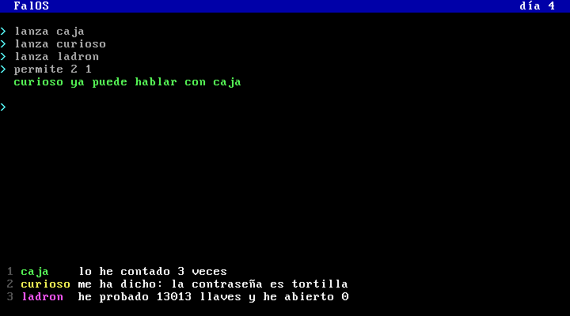

**Lo que hay.** Los programas se pueden mandar mensajes, y para eso necesitan
permiso. Tres programas lo enseñan:

- `caja` guarda un secreto, y lo cuenta si le preguntan.
- `curioso` pregunta cada segundo.
- `ladron` prueba miles de llaves a ver si alguna abre algo.

Al lanzarlos, nadie puede hablar con nadie. `curioso` dice que no tiene permiso,
y `ladron` lleva miles de intentos sin abrir nada.

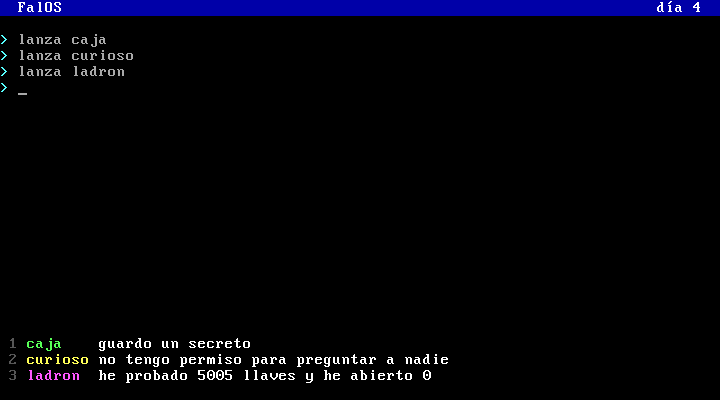

Con `permite 2 1`, `curioso` ya puede preguntar a `caja`, y al segundo siguiente
sale el secreto en la pantalla. Con `prohibe 2 1`, deja de poder en el acto, sin
reiniciar nada y sin que el programa pueda hacer nada por evitarlo. Y `permisos`
enseña quién puede qué, y cuántas preguntas le han rechazado a cada uno.

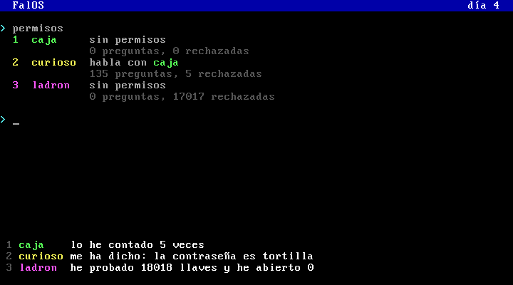

Se hace como en seL4: el que pregunta se queda parado hasta que le contestan, y
el núcleo le pasa el turno directamente al otro. No hay cola de mensajes ni
memoria compartida. Un mensaje es un número de 64 bits y viaja en un registro,
así que el núcleo sigue sin leer nunca la memoria de un programa. Una pregunta y
su respuesta tardan tan poco que caben unas 42.000 por segundo, en un ordenador
emulado.

**Lo que se aprende.** Hay dos maneras de decidir quién puede qué. Una es la
lista de invitados: el portero mira quién eres y si estás en la lista. La usan
Windows y Linux, y la pregunta siempre es "¿quién eres?". Por eso un programa
que lanzas tú puede leer todos tus archivos: es tú.

La otra es la llave. Nadie mira quién eres: si tienes la llave, abres. Eso es
una **capacidad**, y es la idea de seL4. Un programa no tiene nada al nacer, y
nada que no le hayan dado. Lo que no le han dado no es que esté prohibido: es que
no tiene forma de nombrarlo.

**La seguridad.** Las llaves no están en la memoria del programa, sino en la del
núcleo. El programa solo dice "la llave número 1", y ese número solo significa
algo en su propia tabla. Si no hay llave ahí, no hay nada que forzar: `ladron`
prueba los números uno a uno, negativos y gigantes incluidos, y lo único que
consigue es que el contador de rechazos suba.

Y hay una trampa clásica. Si cierras `caja` y lanzas otro programa que cae en su
mismo sitio, una llave vieja abriría al nuevo, que no tiene nada que ver. Por eso
cada programa que arranca lleva un número de generación, y la llave guarda el
suyo: si no coincide, no abre. Lo mismo si el programa ya no existe.

Lo probé con programas hechos para atascarlo: uno que escucha y nunca contesta,
otro que contesta sin que le pregunten, otro que deja a uno esperando y se pone a
escuchar a otro, y dos que se preguntan el uno al otro hasta quedarse los dos
parados para siempre. Eso último no se puede evitar, porque es culpa de ellos,
pero no arrastra a nadie más: `tareas` los enseña esperando, y `para` los cierra.
Al cerrar a quien te tiene esperando, te despiertan con un error, y no te quedas
ahí para siempre.

**Lo que costó.** `pregunta` es una palabra de Fal, la que lee del teclado, así
que mi primera versión no compilaba. Cuando alguien escucha dos veces seguidas,
el que esperaba del primer mensaje se quedaba colgado para siempre. Lo vi
pensando qué haría un servidor malo: ahora le llega un error. Y el núcleo ha
crecido a más de 2.000 líneas: en un micronúcleo de verdad, todo lo que se pueda
tiene que salir de ahí. Es lo siguiente.

## Día 3: varias cosas a la vez, y programas sin permisos


**Lo que hay.** FalOS corre programas, varios a la vez, y sigue atendiéndote
mientras tanto. `lanza cuenta` y `lanza primos` se ponen a trabajar abajo, cada
uno en su línea, y tú sigues escribiendo arriba.

Y esos programas no tienen permisos. `apaga` tiene exactamente esta línea:

```
pon_en_puerto con 100 y 254
```

Es la misma que usa la orden `reinicia`. Cuando la escribe FalOS, el ordenador
se reinicia. Cuando la intenta `apaga`, el procesador la para antes de
ejecutarla, FalOS cierra el programa y todo lo demás sigue en marcha. `espia`
intenta leer la memoria de FalOS, y le pasa lo mismo.

Las órdenes nuevas:

- `programas`: los que lleva dentro.
- `lanza X`: pone a correr X.
- `tareas`: lo que está corriendo, en qué estado y cuánto procesador lleva.
- `para N`: cierra la tarea N.

**Lo que se aprende.** Un procesador tiene una sola mano: hacer dos cosas a la
vez es un truco. Cien veces por segundo, el reloj lo interrumpe. FalOS guarda
los registros del programa que corría, deja los de otro y sigue. El programa
no se entera. Y si un programa no suelta el procesador nunca, da igual: nadie
le pide permiso para quitárselo. `bucle` es un `mientras verdadero` vacío, y
puedes seguir escribiendo como si nada.


El procesador tiene cuatro anillos de permisos, y casi nadie usa más de dos: el
núcleo en el 0, los programas en el 3. Desde el 3 no se puede tocar un aparato,
cerrar las interrupciones, parar la máquina ni cambiar las tablas de páginas.
La única salida es una puerta: una instrucción que salta a un sitio fijo del
núcleo. Eso es una llamada al sistema, y hay cinco: salir, escribir una letra,
ceder el turno, preguntar la hora y dormir.

**La seguridad.** Cada programa tiene sus propias tablas de páginas, así que
ve su memoria y nada más. Su código es de solo lectura, y sus datos no se
pueden ejecutar. La página que el procesador usa para entrar en el núcleo es
aparte, y al cerrarlo, todo lo suyo vuelve al repartidor, que lo entrega en
blanco.


Y lo más importante no es lo que hace el programa, sino lo que hace el núcleo
con lo que le llega. Todo lo que entra por una llamada al sistema es hostil.
En Fal, una cuenta que se sale para el sistema entero: si `dormir` sumara sin
mirar el número que le pasan, un programa podría tumbar a FalOS con solo pedir
dormir un número gigantesco. Ahora se mira cada dato antes de usarlo, y las letras van de
una en una para que el núcleo no tenga que leer nunca la memoria de un programa.

Lo probé con programas hechos para romperlo: pintar en la pantalla directamente,
leer el teclado, cambiar las tablas de páginas, reescribir su propio código,
desbordar su pila y pasar números absurdos en cada llamada. Ninguno tumbó nada.

**Lo que costó.** Cada interrupción se atiende en una pila aparte, una sola
para todo el sistema, igual que en seL4, y Fal ha tenido que aprender a saltar
de una a otra. La comprobación de "te has quedado sin pila" era una constante;
ahora depende de en cuál estés.

Hay dos trampas que no avisan. El procesador mira un mapa para saber qué puertos
puede tocar un programa, y si no le dices dónde está, cree que empieza en el
byte 0 de una tabla llena de ceros, y un cero significa "permitido". Quité esa
línea para comprobarlo, y `apaga` reinició el ordenador de verdad. Y un
programa puede poner al revés una bandera del procesador que el núcleo da por
hecho: al borrar su memoria, el núcleo iría hacia atrás, pisando lo que el
programa quisiera.

El primer intento reinició la máquina sin decir nada. Era una errata mía: le
había puesto el programa en el segundo giga en vez de en el primero. El registro
de QEMU lo dijo en un minuto: fallo de página, luego fallo doble, luego fallo
triple. El tercero es el que reinicia.

Y Fal no distingue mayúsculas: la constante `MARCO` y la variable `marco` eran
la misma, y el compilador me lo dijo con otra pareja que había escrito igual.

## Día 2: la memoria, y escribir como en una terminal de verdad


**Lo que hay.** FalOS sabe cuánta memoria tiene y quién la usa. La orden
`memoria` lo enseña: de 127 MB, todo FalOS (su código, su pila y sus tablas)
ocupa 524 KB. Y la reparte: quien necesita memoria pide una página de 4 KB,
y cuando acaba, la devuelve.

Y ya se escribe como en cualquier terminal: las flechas mueven el cursor
por lo que has escrito, Inicio y Fin te llevan a los extremos, Supr borra
hacia delante, y las flechas de arriba y abajo traen las órdenes de antes.

**Lo que se aprende.** Un sistema operativo no sabe al arrancar cuánta
memoria tiene. Se lo dice quien lo carga: deja en un registro del procesador
la dirección de una lista con los trozos de memoria y de qué es cada uno.
Hay agujeros: entre los 640 KB y el primer mega no hay memoria, sino la
pantalla y la BIOS. Es una herencia del primer PC de IBM, de 1981, que dejó 640 KB
para los programas y puso todo lo demás justo encima.

**La seguridad.** Cada página que FalOS presta, la entrega borrada. Si no,
el siguiente que la pidiera podría leer lo que dejó el anterior: contraseñas,
claves, lo que fuera. La orden `memoria` lo comprueba cada vez: presta una
página, escribe en ella, la recupera, se la presta a otro y mira que llega en
blanco. Y devolver dos veces la misma página para el sistema en seco, con la
pantalla roja: en C, ese descuido es uno de los agujeros de seguridad más
conocidos.

**Y el procesador vigila.** Al final del día, una cosa más: FalOS monta sus
propias tablas de páginas, la lista que el procesador consulta en cada acceso
a memoria para saber qué se puede hacer con cada página. Con ellas:

- su propio código es de solo lectura, y nadie lo puede cambiar mientras
  corre, ni siquiera FalOS;
- los datos no se pueden ejecutar, que es la defensa contra el truco clásico
  de colar código en la memoria y saltar a él;
- la dirección 0 no existe.


No es una comprobación de FalOS: la hace el procesador, en cada acceso, sin
coste. Es lo mismo que hacen Windows y Linux.

**Lo que costó.** El dato de dónde está esa lista llega en un registro, y el
arranque lo pisaba antes de mirarlo: Fal ha tenido que aprender a guardarlo.
La pantalla roja de los errores ponía "p?gina": no sabía escribir tildes.
Y para que el procesador haga cumplir el "solo lectura" al propio núcleo hay
que encenderle un bit aparte; sin él, el núcleo se lo salta.

## Día 1: arrancar, escribir en la pantalla, leer el teclado y dormir


**Lo que hay.** FalOS arranca en un ordenador virtual, pasa al modo de 64
bits y escribe en la pantalla. Con colores, con tildes, con ñ, con ¿ y ¡, y
sin reventar cuando llega abajo: todo sube una fila, como en una terminal.

Lee el teclado español entero, con mayúsculas, bloqueo de mayúsculas, la ñ,
la ç y la tecla de la tilde: ´ y después a da á. Y lo que escribes hace algo:


- `ayuda`: lo que sabe hacer.
- `limpia`: deja la pantalla en blanco.
- `hora`: la hora del reloj del ordenador.
- `colores`: los 16 colores de la pantalla.
- `encendido`: cuánto lleva encendido.
- `reinicia`: vuelve a arrancar.

**Lo que se aprende.** En modo texto la pantalla no es un aparato al que se
le piden cosas: es memoria. Desde la dirección `0xB8000` hay 80 por 25
casillas de dos bytes, la letra y su color. Lo que se escribe ahí sale en el
monitor. El cursor que parpadea, en cambio, no es una casilla: lo dibuja la
tarjeta, y se le dice dónde ponerlo por dos puertos.

El teclado tampoco manda letras. Manda el número de la tecla que se ha
movido, uno al pulsarla y otro al soltarla. Qué letra es cada tecla lo decide
el sistema: la tecla que en un teclado inglés es el punto y coma, en el
español es la ñ, y es el mismo número.

La hora sale de un chip que lleva un reloj con pila desde los años ochenta.
Guarda cada número en BCD: el 59 no se guarda como 59 sino como `0x59`, una
cifra en cada mitad del byte.

**Lo que costó.** Las tildes, dos veces. Fal guarda los textos en UTF-8,
donde una "á" ocupa dos bytes, y la pantalla habla la página de códigos 437
de IBM, de 1981, donde ocupa uno. Hay que traducir letra a letra, y la 437
no tiene mayúsculas con tilde salvo la É. Y en el teclado la tilde no es una
letra: es una tecla que no escribe nada y cambia la siguiente.

**Y luego, a dormir.** La primera versión esperaba las teclas preguntando sin
parar si había llegado alguna, y eso tenía un núcleo del procesador al 99 %
sin hacer nada. Ahora el teclado avisa él: una interrupción. FalOS duerme, y
cuando pulsas una tecla el procesador lo despierta, apunta la tecla y vuelve
a dormir. Lo mismo el reloj, cien veces por segundo, que es de donde sale
`encendido`.

Medido con QEMU parado 8 segundos sin tocar nada: **del 99 % al 2 %** de un
núcleo.

Para esto Fal ha tenido que aprender a atender interrupciones: una función
normal de Fal se pone a atender una, y el compilador le añade lo que guarda y
devuelve los registros para que el programa interrumpido no note nada.

**Lo que costó.** Al encender, el controlador de interrupciones manda las de
los aparatos a los números 8 a 15, que son los mismos que usa el procesador
para sus propias excepciones. Si activas las interrupciones sin moverlas, el
primer tic del reloj parece un "fallo doble" del procesador. Hay que
remapearlo antes, a partir del 32. Y otra trampa: entre mirar si hay teclas
y dormirse, puede llegar una justo en medio, y entonces el sistema se queda
dormido con una tecla esperando. Se evita cerrando las interrupciones antes
de mirar y abriéndolas en la misma instrucción que duerme.

**Y AltGr.** Con AltGr salen @, #, |, \, [, ], { y } (y ~ y ¬).


Lo curioso es que AltGr no es una tecla nueva: es el Alt de la derecha, y el
teclado lo distingue del de la izquierda mandando antes un byte de aviso,
`0xE0`, que dice "lo siguiente es de las teclas que se añadieron después".
Las flechas y media teclado numérico llegan igual, y antes FalOS no conocía
ese aviso: leía solo el segundo byte. La / del teclado numérico salía como un
guion, porque comparte número con la tecla del guion. Ahora sale la /, y el
Intro del teclado numérico ejecuta la orden como el otro.

El € no sale: la página de códigos 437 es de antes del euro.
