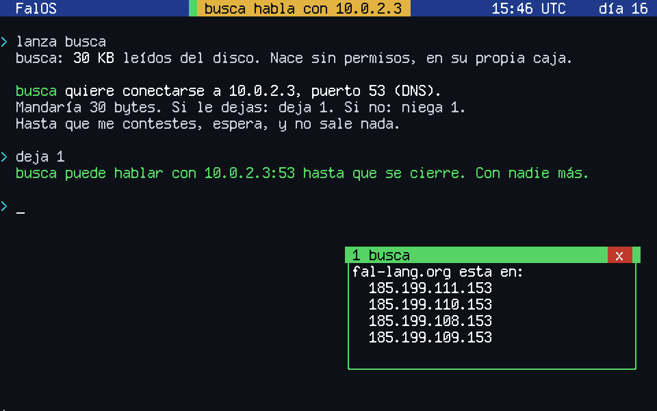

# FalOS

Un sistema operativo escrito desde cero en [Fal](https://github.com/NissanBoss/Fal),
un lenguaje de programación en español. Se construye en público, un día cada
vez: cada día, un paso que se pueda ver, subido aquí y contado en
[TikTok](https://www.tiktok.com/@fal.lang).



## Por qué

Casi todo el código que corre debajo de tus programas está escrito en C, y C
deja leer y escribir la memoria fuera de donde toca. De ahí sale la mayoría de
los agujeros graves: Microsoft calcula que [cerca del 70 %](https://msrc.microsoft.com/blog/2019/07/a-proactive-approach-to-more-secure-code/)
de las vulnerabilidades que corrige son de este tipo, y Chromium da [la misma
cifra](https://www.chromium.org/Home/chromium-security/memory-safety/) para las
suyas.

Y entender cómo funciona un sistema operativo por dentro pasa casi siempre por
leer C y leer inglés. FalOS intenta las dos cosas a la vez: un sistema escrito
en un idioma que entiendes, en un lenguaje donde salirse de la memoria no es
un descuido posible, sino un error que para el sistema y dice en qué línea.

## Cómo

Hace falta el `fal` de la rama `main`, que es el que sabe compilar para
arrancar sin sistema debajo ([cómo funciona](https://github.com/NissanBoss/Fal/blob/main/NUCLEO.md)),
y [QEMU](https://www.qemu.org) para tener un ordenador virtual:

```bash
git clone https://github.com/NissanBoss/Fal
cd Fal && go build -o fal .
```

```bash
fal haz_disco.fal
```

```bash
fal --arranca sistema.fal
```

`haz_disco.fal` compila lo que hay en [programas/](programas), lo junta con los
textos de [disco/](disco) y hace un `disco.img`, y `fal --arranca` lo conecta
solo.

### En un ordenador de verdad

FalOS arranca desde un pendrive con GRUB, por BIOS y por UEFI, y no se instala:
su disco va entero en la memoria y no toca ningún disco del ordenador. Lo que
guardes se borra al apagar. Se ha probado en un ThinkPad L450 de 2015, por
los dos caminos.

La imagen la hace GitHub cada vez que se sube algo (en Actions, el artefacto
`falos-pendrive`), o tú con GRUB y xorriso instalados:

```bash
fal --nucleo sistema.fal
```

```bash
fal haz_disco.fal
```

```bash
sh usb/haz_usb.sh
```

Grábala con [Rufus](https://rufus.ie) en **modo Imagen DD** (en modo ISO, Rufus
cambia el arranque de GRUB) o con `dd`. Borra el pendrive entero. Luego enciende
el ordenador con el pendrive puesto y elige el pendrive en el menú de arranque
(F12 en un ThinkPad, F9 en muchos HP, F11 o F8 en muchas placas). Si no sale:

- **Quita Secure Boot.** GRUB va sin firmar, y con Secure Boot el ordenador no
  lo arranca. Se vuelve a poner después.
- **Si no arranca por UEFI, prueba por BIOS.** En la BIOS se llama CSM, Legacy o
  "Both". La misma imagen vale para los dos.
- **Si arranca pero no puedes escribir,** FalOS solo sabe usar el teclado PS/2.
  Los de los portátiles casi siempre lo son por dentro. Un teclado USB funciona
  si la BIOS tiene "USB Legacy Support" encendido, que lo hace pasar por PS/2.
  Si no hay nada de eso, FalOS lo dice en rojo al arrancar.

Dónde ha arrancado ya:

| Ordenador | Año | Por BIOS | Por UEFI | Teclado | Pantalla |
|---|---|---|---|---|---|
| ThinkPad L450 | 2015 | sí, día 17 | sí, día 19 | sí | sí |

Si lo pruebas en el tuyo, salga bien o mal, cuéntalo con la plantilla
[arranca en mi ordenador](https://github.com/NissanBoss/FalOS/issues/new?template=arranca.yml):
el modelo, cómo arrancó y una foto. Cada ordenador que aparezca aquí es uno que
alguien ha probado de verdad.

### Descargarlo, y romperlo

En [Releases](https://github.com/NissanBoss/FalOS/releases/latest) está la imagen
para el pendrive, el núcleo y el disco para QEMU, y el compilador de Fal con el
que se hizo, para Linux, Windows y Mac. La hace GitHub desde el commit de la
etiqueta, y solo la publica si pasan todas las pruebas.

Y si crees que puedes hacer que un programa se salga de lo que FalOS le deja,
[RETO.md](RETO.md) dice qué hay que conseguir, qué tiene un programa a mano y
cómo avisar. Dentro de FalOS, `reto` lo resume.

El núcleo está en [sistema.fal](sistema.fal), y los cuatro programas que necesita
para ver, oír, leer y salir a la red, en [controladores/](controladores). Lo que se va añadiendo
cada día está en el [diario](DIARIO.md).

Hoy FalOS arranca, pasa al modo de 64 bits, escribe en la pantalla con
colores y tildes, lee el teclado español con AltGr y entiende unas pocas
órdenes: `ayuda`, `limpia`, `hora`, `colores`, `encendido`, `memoria`,
`programas`, `lanza`, `tareas`, `para`, `teclado`, `permisos`, `permite`, `prohibe`,
`disco`, `lee`, `deja`, `niega`, `olvida`, `registro`, `cerrojo`, `bloquea`,
`sin cerrojo`, `portapapeles`, `ping`, `red`, `cuelga`, `rompe`, `reto` y `reinicia`. Lo que escribes se corrige
con las flechas, y las de arriba y abajo traen las órdenes de antes.

Sabe cuánta memoria tiene y la reparte en páginas de 4 KB, que entrega
siempre borradas, y que borra otra vez cuando un programa las devuelve. Monta sus propias tablas de páginas: su código es de solo
lectura, los datos no se pueden ejecutar y la dirección 0 no existe, y eso
lo hace cumplir el procesador.

El reloj y el teclado avisan por interrupciones, así que mientras espera, el
procesador duerme.

Y corre programas, varios a la vez, cada uno con 10 ms de procesador por turno.
Salen del disco, y FalOS no se cree lo que dicen: mira su cabecera antes de hacer
una sola cuenta con ella, y si miente, no los carga. Van en el anillo 3, sin permisos, cada uno con sus propias tablas de páginas:
no ven la memoria de nadie. Para hacer algo, tienen que pedírselo al sistema.
Si intentan tocar un aparato o leer memoria ajena, el procesador los para y
FalOS los cierra sin que caiga nada más.

```
lanza cuenta
lanza primos
lanza apaga
lanza espia
tareas
```

```
lanza gigante
lanza desborda
lanza fuera
lanza corto
lanza carta
```

Cada programa sale en su ventana, con el borde y el título del color de su
caja, como en [Qubes OS](https://www.qubes-os.org). Ese borde lo pinta el
núcleo: un programa solo le manda letras, y no puede salir de su rectángulo ni
cambiar su título. Con el ratón, las ventanas se arrastran por el título, se
traen delante con un clic y se cierran con la x, que cierra también el programa.
`disfraz` dice que es FalOS y te pide la contraseña, pero su ventana dice quién es:

```
lanza cuenta
lanza primos
lanza disfraz
```

Lo que escribes va a la consola, salvo que tú le des el teclado a un programa:
con un clic en su ventana o con `teclado N`. Mientras lo tiene, su título lo
dice, y Esc lo devuelve siempre a la consola, porque esa tecla no le llega a
ningún programa. Un programa no puede pedir el teclado ni quitárselo a otro.
En el disco hay un juego para probarlo, escrito en Fal: una serpiente que crece.
Guarda tu récord en el disco, y sigue ahí aunque apagues.

```
lanza serpiente
teclado 1
```

Un programa puede guardar hasta 464 bytes en el disco, pero solo en un archivo:
el suyo. Lo pide con una llamada, y es el núcleo quien pone el nombre, con el
del programa: `serpiente` escribe en `serpiente.dat` y en nada más. El que
escribe de verdad es el programa del disco, y no pisa lo que no entiende: si el
índice está roto, o el sitio de ese archivo cae encima de otro, no escribe ahí.
Primero escribe los datos y luego el índice, así que un apagón a medias no deja
el índice señalando a medio archivo. `veces` es el ejemplo más corto: cuenta
cuántas veces lo has lanzado.

Y ningún programa guarda nada sin preguntarte. La primera vez que lo intenta,
FalOS te dice cuántos bytes y en qué archivo, y el programa espera hasta que
contestes. `olvida` borra lo que guardó un programa de verdad: llena de ceros el
sitio donde estaba antes de quitarlo del índice.

```
lanza veces
deja 1
disco
lee veces.dat
olvida veces
```

Y lo que guarda va cifrado, sin que el programa haga nada ni lo pueda evitar.
FalOS tiene una llave de 32 bytes al azar, del generador del procesador o, si
no lo trae, del instante exacto en que pulsas cada tecla, y de ella saca una
clave distinta para cada programa, con BLAKE2b y su nombre: lo que guarda `veces` no lo abre la
clave de `serpiente`, aunque alguien le copie el archivo. Cada guardado se cifra
con ChaCha20 y un número que no se repite, y se firma. Si alguien cambia un bit
en el disco, el programa no recibe nada y el registro lo apunta en rojo. Si el
archivo no va cifrado, tampoco: alguien lo ha puesto ahí a mano. El cifrado lo
hace el núcleo en una página suya, así que ni el programa del disco ve nunca lo
que guarda un programa.

`invitado`, o Intro sin escribir nada en la pantalla de bloqueo, entra en modo
invitado: cierra los programas, olvida la llave, el registro y el portapapeles,
y desde ese momento no se escribe nada en el disco. Lo que guarden los programas
vive en la memoria del núcleo hasta que reinicies, y al reiniciar se llena de
ceros. Lo tuyo sigue en el disco, cifrado, y sin la contraseña no se abre. La
prueba automática compara el disco byte a byte antes y después de una sesión de
invitado: es idéntico.

```
invitado
lanza veces
deja 1
registro
```

`notas` es un bloc de notas que guarda cifrado con tu contraseña. La clave sale
de la contraseña con [Argon2id](https://www.rfc-editor.org/rfc/rfc9106), el que
ganó el concurso de 2015 para guardar contraseñas: cada intento llena 2 MB de
memoria tres veces, así que probar contraseñas a ciegas cuesta tiempo y memoria,
también con una tarjeta gráfica. Con esa clave, la nota se cifra con ChaCha20 y
se firma con BLAKE2b: si alguien cambia un solo bit en el disco, `notas` no la
abre y te dice que la han tocado, que no es lo mismo que equivocarte de
contraseña. La sal y el número que no se repite salen del generador de azar del
procesador (RDRAND), no del reloj. Todo está escrito en Fal, en
[comun/cifrado.fal](comun/cifrado.fal), y da byte a byte lo mismo que la
biblioteca de referencia de Argon2. Al disco solo llega ruido: `lee notas.dat` lo
enseña. Y cada vez que un programa lee o escribe en el disco, el núcleo lo pinta
en la barra de arriba, con el color de su caja, donde ninguna ventana lo puede
tapar.

```
lanza notas
teclado 1
lee notas.dat
```

`registro` dice qué programa ha leído o guardado qué, y cuándo, y también lo que
decidiste tú: a quién dejaste guardar, a quién le diste el teclado y con cuántas
teclas tuyas se cerró. Ese registro solo vive en memoria: no se escribe en el
disco, se borra al apagar y ningún programa tiene forma de leerlo. La hora sale
del reloj de la placa, y está también en la barra. Y `deja siempre` recuerda un
permiso aunque reinicies: `permisos` dice quién lo tiene, y `niega` con su
nombre se lo quita.

```
lanza veces
deja siempre 1
registro
niega veces
```

`cerrojo` le pone contraseña a la pantalla. FalOS no la guarda: guarda su huella,
hecha con el mismo Argon2id, y una sal al azar. Argon2id da 64 bytes: con la
mitad se comprueba la contraseña, y con la otra se envuelve la llave que cifra lo
que guardan los programas, así que sin la contraseña no hay llave. Desde entonces arranca bloqueado,
`bloquea` lo bloquea en el acto, y se bloquea solo si pasan 5 minutos sin que
toques el teclado ni el ratón. Bloqueado, los programas siguen corriendo, pero no
les llega ni una tecla ni un clic, lo que pintan no sale en la pantalla y no se
puede escribir ninguna orden. Lo que escribes ahí solo lo ve el núcleo. Al abrir,
te dice cuántas contraseñas malas probó alguien mientras no estabas, y el
registro apunta a qué hora.

```
cerrojo
bloquea
registro
sin cerrojo
```

Y lo que copias solo lo ves tú. En Windows o en Linux con X11, cualquier programa
puede leer el portapapeles cuando quiera, y también cambiarlo: hay programas que
esperan a que copies la dirección de un monedero para poner la suya. En FalOS no
hay ninguna llamada para leerlo ni para escribirlo. Arrastrando el ratón sobre un
texto, en una ventana o en la consola, lo marcas; Ctrl+C lo copia y Ctrl+V lo
pega. Esas dos teclas las atiende el núcleo, como Esc, y no le llegan a ningún
programa. Lo que pegas le llega al que tiene el teclado como si lo escribieras
tú, letra a letra, y nunca pulsa Intro: pegar en la consola no ejecuta nada. La
barra dice cuántos segundos le quedan, y la barra y el registro dicen dónde lo
pegaste. A los 30 segundos, o al bloquear la pantalla, se llena de ceros.
`portapapeles` dice cuánto hay y de dónde, sin enseñarlo. `cambiazo` busca cómo
leerlo o cambiarlo, e intenta pulsar Ctrl+V por ti, y no encuentra nada.

```
lanza cambiazo
portapapeles
teclado 1
registro
olvida portapapeles
```

Y a la red solo se sale cuando tú lo pides. FalOS sabe usar una tarjeta NE2000,
y su controlador es otro programa del anillo 3: el procesador solo le deja tocar
los 32 puertos de la tarjeta. Esta tarjeta mueve cada trama byte a byte por esos
puertos y no escribe en la memoria por su cuenta, así que a través de ella el
controlador tampoco puede. FalOS no envía nada al arrancar: ni DHCP, ni anuncios, ni una sola trama. Lo
único que sale es lo que pide `ping`: una pregunta ARP para saber quién tiene esa
dirección y cuatro ecos ICMP, uno por segundo, que llevan dentro `FalOS: solo
sale si tu lo pides.` La barra dice a quién haces ping mientras dura, el registro
lo apunta, y `red` dice cuántas tramas han salido desde que arrancó. `escucha`
busca otra forma de usar la red, no la encuentra, y cuando toca la tarjeta él
mismo, el procesador lo para. Para probarlo hay que darle la tarjeta a QEMU, que
`fal --arranca` no lo hace:

```bash
fal --nucleo sistema.fal
```

```bash
qemu-system-x86_64 -cpu max -kernel sistema.bin -drive file=disco.img,format=raw,if=ide -nic user,model=ne2k_pci
```

```
ping
ping 10.0.2.99
lanza escucha
red
registro
```

Un programa también puede hablar con alguien de fuera, pero no sin preguntarte.
Lo pide con una llamada: una dirección, un puerto y lo que quiere mandar, un
mensaje UDP. El programa se queda esperando, y FalOS te dice quién quiere
conectarse, a qué dirección y puerto, y cuántos bytes mandaría. Con `deja N` sale
ese mensaje y la respuesta le llega solo a él; con `niega N` no sale nada, y si lo
vuelve a intentar con el mismo sitio, ni te pregunta. El permiso vale para esa
dirección y nada más: si el programa quiere hablar con otra, te vuelve a
preguntar. Mientras habla, la barra dice quién y con quién, y el registro apunta
lo que dejaste, lo que negaste y cuántos bytes volvieron. `busca` le pregunta al
DNS de QEMU dónde está fal-lang.org y te enseña sus direcciones; `chivato` quiere
contarle a un servidor de fuera qué programas usas.

```
lanza busca
deja 1
lanza chivato
niega 2
registro
```

Los programas nacen sin ningún permiso, tampoco el de hablar con otro. Se
hablan con mensajes, una pregunta y una respuesta, y solo si tienen una llave:
una capacidad que guarda el núcleo y que un programa no puede fabricar ni
adivinar. Las das y las quitas tú, mientras corren:

```
lanza caja
lanza curioso
lanza ladron
permite 2 1
prohibe 2 1
permisos
```

El teclado, el disco, la pantalla y la red ya no van dentro del núcleo. Son programas
del anillo 3, y el procesador solo les deja tocar lo suyo: `teclado`, el puerto
96, por el que llega también el ratón; `disco`, del 496 al 503; `red`, los 32 de la tarjeta; y `pantalla`, los puertos de la tarjeta gráfica y su
imagen, y lee lo que hay que pintar sin poder cambiarlo. Si uno se cuelga o se
rompe, FalOS lo nota, lo cierra y lanza otro sin que caiga nada más. Se puede
probar:

```
lanza cuenta
cuelga teclado
rompe teclado
cuelga pantalla
rompe pantalla
disco
lee carta.txt
lanza fisgon
lanza impostor
```

Cada vez que se sube algo, GitHub lo arranca en QEMU, comprueba que llega a
esperar órdenes sin reventar, lanza `apaga` y `espia` y mira que los dos acaban
cerrados y el sistema sigue. Da un permiso, lo quita y mira que `ladron` no ha
abierto nada. Cuelga y rompe el teclado, el disco y la pantalla, y comprueba que
todo vuelve. Le da una tarjeta de red y lo graba todo: con `escucha`, `fisgon` y el
controlador colgado y roto, mira que de FalOS no ha salido ni una trama; con
`ping`, que han salido una pregunta ARP y cuatro ecos con las sumas de control
bien, en orden y con su texto, y que han vuelto cuatro respuestas. Deja a `busca`
preguntar al DNS y niega dos veces a `chivato`: mira que ha salido un solo mensaje
UDP, a 10.0.2.3, con las sumas de control bien, y que hacia los servidores de
`chivato` no ha salido ni una pregunta ARP. Le da archivos que mienten sobre lo que son, y le conecta discos
hechos para romperlo. Abre cuatro ventanas, mira que cada una lleva su color y
cierra dos con el ratón. Juega a la serpiente con `disfraz` abierto al lado, y
mira que a `disfraz` no le ha llegado ni una tecla. Y escribe en el disco: arranca
dos veces, mira que la segunda se acuerda, y le conecta tres discos para que se
equivoque: uno con el índice roto, otro lleno, y otro en el que el archivo de
`veces` cae encima de su propio programa. En los dos primeros comprueba que el
disco sigue igual byte a byte, y en el tercero, que el programa sigue entero.
Le niega el permiso y mira que no se ha guardado nada, y después de `olvida`,
que donde estaba el archivo solo quedan ceros. Escribe una nota con `notas`, saca
la clave con la biblioteca de referencia de Argon2, la descifra con un ChaCha20
escrito aparte en Python, que antes pasa la prueba del RFC 8439, y comprueba la
firma, que el texto no está en el disco y que una contraseña equivocada no abre
nada. Después le cambia un bit a la nota y mira que `notas` no la abre. Pone
contraseña a la pantalla, comprueba la huella con Argon2 y mira que la contraseña
no está en el disco; arranca bloqueado y mira que una orden escrita entonces no
llega a la consola, espera 5 minutos para verlo bloquearse solo, y con un
programa esperando tu permiso, escribe `deja 1` y mira que no se lo ha dado.
Marca con el ratón una orden de la consola, la copia y la pega en la consola y
en `cambiazo`: mira que en la consola no se ha ejecutado, que a `cambiazo` le
han llegado esas 14 teclas y ni una más, que sus 49 intentos se han rechazado,
que a los 30 segundos no queda nada que pegar y que al bloquear se borra. Da un
permiso para siempre, reinicia y mira que no
vuelve a preguntar; se lo quita y mira que pregunta. Busca el registro en el
disco y no puede estar, y le mete un byte raro a la lista de permisos para ver
que FalOS la tira entera en vez de creérsela. Rompe la consola, la cuelga y la
para, y mira que cada vez FalOS lanza otra y la orden siguiente funciona; y lanza
`mandon`, que finge ser la consola, y mira que sus tres órdenes se rechazan.

La idea a la que se quiere llegar es un **micronúcleo con capacidades**, como
[seL4](https://sel4.systems): un núcleo pequeño que casi no hace nada, y cada
programa y cada controlador en su propia caja, sin poder tocar lo que no se le
ha dado expresamente. Los mensajes y las capacidades ya están, y cuatro
controladores y la consola ya viven fuera del núcleo. Falta sacar lo que todavía
vive en él.

## Lo que no cubre

- **Casi todo, de momento.** De la red solo sabe hacer `ping`, y que un programa
  mande un mensaje y espere su respuesta. Un programa solo escribe su propio
  archivo, de 464 bytes como mucho: no se puede escribir un programa dentro de
  FalOS. Es el día 19.
- **Aún no es un micronúcleo.** El teclado, el disco, la pantalla, la red y la
  consola ya salieron, pero el cargador y el vigilante que los reinicia siguen
  dentro del núcleo, y un fallo ahí para todo. La consola entiende lo que
  escribes, pero lo que hace cada orden (lanzar un programa, enseñarte las
  tareas) lo sigue haciendo el núcleo. Por eso apenas adelgaza: tiene unas 6.400
  líneas, y además el cifrado. La pantalla de bloqueo y el portapapeles viven en
  él.
- **La consola puede dar permisos.** Es lo que tiene que poder hacer: cuando
  escribes `deja`, es ella quien se lo pide al núcleo. La separa de los demás que
  es la única con esa llamada, que FalOS la lanza desde su propia imagen y no del
  disco, y que lo único que le llega es lo que tecleas tú.
- **Nadie comprueba quién escribió un programa.** No hay firmas. Quien pueda
  cambiar el disco puede cambiar un programa, y FalOS lo lanzará. Lo que le
  protege es la caja, no saber de dónde viene.
- **La cabecera se mira, el código no.** Un programa que no miente sobre su forma
  se carga aunque sea malo. Hace lo que quiera dentro de su caja.
- **El programa de la pantalla ve todo lo que se pinta, y puede pintar mentiras.**
  No puede cambiar lo que escribe el núcleo, pero sí enseñarte otra cosa. Eso
  vale también para los bordes: el color lo decide el núcleo, pero lo pinta él.
  Los bordes te protegen de los programas, no de ese programa. Aún no hay nada
  en la pantalla de lo que te puedas fiar del todo.
- **Las ventanas son de letras.** Una ventana es un rectángulo de casillas, de 34
  por 6 si el programa no pide otro, y como mucho de 60 por 18. Un programa pone
  letras de colores en ellas, no píxeles, y caben cuatro.
- **Dentro de su ventana, un programa pinta lo que quiera.** También una ventana
  falsa, con el borde de otro color. La de verdad es la de fuera, la que lleva el
  título, y esa es la que hay que mirar.
- **Cada programa guarda 127 teclas.** Si no las lee, las siguientes se pierden,
  también las de un pegado.
- **El portapapeles es de 100 letras, sin colores ni saltos de línea.** Las
  líneas que marcas se juntan con un espacio, y por eso pegar no puede pulsar
  Intro. Si no cabe, `portapapeles` lo dice.
- **Solo se marca con el ratón.** Ni Mayús con las flechas ni doble clic.
- **30 segundos, siempre.** No se puede alargar para quien copia despacio ni
  acortar para una contraseña.
- **El núcleo sí lo ve.** Mientras dura, está sin cifrar en su memoria, como lo
  que sale en la pantalla. Al borrarse se llena de ceros.
- **Un programa puede pedirte que le pegues algo.** Lo pegado va a la ventana que
  tiene el teclado, y esa la eliges tú: si `disfraz` te pide que pegues tu
  contraseña y se la pegas, la tiene. El título de la ventana dice quién es.
- **Solo ratón PS/2.** Es el que trae QEMU, y el TrackPoint y el touchpad de
  muchos portátiles. Al hacer clic en su ventana, QEMU se queda con el ratón, y
  lo suelta con la combinación que pone en su título. Ni ratones USB ni
  pantallas táctiles.
- **En un ordenador de verdad, la pantalla es la de 1024x768 que da GRUB.**
  FalOS pinta su cuadro de 960x600 en el centro, y una pantalla más ancha lo
  estira. Si la tarjeta no tiene ese modo a 32 bits, la pantalla se queda en
  negro. Y si FalOS revienta, el aviso rojo no se ve: lo escribe en el modo de
  texto, que ahí no está.
- **La letra tiene 125 caracteres.** El español, las líneas de las cajas y poco más.
- **El programa del teclado ve todo lo que escribes**, y ahora también cómo
  mueves el ratón. Está en su caja y no puede hacer nada más, pero si alguien lo
  cambiara por otro, lo leería todo, y podría pulsar Ctrl+V por ti.
- **El disco es el IDE de siempre, o la memoria.** El IDE es el que trae QEMU, no
  el de un portátil de ahora, y el formato es uno de texto propio: ni FAT, ni
  nada que escriba otro sistema. Desde el pendrive, el disco va en la memoria, y
  lo que guardes se pierde al apagar: no escribe en el pendrive.
- **El índice del disco cabe en dos sectores.** Son 1.024 bytes, y hoy quedan
  unos 480 libres. Si no cabe, el programa recibe un error y el disco no se toca.
- **Un hueco del disco no se reutiliza.** Si el sitio de antes no vale, o se ha
  borrado con `olvida`, lo siguiente se escribe al final.
- **Argon2id con 2 MB, no con 19.** [OWASP](https://cheatsheetseries.owasp.org/cheatsheets/Password_Storage_Cheat_Sheet.html)
  pide al menos 19 MiB y dos pasadas. FalOS usa 2 MB y tres, porque es lo que un
  programa puede pedir hoy de una vez, y en QEMU sin aceleración ya tarda unos 3
  segundos. Es mucho más caro de atacar que las 20.000 vueltas de ayer, pero
  menos que lo que recomiendan. Y una contraseña corta se adivina igual.
- **El cifrado no lo ha revisado nadie.** BLAKE2b, Argon2id y ChaCha20 dan lo
  mismo que las bibliotecas de referencia en todas las pruebas, pero están
  escritos a mano en Fal. Que coincidan no demuestra que no haya un fallo en un
  caso que no se ha probado.
- **Una contraseña mala y un comprobante tocado se ven igual.** `notas` mira
  primero un comprobante hecho con la clave, y luego la firma. Si alguien cambia
  el comprobante, te dirá que la contraseña no es esa, aunque lo sea.
- **Lo que se ve en la ventana está sin cifrar.** El núcleo pone las letras de la
  nota en la ventana y el programa de la pantalla las dibuja: los dos las ven.
  Cifrar protege el disco, no la memoria.
- **Sin RDRAND, el azar sale de tus teclas.** RDRAND lo traen los procesadores
  de Intel desde 2012 y los de AMD desde 2015, pero el que QEMU pone si no le
  dices otra cosa no lo tiene: hace falta `-cpu max`. Hasta el día 18, sin él la
  llave salía de la hora, y se adivinaba en 3 segundos mirando cuándo cambió el
  archivo. Desde el día 19, el núcleo lee el reloj del ordenador, que cuenta a
  1,19 MHz, en cada tecla y en cada movimiento del ratón, y encadena esas medidas
  con BLAKE2b. Es menos que RDRAND: si un programa guarda nada más arrancar, la
  llave sale de unas decenas de medidas (cada tecla da dos: al pulsarla y al
  soltarla), y con menos de 16 FalOS no la crea. La portada lo avisa. Un disco
  del día 18 o antes que se usó sin `-cpu max` sigue con la llave de entonces:
  empieza con uno nuevo. Y quien no se fíe del generador de Intel tampoco tiene
  aquí otro.
- **El disco no va cifrado entero.** Lo que guardan los programas sí, pero los
  nombres de los archivos, lo que ocupa cada uno, los programas y `permisos.sis`
  se leen tal cual. Y si alguien borra `cerrojo.sis`, FalOS arranca sin
  contraseña: lo guardado sigue sin abrirse, porque la llave se va con él, pero
  la pantalla ya no pide nada. Si lo encuentra roto, lo dice al arrancar.
- **Sin contraseña, la llave está en el disco.** Sin `cerrojo`, la llave va en
  `llave.sis` tal cual. Así un programa no abre lo de otro, pero quien se lleve
  el disco lo abre todo. Al quitar la contraseña, FalOS lo avisa.
- **Cambiar la contraseña no cambia la llave.** Se envuelve la misma con la
  nueva. Quien guardara una copia del disco y supiera la contraseña de entonces
  saca la llave, y con ella abre también lo que se guarde después.
- **Bloqueado, la llave sigue en memoria.** Los programas siguen corriendo y
  pueden pedir guardar, así que el núcleo no la olvida al bloquear. Solo al
  entrar como invitado y al reiniciar.
- **Lo guardado antes del día 14 no se abre.** Iba sin cifrar, y FalOS no puede
  distinguir un archivo viejo de uno que alguien ha puesto ahí a mano. Y una
  contraseña de antes abre la pantalla, pero no tiene llave: hasta que la vuelvas
  a poner con `cerrojo`, los programas no pueden guardar.
- **El invitado ve qué hay.** Puede lanzar los programas del disco, ver los
  nombres de los archivos con `disco` y leerlos con `lee`: ruido, pero sabe cuánto
  ocupa cada uno. Y lo de sus programas cabe en 8 huecos de 464 bytes.
- **Del modo invitado se sale reiniciando.** No hay otra forma de volver a lo tuyo,
  a propósito: así no queda nada a medias. Si en vez de `reinicia` cortas la luz,
  lo que guardaron sus programas no se llena de ceros: se queda en la memoria
  hasta que se borre sola.
- **Entre intento e intento solo espera Argon2.** No hay un tope de intentos ni
  una espera que crezca. En QEMU son unos segundos por intento; en un ordenador de
  verdad, mucho menos.
- **Los programas siguen corriendo bloqueado.** No ven teclas ni ratón y no se
  ven, pero siguen haciendo lo suyo, como pedir guardar. El permiso espera a que
  vuelvas.
- **Los ceros de `olvida` valen en este disco.** En un SSD, el propio disco puede
  guardar copias de un sector en otro sitio sin decírselo a nadie, y escribir
  ceros encima no las alcanza. Lo que guardan los programas va cifrado, así que
  esas copias son ruido; el índice, con los nombres, no.
- **El permiso para siempre va por el nombre.** Se apunta que `veces` puede
  guardar, no qué `veces`: si alguien cambia `veces.prg` por otro programa con el
  mismo nombre, el nuevo lo hereda. Y quien pueda tocar el disco puede escribir
  `permisos.sis` a mano. Ningún programa de dentro puede.
- **Si el controlador de la red es otro, puede enviar lo que quiera.** El núcleo
  le da la tarjeta, no mira cada trama. Quien cambie `controladores/red.fal` y
  vuelva a compilar el núcleo, o lo cambie dentro de la imagen, puede sacar
  tramas sin que nadie haga ping. Lo que hoy lo impide es que el que hay no lo
  hace, y que la prueba automática graba todo lo que sale y mira que no hay nada.
- **La red vive en el núcleo.** ARP, IP, ICMP y UDP los arma el núcleo, no un programa.
  Es poco código, pero es más núcleo.
- **Solo la NE2000, y solo la red de usuario de QEMU.** La dirección es fija,
  10.0.2.15, y la salida, 10.0.2.2: las de QEMU. No hay DHCP, y FalOS no usa el
  DNS él solo: `ping` quiere números, y en otra red no sabe dónde está. Tampoco
  hay TCP: un programa manda un mensaje UDP y espera una sola respuesta, 3
  segundos como mucho. Mientras espera, la consola también.
- **El permiso va por dirección, no por lo que se manda.** FalOS te dice cuántos
  bytes salen, pero no qué llevan. Un programa al que dejas hablar con una
  dirección puede mandarle lo que quiera hasta que se cierre.
- **Una dirección es solo un número.** FalOS no sabe de quién es. 10.0.2.3 es el
  DNS de QEMU, que a su vez pregunta al de tu ordenador: dejar a `busca` es dejar
  que esa pregunta llegue a tu proveedor.
- **Un programa puede preguntar mucho.** Si le niegas una dirección, con esa ya no
  te pregunta, pero puede pedir otra, y otra. No hay tope.
- **El tiempo de `ping` va de 10 en 10 ms.** Lo mide con el reloj de los turnos,
  así que una respuesta de 1 ms dice 10 o 20.
- **El registro guarda los 16 últimos.** Si un programa repite lo mismo, se
  junta en una línea con las veces, pero uno que alterne cosas distintas puede
  empujar fuera lo de antes. Y no apunta lo que lees tú con `lee`.
- **La hora es la del reloj de la placa, en UTC.** FalOS no sabe en qué país
  estás, y si ese reloj va mal, el registro también.
- **Escribir un sector no es atómico del todo.** Si se va la luz justo mientras
  se escribe el índice, el disco puede quedar sin índice. No hay diario ni copia.
- **Un controlador que se cae siempre se relanza siempre.** No hay espera ni
  tope, y la pantalla se llena.
- **Un cuelgue tarda 1 s en notarse, o más.** Solo cuenta el tiempo en que el
  controlador pudo contestar y no lo hizo, para que un programa que acapare el
  procesador no lo haga parecer colgado. Con el procesador lleno son varios
  segundos de reloj. Las teclas que caben en la cola del aparato llegan después.
  Las que no, se pierden.
- **No hay prioridades.** Tres programas que gasten todo lo que les dan dejan a
  los controladores con un cuarto del procesador, y todo va más lento.
- **Las capacidades solo cubren hablar con otro programa.** La línea de la
  pantalla, el procesador, la memoria y los puertos se reparten sin ellas. Y las
  das tú desde la consola: un programa no le puede pasar una a otro.
- **seL4 está demostrado matemáticamente, y FalOS no.** Copiar la idea no
  copia la demostración.
- **Solo el teclado español.** Y sin €: todavía no lo he dibujado.
- **Solo el primer giga de memoria.** Si el ordenador tiene más, el resto
  no se usa todavía.
- **Meltdown, en procesadores de antes de 2019.** Cada programa lleva en sus
  tablas de memoria el primer giga entero, marcado como solo para el núcleo. En
  un Intel anterior a 2019, como el del ThinkPad L450, un programa puede leerlo
  por especulación aunque no tenga permiso: la llave, el portapapeles, las
  teclas que van a otros. Es [Meltdown](https://meltdownattack.com), y el arreglo
  es lo que Linux llama KPTI: que un programa solo vea lo justo para entrar y
  salir del núcleo. Llega en un día propio. En QEMU sin KVM no se reproduce.
- **Dos programas pueden hablarse a escondidas.** El núcleo no guarda los
  registros del x87 de cada programa, así que dos hechos a mano pueden pasarse
  datos por ahí, y también midiendo el tiempo. Uno sin red se lo puede contar a
  otro que sí la tenga. No es una fuga del núcleo: Fal no usa el x87, y el núcleo
  no deja nada en él.
- **No es seguro todavía.** Está diseñado para el aislamiento, que no es lo
  mismo. Un sistema es seguro cuando alguien de fuera intenta romperlo y no
  puede, y eso aquí aún no ha pasado: para eso está el [reto](RETO.md). No lo
  uses para nada que importe.
- **Pocos ordenadores de verdad.** Los de la tabla de arriba, y nada más. En
  otro puede fallar el teclado, el reloj o la pantalla, y la red no va en
  ninguno: solo sé usar la NE2000, que es la de QEMU.
- **Solo x86-64**, arrancado por multiboot: con QEMU o con GRUB. Ni ARM ni
  Secure Boot.

## Filosofía

- **Un día, un paso que se vea.** Mejor poco y funcionando que mucho a medias.
- **No se promete lo que no se ha comprobado.** Lo que dice este README lo
  comprueba la prueba automática, o no lo dice.
- **Nadie tiene más permisos de los que necesita.** Tampoco el propio núcleo.
- **Los errores enseñan.** Cuando algo falla, la pantalla dice qué, en qué
  línea y cómo arreglarlo, como en el resto de Fal.
- **En castellano.** El código, los mensajes y el diario.

## Otros que hacen algo parecido

- [SerenityOS](https://github.com/SerenityOS/serenity) también nació en
  público, con vídeos de su autor programándolo. Es C++ y quiere ser un
  escritorio completo; FalOS va a paso de día y pone el aislamiento por
  delante.
- [TempleOS](https://templeos.org) se escribió en un lenguaje propio, HolyC,
  pero sin ninguna protección: todo corre con todos los permisos. FalOS es lo
  contrario.
- [Redox](https://www.redox-os.org) es un micronúcleo en Rust, con la misma
  idea de seguridad de memoria. Está mucho más avanzado; FalOS se construye
  desde cero y a la vista, para que se entienda cada paso.
- [Qubes OS](https://www.qubes-os.org) aísla con máquinas virtuales sobre Xen
  y Linux, y de él salen los bordes de colores y la idea del portapapeles: entre
  dos cajas, lo copiado solo pasa con Ctrl+Mayús+C y Ctrl+Mayús+V. FalOS busca
  ese aislamiento en el diseño del propio núcleo, sin máquinas virtuales.
- [Tails](https://tails.net) arranca sin tocar el disco del ordenador y lo olvida
  todo al apagar. El modo invitado de FalOS es esa idea dentro del sistema de
  siempre: entras sin contraseña, usas lo que hay, y no se escribe nada.
- [OpenSnitch](https://github.com/evilsocket/opensnitch) y
  [Little Snitch](https://www.obdev.at/products/littlesnitch) avisan cuando un
  programa quiere conectarse, pero viven encima de un sistema que se lo deja
  hacer a cualquiera. En FalOS el aviso no es un añadido: la única forma de
  salir es pedírtelo, y el permiso vale para una sola dirección.

## Licencia

MIT.
